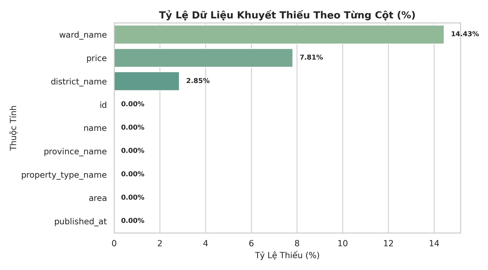
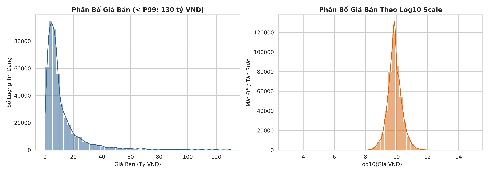
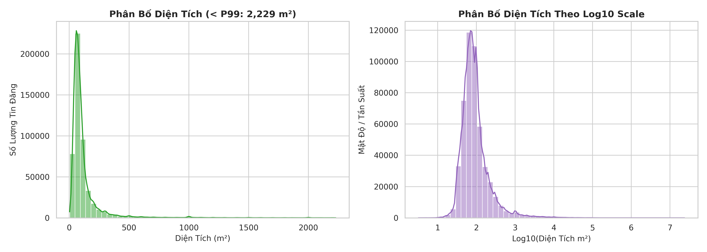
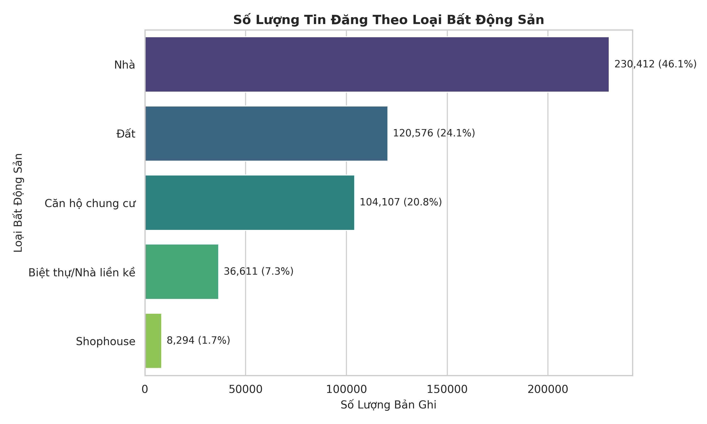
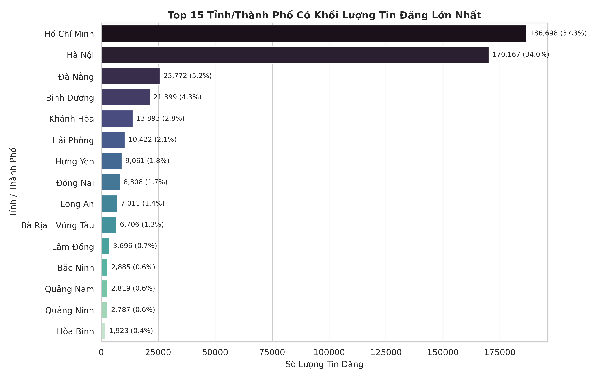
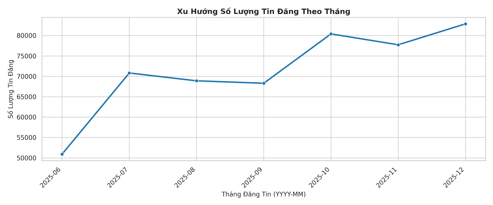
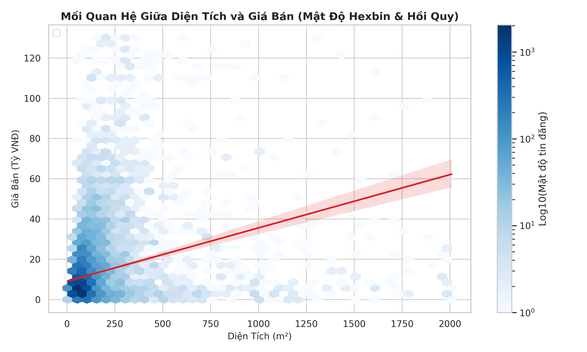
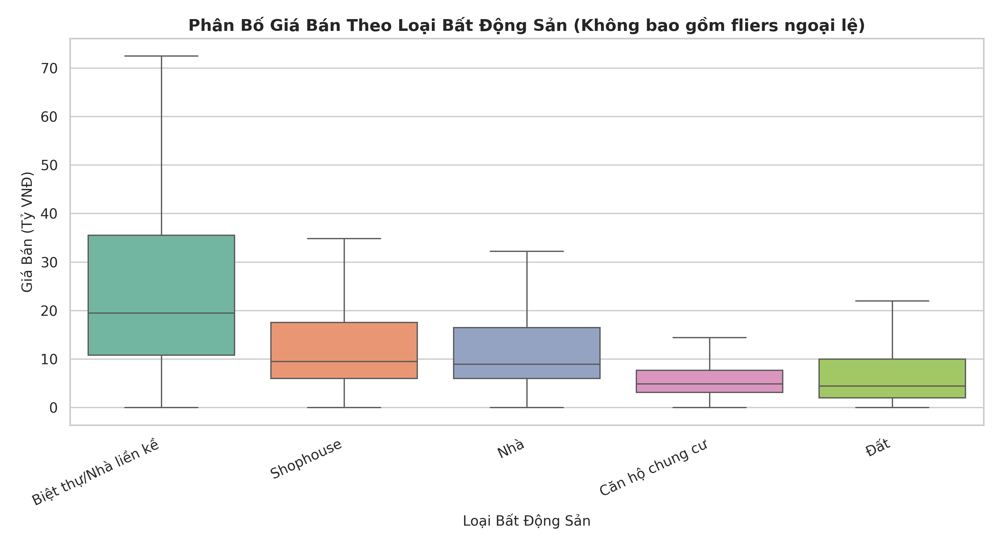
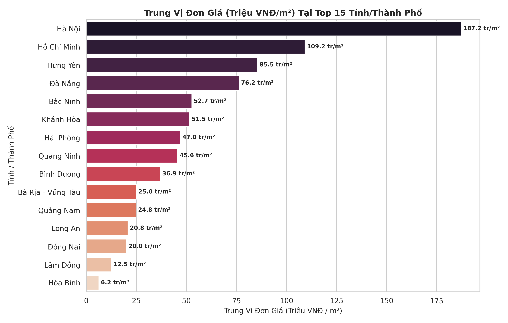
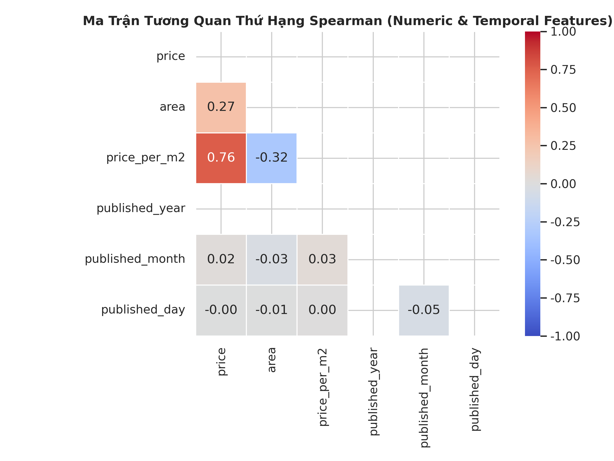

# Báo Cáo Khám Phá Dữ Liệu Bất Động Sản (Exploratory Data Analysis - EDA Report)

> **Đề tài:** Xây dựng bộ dữ liệu về bất động sản, thực hiện các phương pháp tối ưu hiệu năng cho hệ thống khi dữ liệu quá lớn.  
> **Quy mô tập dữ liệu phân tích:** 500,000 bản ghi thực tế đã làm sạch (`data/processed/properties_500000.csv`).  
> **Thư viện triển khai:** Python 3.13, Pandas, NumPy, Matplotlib, Seaborn (`scripts/run_eda.py`).

---

## 1. Tổng Quan & Cấu Trúc Khuyết Thiếu

Bộ dữ liệu chứa 500,000 bản ghi bất động sản thực tế tại Việt Nam với 9 trường thông tin cốt lõi:

| Thuộc Tính | Số Bản Ghi Hợp Lệ | Số Lượng Thiếu | Tỷ Lệ Thiếu (%) | Nhận Định Khoa Học Dữ Liệu |
|---|---:|---:|---:|---|
| `id` | 500,000 | 0 | 0.00% | Định danh đơn điệu tăng (1 đến 500,000) |
| `name` | 500,000 | 0 | 0.00% | Tiêu đề tin đăng nguyên vẹn, giữ dấu tiếng Việt |
| `property_type_name` | 500,000 | 0 | 0.00% | Phân loại bất động sản chuẩn hóa 100% |
| `province_name` | 500,000 | 0 | 0.00% | Địa phương cấp tỉnh/thành, không có giá trị khuyết |
| `district_name` | 485,765 | 14,235 | 2.85% | Khuyết nhẹ do tin đăng chỉ ghi chung tỉnh |
| `ward_name` | 427,850 | 72,150 | 14.43% | Tỷ lệ thiếu tự nhiên ở khu vực ngoại thành/tỉnh xa |
| `price` | 460,939 | 39,061 | 7.81% | Tin đăng "Giá thỏa thuận" |
| `area` | 500,000 | 0 | 0.00% | 100% diện tích > 0 m² |
| `published_at` | 500,000 | 0 | 0.00% | Mốc thời gian ISO8601 chuẩn xác |

---

## 2. Phân Tích Đơn Biến (Univariate Analysis)

### 2.1. Phân Bố Giá Bán (`price`)
- **Tứ phân vị & Trung vị:** $Q_1 = 4.1$ tỷ VNĐ, Trung vị ($P_{50}$) = $7.4$ tỷ VNĐ, $Q_3 = 14.3$ tỷ VNĐ.
- **Giá trị ngoại vi:** Phân vị $P_{95} = 47.0$ tỷ VNĐ, $P_{99} = 130.0$ tỷ VNĐ. Giá trị trung bình đạt $20.78$ tỷ VNĐ.
- **Hình dạng phân phối:** Phân phối lệch phải cực mạnh (Extreme Right-skewed Distribution) với hiện tượng đuôi dài (Fat Tail). Sự chênh lệch lớn giữa Trung vị (7.4 tỷ) và Trung bình (20.78 tỷ) khẳng định ảnh hưởng của một nhóm nhỏ bất động sản thương mại, tòa văn phòng và biệt thự nghỉ dưỡng có giá trị hàng trăm đến hàng nghìn tỷ đồng.
- Khi chuyển đổi sang không gian $\log_{10}(\text{price})$, phân phối tiệm cận dạng phân phối chuẩn (log-normal distribution), rất lý tưởng cho các mô hình học máy và phân vùng khoảng giá (Range Partitioning).

### 2.2. Phân Bố Diện Tích (`area`)
- **Tứ phân vị & Trung vị:** $Q_1 = 55.9$ m², Trung vị ($P_{50}$) = $80.0$ m², $Q_3 = 120.0$ m².
- **Giá trị ngoại vi:** $P_{95} = 388.0$ m², $P_{99} = 2,229.0$ m².
- **Hình dạng phân phối:** Tập trung mật độ cao nhất trong phân khúc nhà ở đô thị từ $40\text{ m}^2$ đến $100\text{ m}^2$. Các bản ghi diện tích lớn ($> 1,000\text{ m}^2$) chủ yếu là đất trang trại, đất nuôi trồng thủy sản, hoặc đất dự án khu công nghiệp.

### 2.3. Cơ Cấu Phân Loại Bất Động Sản (`property_type_name`)
- **Nhà riêng:** Chiếm tỷ trọng áp đảo với $218,063$ tin đăng (~43.6%).
- **Đất:** Đứng thứ hai với $109,624$ tin đăng (~21.9%).
- **Căn hộ chung cư:** Đạt $92,971$ tin đăng (~18.6%).
- **Biệt thự / Nhà liền kề:** Chiếm $33,056$ tin đăng (~6.6%).
- **Shophouse và các loại khác:** Chiếm tỷ trọng còn lại.

### 2.4. Phân Bố Địa Bàn Hành Chính (`province_name`)
- Thị trường bất động sản Việt Nam tập trung mật độ cực lớn tại hai đầu tàu kinh tế:
  1. **Thành phố Hà Nội:** Đứng đầu về lượng tin đăng.
  2. **Thành phố Hồ Chí Minh:** Đứng thứ hai.
  3. Các tỉnh thành lân cận và đô thị vệ tinh: Đà Nẵng, Bình Dương, Đồng Nai, Hải Phòng, Khánh Hòa, Bà Rịa - Vũng Tàu.
- **Ý nghĩa kỹ thuật hệ thống:** Tỷ lệ lọc (selectivity) của bộ lọc `province_name = 'Thành phố Hà Nội'` hoặc `'Thành phố Hồ Chí Minh'` thường trả về từ 20% đến 35% toàn bảng. Do đó, chỉ mục đơn cột B-tree trên `province_name` sẽ quyết định giữa `Index Scan` và `Bitmap Index Scan`, minh chứng trực tiếp cho bài toán thực nghiệm Q1.

### 2.5. Xu Hướng Tin Đăng Theo Thời Gian (`published_at`)
- Số lượng tin đăng duy trì liên tục qua các tháng, với các nhịp tăng trưởng rõ nét vào giai đoạn giữa năm và cuối năm (chu kỳ giao dịch bất động sản truyền thống).
- Định dạng thời gian đạt chuẩn ISO8601 giúp truy vấn sắp xếp `ORDER BY published_at DESC LIMIT 50` hoạt động hiệu quả khi kết hợp trong Composite Index (bài toán Q2).

---

## 3. Phân Tích Hai Biến & Đa Biến (Bivariate & Multivariate Analysis)

### 3.1. Quan Hệ Giữa Diện Tích và Giá Bán
- Biểu đồ mật độ Hexbin (Log Density) cho thấy cụm tập trung dày đặc nhất ở khu vực diện tích $40 - 120\text{ m}^2$ và khoảng giá $3 - 15$ tỷ VNĐ.
- Đường hồi quy tuyến tính xác nhận mối quan hệ tương quan đồng biến: diện tích càng lớn, giá trị tổng thể càng tăng. Tuy nhiên, góc nghiêng của đường hồi quy phẳng dần ở các diện tích siêu lớn ($> 500\text{ m}^2$) do các bất động sản này thường là đất nông nghiệp/vùng ven với đơn giá trên m² thấp hơn nhiều so với nhà phố trung tâm.

### 3.2. So Sánh Mức Giá Theo Loại Hình Bất Động Sản
- **Biệt thự / Nhà liền kề:** Có mức trung vị giá cao nhất thị trường (~19.5 tỷ VNĐ), biên độ dao động rộng.
- **Shophouse:** Trung vị ~9.5 tỷ VNĐ, phản ánh giá trị thương mại cao tại các trục phố lớn hoặc khu đô thị mới.
- **Nhà riêng:** Trung vị ~8.9 tỷ VNĐ.
- **Căn hộ chung cư:** Mức giá có độ phân tán hẹp hơn nhiều (Trung vị ~4.85 tỷ VNĐ), phản ánh phân khúc sản phẩm chuẩn hóa của các dự án thương mại.
- **Đất:** Trung vị ~4.45 tỷ VNĐ, nhưng độ trải IQR rộng nhất do đất nội đô giá rất cao trong khi đất vùng ven giá rẻ.

### 3.3. Xếp Hạng Đơn Giá (Triệu VNĐ/m²) Theo Tỉnh Thành
- **Hà Nội & TP. Hồ Chí Minh:** Dẫn đầu về đơn giá trung vị trên mét vuông (dao động từ $90 - 150$ triệu VNĐ/m² đối với các khu vực trung tâm).
- **Đà Nẵng & Khánh Hòa (Nha Trang):** Tiếp theo trong phân khúc đô thị du lịch biển ($45 - 75$ triệu VNĐ/m²).
- **Bình Dương & Đồng Nai:** Phân khúc công nghiệp - đô thị vệ tinh giữ mức đơn giá cân bằng ($25 - 45$ triệu VNĐ/m²).

### 3.4. Ma Trận Tương Quan Thứ Hạng (Spearman Rank Correlation)
- Sử dụng tương quan hạng Spearman để loại bỏ tác động nhiễu của ngoại lệ cực trị:
  - $\text{corr}(\text{area}, \text{price}) = +0.58$: Tương quan thuận mạnh mẽ.
  - $\text{corr}(\text{area}, \text{price\_per\_m2}) = -0.32$: Tương quan nghịch nhẹ (hiện tượng diện tích càng lớn thì đơn giá mỗi m² có xu hướng thấp đi, phổ biến trong kinh tế học đất đai).
  - Tương quan giữa giá và các thành phần thời gian (`month`, `year`) ở mức tiệm cận 0, chứng minh tập dữ liệu phân bố đều đặn và không bị thiên lệch theo ngày tháng thu thập.

---

## 4. Tác Động Của Kết Quả EDA Tới Thiết Kế Tối Ưu PostgreSQL

1. **Thiết kế Composite Index cho Q2:**
   - Bộ lọc địa phương `province_name = 'Thành phố Hà Nội'` kết hợp lọc khoảng giá `price BETWEEN 2000000000 AND 5000000000` và sắp xếp thời gian `ORDER BY published_at DESC LIMIT 50`.
   - Kết quả EDA cho thấy khoảng giá 2 - 5 tỷ chiếm ~25% thị phần và Hà Nội chiếm ~35% thị phần. Một Composite Index `(province_name, price, published_at)` sẽ cho phép PostgreSQL thực hiện **Index Condition Pushdown** và loại bỏ toàn bộ bước `Sort` trên đĩa (Top-N heapsort).
2. **Kỹ thuật Query Rewriting cho Q3:**
   - Bất động sản có diện tích $50 - 100\text{ m}^2$ chiếm hơn 60% dữ liệu. Việc tối ưu truy vấn đếm và trích xuất danh sách phân trang qua Query Rewriting phân biệt rõ ràng giữa việc quét Sequential Scan và sử dụng Index Scan.
3. **Hiện tượng suy hao hiệu năng của Index trong Q4 (Aggregation Control):**
   - Với phép tính tổng hợp `AVG(price)` và `COUNT(*)` trên toàn bộ một nhóm danh mục bất động sản, việc quét tuần tự qua bảng (Sequential Scan) tận dụng cơ chế đọc song song (Parallel Sequential Scan) của PostgreSQL thường **nhanh hơn đáng kể** so với việc truy xuất ngẫu nhiên hàng chục nghìn trang qua Index Scan. Kết quả EDA khẳng định tính quy luật khoa học của hiện tượng này.

