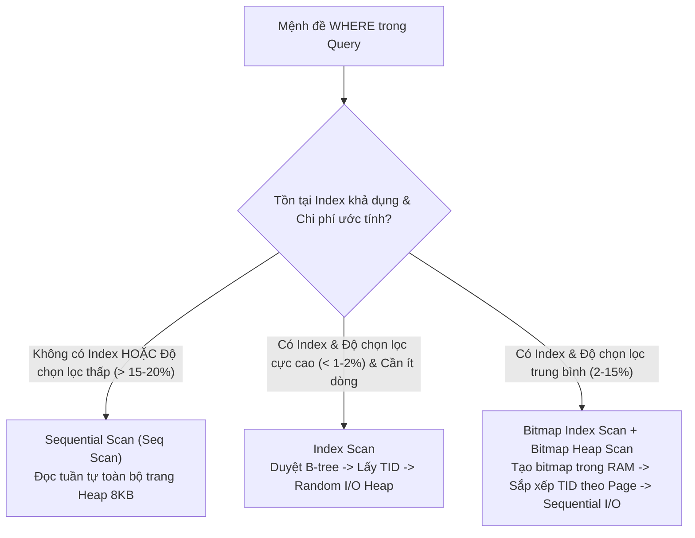

# CHƯƠNG 2: CƠ SỞ LÝ THUYẾT VÀ TỔNG QUAN TÀI LIỆU

## 2.1. Kiến trúc lưu trữ và Quản lý bộ đệm trong PostgreSQL

### 2.1.1. Cấu trúc bảng Heap và Định dạng Page 8 KB
Hệ quản trị cơ sở dữ liệu PostgreSQL tổ chức lưu trữ các bảng quan hệ dưới dạng các tệp bảng đống (**Heap Files**) không có thứ tự vật lý cố định. Mỗi bảng trên đĩa được chia thành các khối dữ liệu cố định gọi là các trang đệm (**Pages** hoặc **Blocks**) với kích thước mặc định là **8.192 bytes (8 KB)**. 

Cấu trúc bên trong một trang 8 KB của PostgreSQL bao gồm các thành phần:
1. **PageHeaderData (24 bytes):** Chứa siêu dữ liệu của trang như con trỏ tới vùng dữ liệu trống tiếp theo (`pd_lower`), con trỏ tới đuôi của vùng dữ liệu (`pd_upper`), và thông tin kiểm tra tính toàn vẹn (checksum).
2. **Mảng ItemIdData (Line Pointers):** Là một mảng các con trỏ dòng (mỗi con trỏ chiếm 4 bytes) tăng dần từ đầu trang xuống. Mỗi con trỏ chứa thông tin độ dịch chuyển (offset) và độ dài trỏ tới vị trí bắt đầu của bản ghi dữ liệu thực tế bên dưới trang.
3. **Vùng không gian trống (Free Space):** Vùng đệm nằm giữa mảng con trỏ dòng và các bản ghi dữ liệu, sẽ thu hẹp dần khi có thêm các dòng mới được chèn vào.
4. **Bản ghi dữ liệu (Items / Tuples):** Chứa dữ liệu của các hàng, được lấp đầy từ đáy trang (offset 8191) ngược dần lên trên. Mỗi hàng có phần đầu bản ghi (**HeapTupleHeaderData**) chiếm tối thiểu 23 bytes chứa các thông tin kiểm soát phiên bản đa chiều (MVCC - Multiversion Concurrency Control) như `xmin`, `xmax`, `t_ctid`, và bitmap đánh dấu các giá trị `NULL`.

Mỗi hàng trong bảng Heap được định danh duy nhất bởi một con trỏ vật lý gọi là **TID (Tuple Identifier)** hoặc **ItemPointer**, có cấu trúc `(BlockNumber, OffsetNumber)`. Trong đó, `BlockNumber` là số thứ tự trang trong tệp bảng và `OffsetNumber` là chỉ số của con trỏ dòng trong trang đó. 

> [!IMPORTANT]
> Do các hàng trong bảng Heap được chèn vào bất kỳ trang nào còn chỗ trống, việc truy xuất dữ liệu mà không có chỉ mục buộc PostgreSQL phải đọc tuần tự từ Block số 0 đến Block cuối cùng. Khóa chính (Primary Key) trong PostgreSQL mặc định tạo ra một cây chỉ mục B-tree duy nhất trên cột khóa, nhưng **hoàn toàn không tự động sắp xếp vật lý các hàng trong bảng Heap** trên đĩa theo thứ tự khóa chính (khác biệt căn bản với Clustered Index trong Microsoft SQL Server hoặc MySQL InnoDB).

### 2.1.2. Cơ chế Buffer Pool và Chính sách Đọc/Ghi đệm
Để giảm thiểu độ trễ cơ học và điện tử khi truy xuất đĩa cứng (Disk I/O), PostgreSQL duy trì một vùng nhớ đệm chia sẻ gọi là **Shared Buffers** trong RAM. Khi một câu lệnh truy vấn cần dữ liệu từ một trang, luồng xử lý (backend process) sẽ thực hiện các bước:
1. Tra cứu bảng băm bộ đệm (**Buffer Mapping Table**) xem trang `(relfilenode, forknum, blocknum)` đã có sẵn trong Shared Buffers hay chưa.
2. Nếu trang đã có sẵn trong RAM: ghi nhận một sự kiện **Shared Hit Block** (trúng bộ đệm), tăng số đếm sử dụng (`usage_count`) của trang đó theo thuật toán quét đồng hồ (**Clock Sweep** - biến thể hiệu năng cao của LRU), và đọc trực tiếp từ bộ nhớ với độ trễ cỡ nano-giây.
3. Nếu trang chưa có trong RAM: chọn một khung đệm (buffer frame) nạn nhân theo giải thuật Clock Sweep, đẩy trang cũ xuống đĩa nếu trang đó bị bẩn (`dirty page`), sau đó đọc trang 8 KB từ tệp trên đĩa cứng vào khung đệm, ghi nhận một sự kiện **Shared Read Block** (đọc đĩa vật lý) với độ trễ cỡ mili-giây.

Trong các thực nghiệm đo lường hiệu năng chuyên sâu, chỉ số `Shared Hit Blocks` và `Shared Read Blocks` được trích xuất từ câu lệnh `EXPLAIN (ANALYZE, BUFFERS)` là thước đo định lượng khách quan nhất phản ánh chính xác khối lượng công việc I/O mà hệ thống phải gánh chịu, loại bỏ hoàn toàn các sai số do biến động ngẫu nhiên của CPU hoặc tác vụ nền của hệ điều hành.

---

## 2.2. Cấu trúc dữ liệu và Cơ chế hoạt động của Chỉ mục B-tree

### 2.2.1. Cây B-tree đa nhánh và Thứ tự khóa (Key Ordering)
Chỉ mục mặc định và phổ biến nhất trong PostgreSQL là **B-tree (Balanced Tree)**, cụ thể là biến thể **B+ tree** được thiết kế tối ưu cho lưu trữ khối. Cây B-tree trong PostgreSQL là một cây tìm kiếm đa nhánh tự cân bằng hoàn hảo, trong đó tất cả các nút lá (Leaf Nodes) đều nằm ở cùng một độ sâu.

Cấu trúc hình học của cây B-tree bao gồm:
- **Nút gốc (Root Node):** Nằm ở đỉnh cây, chứa các khóa phân cách hướng dẫn đường đi xuống các nút con.
- **Các nút trung gian (Internal Nodes):** Chứa các cặp `(Key, Child_BlockNumber)`, chia không gian khóa thành các khoảng rời rạc. Mỗi nút có hệ số phân nhánh (**Fan-out**) rất lớn, thường chứa từ hàng trăm đến hàng nghìn phần tử trên một trang 8 KB.
- **Các nút lá (Leaf Nodes):** Chứa các cặp `(IndexKey, TID)`. Trong đó `IndexKey` là giá trị thuộc tính được đánh chỉ mục và `TID` là con trỏ vật lý trỏ trực tiếp về trang Heap chứa hàng dữ liệu thực tế.
- **Liên kết hai chiều (Bidirectional Sibling Pointers):** Các nút lá ở cùng tầng đáy được liên kết chặt chẽ với nhau bằng con trỏ trái và phải (`bpt_left`, `bpt_right`). Đặc tính này cho phép hệ thống thực hiện các phép quét khoảng (**Range Scan**) hoặc duyệt theo thứ tự sắp xếp (**Ordered Scan**) với độ phức tạp $O(\log N + K)$ cực kỳ hiệu quả mà không cần quay lui lên các nút cha.

Độ phức tạp thời gian để tìm kiếm một khóa trong cây B-tree với $N$ bản ghi là:
$$T_{lookup} = O(\log_{B} N)$$
Trong đó $B$ là hệ số phân nhánh (Fan-out) của mỗi trang. Với bảng 500.000 dòng, độ sâu của cây B-tree thường chỉ từ 2 đến 3 tầng, đồng nghĩa với việc PostgreSQL chỉ cần tối đa 3 lần truy cập trang là có thể xác định chính xác vị trí con trỏ của bản ghi cần tìm.

### 2.2.2. Composite Index và Quy tắc tiền tố ngoài cùng bên trái (Leftmost Prefix Rule)
Chỉ mục tổ hợp đa cột (**Composite Index**) là chỉ mục được xây dựng trên hai hoặc nhiều thuộc tính: `CREATE INDEX idx ON table (col1, col2, col3, ...)`.

Trong cấu trúc nội tại của cây B-tree đa cột, các khóa được sắp xếp theo thứ tự từ điển (lexicographical ordering):
1. Trước hết sắp xếp tuyệt đối theo giá trị của `col1`.
2. Nếu các giá trị `col1` trùng nhau, tiến hành sắp xếp tiếp theo giá trị của `col2`.
3. Nếu cả `col1` và `col2` đều trùng nhau, sắp xếp tiếp theo `col3`.

Từ nguyên lý sắp xếp từ điển này, quy tắc **Tiền tố ngoài cùng bên trái (Leftmost Prefix Rule)** được xác lập:
- Chỉ mục có thể phục vụ tối ưu cho các truy vấn lọc trên: `(col1)`, `(col1, col2)` hoặc `(col1, col2, col3)`.
- Chỉ mục **hoàn toàn không thể sử dụng** để tìm kiếm trực tiếp trên `col2` hoặc `col3` nếu thiếu vắng điều kiện đẳng thức trên `col1`, bởi vì tại tầng lá, các giá trị của `col2` bị phân tán ngẫu nhiên qua các nhánh khác nhau của `col1`.

Đặc biệt, khi truy vấn kết hợp giữa phép lọc đẳng thức (`col1 = 'A'`), phép lọc khoảng (`col2 BETWEEN X AND Y`), phép sắp xếp (`ORDER BY col2, col3`) và cắt ngọn (`LIMIT K`), nếu chỉ mục được sắp xếp theo đúng thứ tự:
$$\text{Index Columns} = (\text{Equality\_Cols}, \text{Range\_or\_Sort\_Cols}, \text{Tie\_breaker\_Cols})$$
thì toàn bộ các bản ghi thỏa mãn điều kiện lọc và thứ tự sắp xếp sẽ nằm liên tục cạnh nhau trên các trang lá của cây B-tree. Hệ thống có thể duyệt trực tiếp và dừng quét ngay khi gom đủ $K$ bản ghi thỏa mãn (**Early Termination**), triệt tiêu hoàn toàn chi phí quét các bản ghi còn lại và chi phí sắp xếp trong bộ nhớ.

---

## 2.3. Bộ lập lịch truy vấn (Query Optimizer) và Mô hình chi phí (Cost Model)

### 2.3.1. Các phương thức quét bảng: Sequential Scan, Index Scan, Bitmap Heap Scan
Trước khi thực thi một câu lệnh SQL, bộ tối ưu hóa chi phí (Cost-Based Optimizer - CBO) của PostgreSQL tạo ra nhiều cây kế hoạch thực thi ứng viên (Execution Plans) và ước tính tổng chi phí theo mô hình hàm:
$$\text{Cost} = N_{page\_seq} \cdot \text{seq\_page\_cost} + N_{page\_rand} \cdot \text{random\_page\_cost} + N_{tuples} \cdot \text{cpu\_tuple\_cost} + N_{ops} \cdot \text{cpu\_operator\_cost}$$
Các tham số mặc định trong PostgreSQL:
- `seq_page_cost = 1.0`: Chi phí ước tính cho việc đọc tuần tự 1 trang 8 KB từ đĩa.
- `random_page_cost = 4.0`: Chi phí ước tính cho việc đọc ngẫu nhiên 1 trang 8 KB từ đĩa (phản ánh độ trễ tìm kiếm cơ học của ổ HDD truyền thống; trên SSD tham số này thường được cấu hình từ 1.1 đến 1.5).
- `cpu_tuple_cost = 0.01`: Chi phí CPU để xử lý một hàng dữ liệu.
- `cpu_operator_cost = 0.0025`: Chi phí CPU để kiểm tra một toán tử điều kiện trong mệnh đề WHERE.

Bộ lập lịch sẽ so sánh chi phí giữa ba phương thức quét bảng cơ bản:



1. **Quét tuần tự (Sequential Scan - Seq Scan):**
   - Đọc lần lượt từng trang Heap từ đầu đến cuối tệp dữ liệu.
   - Thích hợp khi bảng có kích thước nhỏ, hoặc khi câu truy vấn yêu cầu lấy một tỷ lệ lớn bản ghi từ bảng (ví dụ trên 15–20% tổng số dòng). Lúc này, chi phí đọc ngẫu nhiên qua Index sẽ lớn hơn việc đọc tuần tự liên tục theo khối lớn.
2. **Quét chỉ mục trực tiếp (Index Scan):**
   - Duyệt từ nút gốc cây B-tree xuống nút lá để tìm các khóa thỏa mãn điều kiện.
   - Với mỗi khóa tìm thấy, lấy con trỏ `TID` và thực hiện truy cập ngẫu nhiên (**Random I/O**) ngay lập tức vào trang Heap tương ứng để lấy các cột dữ liệu còn thiếu.
   - Cực kỳ nhanh khi độ chọn lọc cao (số lượng dòng trả về rất ít, ví dụ 1 đến 100 dòng), nhưng nếu số dòng tăng lên, việc nhảy ngẫu nhiên giữa các trang Heap sẽ gây nghẽn I/O nghiêm trọng.
3. **Quét đống bản đồ bit (Bitmap Index Scan + Bitmap Heap Scan):**
   - Được thiết kế nhằm khắc phục nhược điểm đọc ngẫu nhiên của Index Scan khi số lượng dòng thỏa mãn điều kiện nằm ở mức trung bình (từ vài trăm đến vài chục nghìn dòng).
   - **Giai đoạn 1 (Bitmap Index Scan):** Duyệt cây B-tree, gom toàn bộ các con trỏ `TID` thỏa mãn điều kiện và xây dựng một mảng bit (**Bitmap**) trong bộ nhớ RAM. Mỗi bit trong mảng đại diện cho một trang dữ liệu hoặc một dòng trong bảng Heap.
   - **Giai đoạn 2 (Bitmap Heap Scan):** Sắp xếp lại danh sách các trang cần đọc theo đúng thứ tự vật lý tăng dần của chúng trên đĩa, sau đó đọc tuần tự các trang Heap có đánh dấu bit. Điều này biến các truy cập ngẫu nhiên phân tán thành các truy cập tuần tự cục bộ, giảm đáng kể thời gian di chuyển đầu đọc đĩa.

### 2.3.2. Thuật toán sắp xếp trong bộ nhớ (Top-N Heapsort vs External Merge Sort)
Khi câu truy vấn chứa mệnh đề `ORDER BY col LIMIT K`:
- Nếu bộ lập lịch phải dùng `Seq Scan`, nó sẽ phải lọc toàn bộ các bản ghi thỏa mãn điều kiện vào bộ nhớ.
- Khi dung lượng dữ liệu cần sắp xếp nhỏ hơn tham số `work_mem` (mặc định 4 MB trong PostgreSQL), hệ thống sẽ sử dụng thuật toán **Top-N Heapsort**: duy trì một cấu trúc đống nhị phân (Binary Heap) có kích thước cố định là $K$ phần tử. Với mỗi hàng mới nạp vào, chi phí cập nhật đống là $O(\log K)$. Độ phức tạp tổng thể là:
$$T_{heapsort} = O(M \cdot \log K)$$
Trong đó $M$ là tổng số hàng thỏa mãn điều kiện lọc ($M \gg K$). Dù thuật toán này không cần ghi tạm ra đĩa cứng, CPU vẫn phải xử lý $M$ lần so sánh và duy trì đống trong RAM.
- Ngược lại, nếu câu truy vấn tận dụng được một chỉ mục B-tree đã có thứ tự sẵn theo đúng các cột trong `ORDER BY`, PostgreSQL hoàn toàn **không cần khởi tạo nút Sort**. Nó chỉ việc đọc tuần tự đúng $K$ con trỏ đầu tiên từ cây B-tree, đem lại độ phức tạp lý thuyết là $O(K)$, độc lập hoàn toàn với tổng số dòng $M$ thỏa mãn điều kiện trong bảng.

---

## 2.4. Tính khả chỉ mục của vị từ truy vấn (Sargability)

### 2.4.1. Khái niệm Sargable Predicate
Thuật ngữ **Sargable** xuất phát từ cụm từ **S**earch **Arg**ument **Able** trong lý thuyết cơ sở dữ liệu quan hệ, được đặt ra bởi các nhà nghiên cứu của IBM System R (Selinger et al., 1979). Một vị từ tìm kiếm (predicate) trong mệnh đề `WHERE` được coi là **sargable** khi bộ tối ưu hóa truy vấn có thể sử dụng trực tiếp cấu trúc chỉ mục B-tree để giới hạn phạm vi tìm kiếm khóa (Index Seek / Index Range Scan), thay vì phải quét toàn bộ các khóa hoặc toàn bộ các trang dữ liệu (Full Scan).

Một vị từ có dạng tổng quát:
$$\text{Column} \odot \text{Constant\_Expression}$$
Trong đó $\odot$ là các toán tử so sánh tiêu chuẩn: `=`, `<`, `<=`, `>`, `>=`, hoặc `BETWEEN`.

### 2.4.2. Tác động của hàm ép kiểu và biểu thức trên cột chỉ mục
Một trong những lỗi thiết kế truy vấn phổ biến nhất làm phá hủy tính sargable là việc bao bọc cột dữ liệu bên trong một hàm số học, hàm chuỗi hoặc toán tử ép kiểu:
$$f(\text{Column}) = \text{Constant}$$
Xét trường hợp cụ thể của cột `published_at` có kiểu dữ liệu `TIMESTAMP WITHOUT TIME ZONE`:
- **Truy vấn Non-sargable:**
  ```sql
  WHERE published_at::date = DATE '2025-10-15';
  ```
  Trong trường hợp này, cây B-tree được đánh chỉ mục trên giá trị thô `published_at` (chứa cả ngày, giờ, phút, giây, microsecond). Cây B-tree không hề lưu trữ kết quả của hàm ép kiểu `::date`. Do hàm toán học $f(x) = x\text{::date}$ chưa được tính toán từ trước, bộ tối ưu hóa của PostgreSQL không thể so khớp giá trị `'2025-10-15'` với các nút trên cây B-tree. Kết quả là bộ lập lịch **buộc phải vô hiệu hóa hoàn toàn chỉ mục**, chuyển sang quét tuần tự (`Seq Scan`) toàn bộ bảng và thực thi hàm ép kiểu trên từng bản ghi một.
- **Biến đổi sang Sargable Range Predicate (Khoảng thời gian nửa mở):**
  Để bảo toàn tính sargable, biểu thức cần được viết lại sao cho cột dữ liệu đứng hoàn toàn độc lập ở một vế của toán tử:
  ```sql
  WHERE published_at >= TIMESTAMP '2025-10-15 00:00:00'
    AND published_at <  TIMESTAMP '2025-10-16 00:00:00';
  ```
  Biểu thức này thiết lập một khoảng nửa mở $[T_{start}, T_{end})$. Bộ tối ưu hóa PostgreSQL lập tức nhận dạng đây là điều kiện lọc khoảng trực tiếp trên khóa chỉ mục, cho phép duyệt cây B-tree đến vị trí $T_{start}$ và quét đến vị trí $T_{end}$, giảm số lượng trang dữ liệu cần đọc xuống hàng trăm lần.

---

## 2.5. Lý thuyết xử lý dữ liệu lớn ở tầng tiền kỳ (In-memory Data Ingestion)

### 2.5.1. Định dạng hàng (CSV) đối chiếu định dạng cột nhị phân (Parquet)
Trong vòng đời của một dự án Khoa học Dữ liệu, giai đoạn tiền xử lý, phân tích khám phá (EDA) và trích xuất đặc trưng thường diễn ra trên các khung dữ liệu (DataFrame) trong bộ nhớ trước khi nạp vào hệ quản trị cơ sở dữ liệu quan hệ.

Sự khác biệt cốt lõi giữa hai định dạng tệp lưu trữ dữ liệu phổ biến:
1. **CSV (Comma-Separated Values):**
   - Lưu trữ dạng văn bản thuần túy (Plain Text), có cấu trúc hướng hàng (Row-oriented).
   - Không chứa siêu dữ liệu về kiểu dữ liệu (Schema-less): khi nạp vào bộ nhớ, thư viện phân tích buộc phải đọc từng byte, phân tích cú pháp chuỗi ký tự (String Parsing) và suy đoán kiểu dữ liệu (Type Inference).
   - Kích thước tệp lớn do không có cơ chế nén chuyên biệt, chi phí CPU giải mã chuỗi cao và độ trễ I/O đĩa lớn.
2. **Apache Parquet:**
   - Định dạng lưu trữ nhị phân mã nguồn mở, có cấu trúc hướng cột (Columnar Storage Format).
   - Dữ liệu của cùng một thuộc tính được lưu trữ liên tục cạnh nhau trong các nhóm dòng (**Row Groups**), được chia thành các trang dữ liệu (**Data Pages**).
   - Tận dụng các thuật toán nén hiện đại như Snappy hoặc Zstandard (zstd), kết hợp mã hóa chuyên sâu cho dữ liệu số và chuỗi (Run-Length Encoding - RLE, Dictionary Encoding, Bit-Packing).
   - Tệp Parquet lưu trữ sẵn siêu dữ liệu lược đồ (Schema Metadata) và thống kê cực trị (`min`, `max`, `null_count`) của từng cột trong phần đuôi tệp (Footer). Điều này cho phép các công cụ phân tích hiện đại thực hiện kỹ thuật cắt tỉa trang (**Predicate Pushdown / Row Group Pruning**): chỉ đọc các cột cần thiết và bỏ qua hoàn toàn các nhóm dòng không chứa dữ liệu thỏa mãn điều kiện lọc.

### 2.5.2. Kỹ thuật nạp phân khối (Chunked Streaming) kiểm soát giới hạn RAM
Khi khối lượng tệp CSV vượt quá dung lượng RAM khả dụng của hệ thống, việc nạp toàn bộ tệp vào DataFrame bằng hàm thông thường (như `pd.read_csv()`) sẽ gây ra hiện tượng tràn bộ nhớ (**Out-Of-Memory - OOM Error**). 

Nguyên nhân là do bộ quản lý bộ nhớ của Python cần cấp phát không gian RAM không chỉ cho dữ liệu thuần mà còn cho các đối tượng phụ trợ (`PyObject`), con trỏ mảng và bộ nhớ đệm sao chép tạm thời trong quá trình parse văn bản, khiến dung lượng RAM tiêu thụ thực tế có thể gấp **3 đến 5 lần kích thước tệp CSV trên đĩa**.

Giải pháp kỹ nghệ chuẩn mực để xử lý thách thức này là kỹ thuật **Nạp phân khối (Chunked Streaming)**:
- Chia nhỏ tệp dữ liệu đầu vào thành các khối có số dòng cố định (ví dụ $C = 10.000$ hoặc $50.000$ bản ghi).
- Sử dụng cơ chế phát sinh dòng (Generator Iterator) để nạp từng khối vào RAM, thực hiện các biến đổi hoặc tính toán tổng hợp cục bộ (như tính tổng $\sum x_i$ và đếm số lượng $n_i$), giải phóng ngay bộ nhớ của khối đó trước khi nạp khối tiếp theo.
- Kỹ thuật này giới hạn đỉnh tiêu thụ bộ nhớ RAM thực tế (**Peak RSS**) ở mức hằng số $O(C)$, hoàn toàn độc lập với tổng kích thước dữ liệu $N$, cho phép xử lý an toàn các tệp dữ liệu hàng chục gigabyte trên máy trạm cá nhân tiêu chuẩn.
