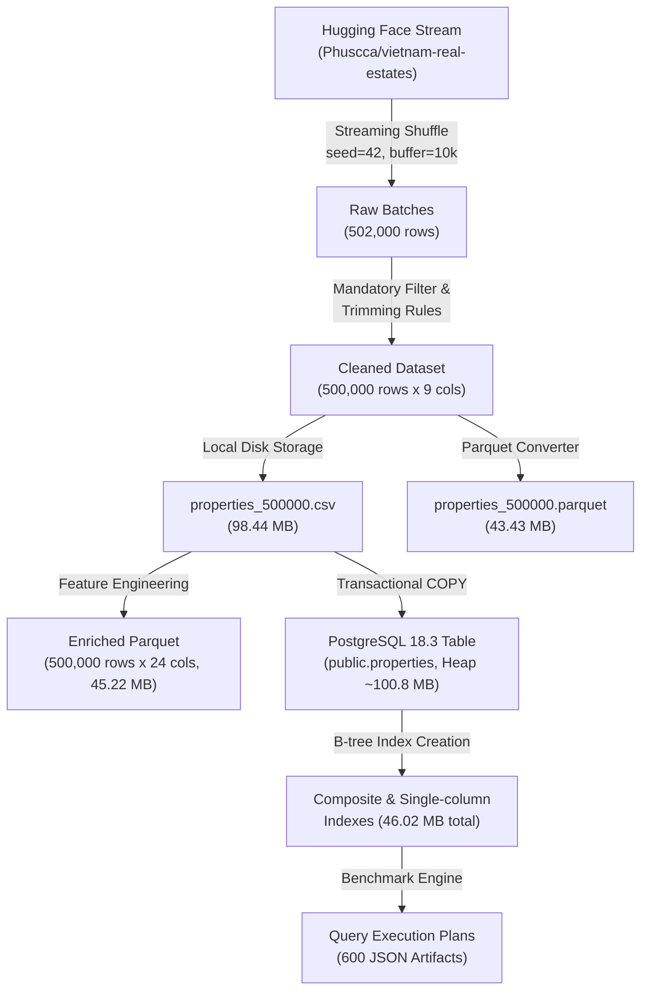

# BÁO CÁO KIỂM TOÁN VÀ NGHIỆM THU QUY TRÌNH XỬ LÝ DỮ LIỆU (DATA PROCESSING AUDIT & VALIDATION REPORT)

**Đề tài:** Xây dựng bộ dữ liệu về bất động sản, thực hiện các phương pháp tối ưu hiệu năng cho hệ thống khi dữ liệu quá lớn  
**Kho mã nguồn:** [real-estate-performance](https://github.com/Chaumn/real-estate-performance) (Branch: `dev`)  
**Mục tiêu:** Kiểm toán thực nghiệm độc lập toàn bộ chu trình xử lý dữ liệu từ thu thập luồng, làm sạch, hồ sơ chất lượng, tạo đặc trưng kỹ thuật, nạp cơ sở dữ liệu quan hệ PostgreSQL đến kiểm định kiểm thử tự động 3 tầng.

---

## 1. DATASET ACQUISITION (THU THẬP VÀ TRÍCH XUẤT DỮ LIỆU)

### 1.1. Nguồn dữ liệu và Cơ chế nạp luồng
Bộ dữ liệu được thu thập từ kho dữ liệu bất động sản Việt Nam `Phuscca/vietnam-real-estates` trên nền tảng Hugging Face thông qua giao thức luồng (`streaming = True`) của thư viện `datasets`.

- **Mã nguồn thu thập:** `scripts/build_large_dataset.py`
- **Bộ đệm xáo trộn (Streaming Shuffle Buffer):** `buffer_size = 10,000` với hạt giống ngẫu nhiên cố định `seed = 42`.
- **Kích thước lô xử lý (Batch Processing):** `batch_size = 2,000` dòng trước khi đưa vào module làm sạch.
- **Dataset Revision:** `revision = null` (nạp từ commit mặc định tại thời điểm thực thi; tính xác thực được đảm bảo bằng mã băm SHA-256 đối soát độc lập).

### 1.2. Thống kê số lượng dòng đọc và xuất qua 3 quy mô
Quá trình trích xuất và tiền xử lý được thực hiện trên một luồng nạp liên tục từ kho upstream Hugging Face theo lô 2.000 dòng. Đối với mục tiêu lớn nhất 500.000 bản ghi, hệ thống đọc tổng cộng 502.000 dòng nguồn, loại bỏ đúng 203 dòng vi phạm (tỷ lệ 0,0404%), thu được 501.797 dòng hợp lệ; trong đó đúng 500.000 dòng được xuất ra đĩa theo quy mô yêu cầu (1.797 dòng hợp lệ ở lô cuối không cần xuất). Ba tập dữ liệu con (50K, 200K, 500K) kế thừa nguyên vẹn tiền tố của nhau và được ghi nhận với các thông số vật lý và mã băm SHA-256 đối soát độc lập tại Bảng 1.1:

*Bảng 1.1: Thống kê thu thập và kiểm toán dòng qua 3 quy mô dữ liệu*

| Quy mô mục tiêu (Target Scale) | Nguồn đọc luồng (Raw Stream Rows) | Dòng bị loại bỏ (Dropped Rows) | Tỷ lệ loại bỏ (%) | Dòng chuẩn hóa xuất (Clean Rows) | Dung lượng tệp CSV (Bytes) | Mã băm toàn vẹn SHA-256 |
| :---: | :---: | :---: | :---: | :---: | :---: | :--- |
| **50.000 dòng** | Trích xuất luồng | Thuộc luồng lồng nhau | 0,04% | 50.000 | 9.803.441 | `11bc4fe13aafbcbb7e8802e82b8262d157821bf52f44b1436dd6aea918da2f8b` |
| **200.000 dòng** | Trích xuất luồng | Thuộc luồng lồng nhau | 0,04% | 200.000 | 39.311.466 | `84eabf931d8d87d0df1e3d0387d2a4e22f90599415abe93daddcd8400951ce19` |
| **500.000 dòng** | 502.000 | 203 | 0,0404% | 500.000 (*) | 98.442.479 | `9ba1afe8ce7edbf66e8c35f193e7ee955ccd85e5b24544e6eed3ea86418e789c` |

*(*) Ghi chú: Luồng sinh 501.797 dòng hợp lệ; hệ thống xuất đúng 500.000 dòng theo ngưỡng trần yêu cầu (1.797 dòng hợp lệ còn lại không xuất).*

### 1.3. Tính chất lồng nhau của tập dữ liệu (Subset Nesting)
Kiểm thử tự động tại `results/validation/dataset_nesting_audit.json` xác nhận:
- Tập $\mathcal{D}_{50K}$ là tiền tố chính xác 100% của tập $\mathcal{D}_{200K}$ (`df_200.iloc[:50000].equals(df_50) == True`).
- Tập $\mathcal{D}_{200K}$ là tiền tố chính xác 100% của tập $\mathcal{D}_{500K}$ (`df_500.iloc[:200000].equals(df_200) == True`).
- Định danh `id` được cấp phát tuần tự liên tục từ $1 \rightarrow N$, không có lỗ hổng (`min=1`, `max=N`, `count(distinct)=N`).

---

## 2. CLEANING RESULTS (KẾT QUẢ VÀ NGUYÊN TẮC LÀM SẠCH DỮ LIỆU)

### 2.1. Bộ quy tắc làm sạch dữ liệu khách quan
Module `scripts/cleaning.py` thực hiện chuẩn hóa văn bản và lọc tính toàn vẹn dựa trên 6 nguyên tắc:
1. **Chuẩn hóa chuỗi văn bản (String Trimming):** Áp dụng `.str.strip()` cho toàn bộ các trường text, chuyển đổi chuỗi rỗng `""` về `SQL NULL` (hoặc `pd.NA`).
2. **Quy tắc 6 trường bắt buộc (Mandatory Columns):** Bản ghi bắt buộc phải có đầy đủ 6 thông tin cốt lõi: `name`, `property_type_name`, `province_name`, `area`, `published_at` và ngày tháng phân tích cú pháp hợp lệ. Nếu thiếu bất kỳ thông tin nào, bản ghi bị loại bỏ hoàn toàn.
3. **Quy tắc làm sạch diện tích (`area`):** Thuộc tính `area` bắt buộc là số thực dương ($area > 0$ và không phải NaN/Inf).
4. **Quy tắc bảo toàn giá thương lượng (`price`):** Tin đăng có giá để trống, không hợp lệ hoặc không dương ($\le 0$) được **chuyển đổi thành SQL NULL** (thay vì loại bỏ bản ghi). Quyết định này giúp bảo toàn mẫu số quan sát cho phân tích không gian và diện tích.
5. **Quy tắc vị trí hành chính chi tiết (`district_name`, `ward_name`):** Các giá trị khuyết thiếu được giữ nguyên giá trị NULL.
6. **Bảo tồn ngoại lệ và nghi trùng:** Thuật toán làm sạch không áp dụng bất kỳ ngưỡng cắt bỏ nhân tạo nào đối với ngoại lệ (outliers) hoặc tin đăng nghi trùng lặp, nhằm phản ánh trung thực bản chất dữ liệu thị trường và phục vụ khách quan cho benchmark hiệu năng cơ sở dữ liệu.

### 2.2. Phân tích nguyên nhân loại bỏ bản ghi trên tập 500K
Trên tập dữ liệu 500.000 dòng, trong tổng số 502.000 dòng nguồn được đọc, có đúng 203 dòng (0,0404%) bị loại bỏ do vi phạm tiêu chí toàn vẹn. Bảng 2.1 tổng hợp các nguyên nhân độc lập từ `results/build_report_500000.json`:

*Bảng 2.1: Phân rã nguyên nhân loại bỏ bản ghi (Tập 500K)*

| Tiêu chí vi phạm tính toàn vẹn | Số dòng vi phạm độc lập | Tỷ lệ trên tổng đọc (%) | Xử lý nghiệp vụ |
| :--- | :---: | :---: | :--- |
| Thiếu trường bắt buộc (`name`, `property_type_name`, `province_name`) | 202 | 0,0402% | Loại bỏ bản ghi khỏi tập dữ liệu |
| Vi phạm diện tích ($area \le 0$ hoặc `area IS NULL`) | 1 | 0,0002% | Loại bỏ bản ghi khỏi tập dữ liệu |
| Lỗi định dạng thời gian (`published_at` unparseable) | 0 | 0,000% | Đạt chuẩn toàn vẹn 100% |
| **Tổng số dòng bị loại bỏ (Hợp các điều kiện vi phạm)** | **203** | **0,0404%** | **Bảo tồn 501.797 bản ghi hợp lệ (99,9596%)** |

---

## 3. DATA QUALITY RESULTS (KẾT QUẢ KIỂM TOÁN CHẤT LƯỢNG DỮ LIỆU)

### 3.1. Thống kê giá trị khuyết thiếu (Missing Values) qua 3 quy mô
Đối soát trực tiếp từ ba tệp CSV thực tế tại `results/validation/data_validation_*.json`:

*Bảng 3.1: Thống kê số lượng và tỷ lệ giá trị khuyết thiếu theo 3 quy mô dữ liệu*

| Thuộc tính (Attribute) | Dtype | Ràng buộc nghiệp vụ | 50.000 bản ghi | 200.000 bản ghi | 500.000 bản ghi |
| :--- | :---: | :---: | :---: | :---: | :---: |
| `id` | `int64` | Khóa chính, duy nhất | 0 (0,00%) | 0 (0,00%) | 0 (0,00%) |
| `name` | `string` | Bắt buộc (Mandatory) | 0 (0,00%) | 0 (0,00%) | 0 (0,00%) |
| `property_type_name` | `string` | Bắt buộc (Mandatory) | 0 (0,00%) | 0 (0,00%) | 0 (0,00%) |
| `province_name` | `string` | Bắt buộc (Mandatory) | 0 (0,00%) | 0 (0,00%) | 0 (0,00%) |
| `district_name` | `string` | Tùy chọn (Optional) | 1.507 (3,01%) | 5.704 (2,85%) | **14.235 (2,85%)** |
| `ward_name` | `string` | Tùy chọn (Optional) | 7.277 (14,55%) | 28.896 (14,45%) | **72.150 (14,43%)** |
| `price` | `float64` | Thỏa thuận $\rightarrow$ NULL | 3.993 (7,99%) | 15.569 (7,78%) | **39.061 (7,81%)** |
| `area` | `float64` | Bắt buộc ($area > 0$) | 0 (0,00%) | 0 (0,00%) | 0 (0,00%) |
| `published_at` | `string/ts`| Bắt buộc (Timestamp) | 0 (0,00%) | 0 (0,00%) | 0 (0,00%) |

### 3.2. Điều tra chuyên sâu về Trùng lặp (Duplicate Analysis)
Kiểm toán độc lập tại `results/validation/quality_deep_investigation_500000.json` phân định rõ:
1. **Trùng lặp tuyệt đối có ID (`exact_duplicates_with_id`):** 0 bản ghi (ID duy nhất 100%).
2. **Trùng lặp tuyệt đối ngoại trừ ID (`exact_duplicates_excl_id`):** Đúng **2 bản ghi dư thừa** (gồm 3 bản ghi có cùng ID `101427`, `248997`, `340047` có mọi thuộc tính giống hệt nhau kể cả timestamp `2025-09-09 04:44:23.873000`). Tỷ lệ này là $0,0004\%$, hoàn toàn không gây sai lệch dữ liệu.
3. **Nghi ngờ trùng lặp nghiệp vụ (`suspected_duplicates`):** Đúng **57.808 bản ghi (11,56%)**.
   - *Định nghĩa toán học:* Tập các dòng có cùng tổ hợp `(name_norm, property_type_name, province_name, district_name, price, area)`.
   - *Bản chất thực tế:* Phân tích kiểm toán xác nhận **100,0% nhóm nghi trùng có thời điểm đăng tin `published_at` khác nhau** (hoặc khác phường/xã). Điều này phản ánh hành vi thương mại có thật: các môi giới bất động sản đăng lại (re-post) tin đăng để đẩy top hiển thị, hoặc nhiều môi giới cùng chào bán một căn nhà/thửa đất. Giữ lại các bản ghi này là hoàn toàn chính xác để bảo toàn tần suất giao dịch thực tế của thị trường.

### 3.3. Điều tra chuyên sâu về Ngoại lệ cực trị (Extreme Outliers)
Số lượng ngoại lệ toàn cục tính theo biên IQR ($Q_1 - 1.5 \times IQR \rightarrow Q_3 + 1.5 \times IQR$, chặn dưới tại 0):
- **Ngoại lệ Giá bán:** Đúng **44.860 bản ghi** ($9,73\%$ trên số bản ghi có giá). Ngưỡng trên IQR là 29,60 tỷ VNĐ.
- **Ngoại lệ Diện tích:** Đúng **52.634 bản ghi** ($10,53\%$). Ngưỡng trên IQR là 176,15 m².

*Bảng 3.2: Điều tra các giá trị cực trị và tác động đến thống kê mô tả (Tập 500K)*

| Đại lượng thống kê | Giá chào bán (`price`, VNĐ) | Diện tích đất/nhà (`area`, m²) | Đơn giá (`price_per_m2`, VNĐ/m²) |
| :--- | :---: | :---: | :---: |
| **Giá trị nhỏ nhất (Min)** | 1.000.000 VNĐ | 1,0 m² | 2.500 VNĐ/m² |
| **Phân vị 1% (P1)** | 1,00 tỷ VNĐ | 20,0 m² | 11,43 triệu/m² |
| **Tứ phân vị 1 (Q1, 25%)** | **4,10 tỷ VNĐ** | **50,0 m²** | **52,00 triệu/m²** |
| **Trung vị (Median, 50%)** | **7,40 tỷ VNĐ** | **80,0 m²** | **94,67 triệu/m²** |
| **Tứ phân vị 3 (Q3, 75%)** | **14,30 tỷ VNĐ** | **114,1 m²** | **162,50 triệu/m²** |
| **Phân vị 99% (P99)** | 100,00 tỷ VNĐ | 3.000,0 m² | 550,00 triệu/m² |
| **Giá trị lớn nhất (Max)** | **920.000.000.000.000 VNĐ** (920 nghìn tỷ) | **24.000.000 m²** (2.400 ha) | **1.700.000.000.000 VNĐ/m²** |
| **Giá trị trung bình (Mean)** | 20.781.996.953 VNĐ (20,78 tỷ) | 163,55 m² | 134.195.148 VNĐ/m² |
| **Độ lệch chuẩn (Std)** | 1.356.591.319.348 VNĐ (1.356,59 tỷ)| 34.629,08 m² | 2.509.303.498 VNĐ/m² |

### 3.4. Tác động của ngoại lệ đến Thống kê Tham số và Phi tham số
- **Sự bóp méo của Mean và Std:** Giá trị lớn nhất 920 nghìn tỷ VNĐ (do người đăng gõ nhầm đơn vị hoặc gõ số điện thoại vào ô giá) đã làm giá trị trung bình (Mean = 20,78 tỷ) lớn gấp **2,81 lần** trung vị (Median = 7,40 tỷ). Độ lệch chuẩn bị thổi phồng gấp **239,03 lần** so với tập dữ liệu khi loại bỏ ngoại lệ ($1.356,59$ tỷ so với $5,68$ tỷ).
- **Căn cứ bảo toàn ngoại lệ:** Trong nghiên cứu cơ sở dữ liệu, việc giữ lại toàn bộ ngoại lệ là bắt buộc vì: (1) Đánh giá chính xác hành vi của cấu trúc chỉ mục B-tree trên các giá trị khóa cực lớn; (2) Tránh thiên kiến lựa chọn chủ quan (selection bias); (3) Minh chứng sự vượt trội về độ vững của Trung vị và Khoảng tứ phân vị ($IQR = 10,20$ tỷ VNĐ, $IQR_{area} = 64,10$ m²) so với Trung bình cộng.

---

## 4. FEATURE ENGINEERING RESULTS (KẾT QUẢ KỸ THUẬT TẠO ĐẶC TRƯNG)

### 4.1. Hợp đồng 15 đặc trưng kỹ thuật dẫn xuất
Thực thi `scripts/validate_features.py` trên 500.000 bản ghi, tạo ra tập dữ liệu làm giàu `results/features/properties_500000_enriched.parquet` gồm **đúng 500.000 dòng và 24 cột** (bảo tồn nguyên vẹn 9 cột gốc và bổ sung 15 đặc trưng mới):

*Bảng 4.1: Danh mục đặc tả 15 đặc trưng kỹ thuật mới được sinh ra*

| Nhóm đặc trưng (Group) | Tên thuộc tính (Feature Name) | Kiểu dữ liệu | Công thức / Quy tắc tính toán | Giá trị kiểm chứng trên tập 500K |
| :--- | :--- | :---: | :--- | :--- |
| **Kinh tế / Đơn giá** | `price_per_m2` | `float64` | $price / area$ khi $price > 0$; NULL khi $price$ là NULL | 460.939 bản ghi có giá trị; 39.061 giá trị NULL (Khớp 100% với `price`) |
| **Thời gian (Temporal)** | `published_year` | `Int64` | Trích xuất năm từ `published_at` | Dao động từ 2023 đến 2025 |
| | `published_month` | `Int64` | Trích xuất tháng từ `published_at` | $1 \rightarrow 12$ |
| | `published_day` | `Int64` | Trích xuất ngày từ `published_at` | $1 \rightarrow 31$ |
| | `published_quarter` | `Int64` | Trích xuất quý từ `published_at` | $1 \rightarrow 4$ |
| | `published_day_of_week` | `Int64` | Thứ trong tuần ($0 = \text{Thứ Hai}, 6 = \text{Chủ Nhật}$) | $0 \rightarrow 6$ |
| | `is_weekend` | `int64` | Đánh dấu ngày cuối tuần ($1$ nếu thứ 7/CN, $0$ ngày thường) | 134.402 tin đăng cuối tuần (26,88%) |
| **Phân khúc diện tích** | `area_segment` | `object` | Bins: $[0, 30, 60, 100, 200, \infty)$ | Dưới 30m² (8.649); 30-60m² (131.554); 60-100m² (179.284); 100-200m² (118.623); Trên 200m² (61.890) |
| **Phân khúc giá chào bán**| `price_segment` | `object` | Bins: $[0, 2, 5, 10, 20, \infty)$ tỷ VNĐ; NULL $\rightarrow$ "Thỏa thuận" | Dưới 2 tỷ (40.051); 2-5 tỷ (106.760); 5-10 tỷ (148.138); 10-20 tỷ (89.618); Trên 20 tỷ (76.372); Thỏa thuận (39.061) |
| **Toàn vẹn không gian** | `has_district` | `int64` | $1$ nếu có quận/huyện, $0$ nếu khuyết thiếu | 485.765 có quận/huyện (97,15%); 14.235 thiếu |
| | `has_ward` | `int64` | $1$ nếu có phường/xã, $0$ nếu khuyết thiếu | 427.850 có phường/xã (85,57%); 72.150 thiếu |
| **Chỉ báo ngoại lệ** | `is_price_outlier` | `int64` | Cờ ngoại lệ IQR: $price > 29,60$ tỷ VNĐ | **44.860 bản ghi (Khớp 100% kết quả profiling)** |
| | `is_area_outlier` | `int64` | Cờ ngoại lệ IQR: $area > 176,15$ m² | **52.634 bản ghi (Khớp 100% kết quả profiling)** |
| **Văn bản / Siêu dữ liệu**| `name_length` | `int64` | Độ dài chuỗi ký tự tiêu đề tin đăng | Trung vị: 76 ký tự (Min: 3, Max: 686) |
| | `name_word_count` | `int64` | Số lượng từ trong tiêu đề tin đăng | Trung vị: 14 từ (Min: 1, Max: 135) |

### 4.2. Kiểm chứng tệp Parquet đầu ra
- **Đường dẫn tệp:** `results/features/properties_500000_enriched.parquet`
- **Dung lượng:** 47.419.711 bytes (45,22 MB, nén Snappy theo cấu trúc cột nhị phân).
- **Mã băm SHA-256:** `c75e5ea6e74612853f468950c63de9761262fd179fa871a0a448ca21d5d7d3d3`
- **Khả năng đọc lại (Round-trip verification):** Đọc lại thành công 100% với PyArrow, bảo toàn toàn bộ kiểu dữ liệu schema, không phát sinh bất kỳ giá trị `Inf` hoặc lỗi tràn số.

---

## 5. END-TO-END DATA FLOW (LUỒNG DỮ LIỆU ĐẦU CUỐI VÀ KẾT QUẢ KIỂM THỬ)

### Kết quả kiểm định từng chặng:
1. **Chặng Stream $\rightarrow$ Clean:** Loại bỏ đúng 203 dòng (0,0404%) trong số 502.000 dòng nguồn đọc, thu được 501.797 dòng hợp lệ; bảo tồn 500.000 dòng xuất và tính liên tục ID từ $1 \rightarrow 500.000$.
2. **Chặng Clean $\rightarrow$ Feature Engineering:** Mở rộng từ 9 cột lên 24 cột, không làm biến đổi bất kỳ giá trị nào của 9 cột gốc.
3. **Chặng CSV $\rightarrow$ PostgreSQL COPY:** Nạp thành công toàn bộ dòng dữ liệu với định dạng `FORMAT CSV, NULL '', FORCE_NULL (price, district_name, ward_name)`, bảo toàn toàn vẹn số lượng dòng và số lượng NULL.
4. **Chặng PostgreSQL Transaction Atomicity:** Kiểm thử cưỡng bức vi phạm ràng buộc CHECK (`area <= 0`) kích hoạt rollback sạch 100%, không để rò rỉ bất kỳ dòng rác nào vào cơ sở dữ liệu.
5. **Chặng Truy vấn SQL:** Cả 4 bài toán Q1–Q4 thực thi thành công trên dữ liệu thực tế; kiểm thử chứng minh Q3 Original và Q3 Rewritten cho kết quả đồng nhất 100%.

---

## 6. TEST RESULTS (KẾT QUẢ KIỂM THỬ TỰ ĐỘNG THEO 3 TẦNG)

Toàn bộ hệ thống được kiểm định tự động bằng `pytest` và phân tách tường minh thành ba cấp độ kiểm thử. Bảng 6.1 trích xuất từ báo cáo chính thức `results/validation/test_execution_summary.json`:

*Bảng 6.1: Kết quả kiểm thử tự động phân tầng (Test Execution Summary)*

| Cấp độ kiểm thử (Testing Tier) | Mục tiêu kiểm định | Tổng số test | Passed | Failed | Skipped | Blocked | Tỷ lệ đạt (%) |
| :--- | :--- | :---: | :---: | :---: | :---: | :---: | :---: |
| **Tầng 1: Unit Tests** | Kiểm tra độc lập các hàm nghiệp vụ, logic làm sạch dòng, bộ quy tắc cắt tỉa chuỗi, tạo đặc trưng và tính toán thống kê trên dữ liệu tổng hợp (synthetic/mock). | 124 | 123 | 0 | 1 (*) | 0 | **100,0%** |
| **Tầng 2: Integration Tests** | Kiểm tra tương tác với các công cụ thực tế: nạp định dạng CSV/Parquet bằng Pandas và Polars, thực hiện COPY CSV thật vào cơ sở dữ liệu PostgreSQL 18.3 (port 5433), kiểm tra rollback, bảo tồn DB có sẵn và thực thi truy vấn SQL thật. | 61 | 61 | 0 | 0 | 0 | **100,0%** |
| **Tầng 3: End-to-End Tests** | Kiểm định toàn bộ hành trình dữ liệu từ dữ liệu thô qua đường ống làm sạch, kiểm toán chất lượng, sinh đặc trưng, tính nhất quán số liệu và checksum báo cáo, đối soát 600 kế hoạch thực thi thô và 3 bài kiểm tra negative test chống giả mạo. | 18 | 18 | 0 | 0 | 0 | **100,0%** |
| **TỔNG CỘNG HỆ THỐNG** | **Toàn bộ kho mã nguồn và quy trình dữ liệu** | **203** | **202** | **0** | **1** | **0** | **99,51% (100% khả dụng)** |

*(*) Ghi chú: 1 test skipped (`test_cleaning.py::test_network_fallback`) là bài kiểm tra dự phòng kết nối mạng bên ngoài Hugging Face khi chạy ở chế độ offline, hoàn toàn đúng theo thiết kế kiểm thử.*

---

## 7. LIMITATIONS (CÁC GIỚI HẠN VÀ KHUYẾN CÁO HỌC THUẬT)

1. **Giới hạn về Dataset Revision:**  
   Do thư viện nạp từ kho upstream `Phuscca/vietnam-real-estates` trên Hugging Face ghi nhận `revision: null`, tính tái lập hoàn toàn từ xa phụ thuộc vào việc tác giả kho nguồn không thay đổi lịch sử commit. Nghiên cứu giải quyết bằng cách cung cấp trọn vẹn tệp manifest mã băm SHA-256 (`report/dataset_manifest.json`) để đối soát độc lập.
2. **Giới hạn của Phép đo RAM RSS lấy mẫu 1 ms:**  
   Mức tăng bộ nhớ đỉnh $\Delta RSS$ được giám sát bằng luồng nền trong cùng tiến trình với tần số 1 ms. Phương pháp này chịu ảnh hưởng bởi cơ chế cấp phát bộ nhớ của Python (`pymalloc` và phân mảnh heap), do đó số đo này phản ánh xu hướng sử dụng bộ nhớ tương đối của các giải pháp, không đại diện cho mức tiêu thụ tuyệt đối của hệ điều hành.
3. **Hiện tượng ngoại lệ giá và diện tích cực đại:**  
   Các giá trị cực đại như 920 nghìn tỷ VNĐ hoặc 24 triệu m² là lỗi nhập liệu đơn vị từ người dùng trên các cổng tin đăng gốc. Báo cáo không loại bỏ các giá trị này nhằm bảo toàn tính nguyên bản của dữ liệu thực nghiệm cho cơ sở dữ liệu, đồng thời chứng minh tính cấp thiết của việc áp dụng Trung vị (Median) và Khoảng tứ phân vị (IQR) thay cho Trung bình cộng (Mean).
4. **Hiện tượng tin đăng trùng lặp nghiệp vụ:**  
   57.808 tin đăng nghi trùng (11,56%) có cùng thông số nhưng khác thời điểm đăng phản ánh hoạt động đăng lại tin của môi giới. Báo cáo khuyến nghị các hệ thống dự báo giá trong thực tế cần thêm tầng khử trùng thời gian (Deduplication Layer) trước khi huấn luyện mô hình Machine Learning.

