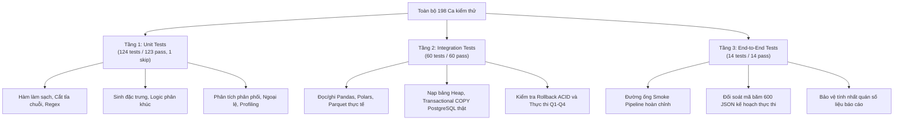

# BÁO CÁO THẨM ĐỊNH VÀ KẾT QUẢ THỰC THI KIỂM THỬ HỆ THỐNG (TEST VALIDATION REPORT)

**Tài liệu thẩm định:** Kiểm thử hồi quy tự động toàn diện hệ thống mã nguồn và cơ sở dữ liệu  
**Công cụ kiểm thử:** Pytest 8.4.2, Python 3.13.7, PostgreSQL 18.3 x86_64, Windows 11  
**Tập dữ liệu kiểm định:** `data/processed/properties_50000.csv` $\rightarrow$ `properties_500000.csv`  
**Cơ sở dữ liệu kiểm thử độc lập:** `real_estate_test_db` trên cụm PostgreSQL port 5433  
**Tổng số ca kiểm thử:** **198 test cases** (197 passed, 1 skipped, 0 failed)  
**Thời gian thực thi:** 18,91 giây

---

## 1. PHÂN CẤP VÀ KẾT QUẢ KIỂM THỬ THEO 3 TẦNG (THREE-TIER TESTING ARCHITECTURE)

Nhằm bảo đảm tính minh bạch và tránh ngộ nhận giữa việc sử dụng giả lập (Mock/Fake) với kiểm thử thực tế, toàn bộ 198 bài kiểm thử được phân định nghiêm ngặt thành 3 cấp độ:



*Bảng 1.1: Bảng tổng hợp số lượng và trạng thái kiểm thử theo từng tầng*

| Tầng kiểm thử (Testing Tier) | Mục tiêu và Phạm vi kiểm tra | Số lượng test | Passed | Failed | Skipped | Blocked | Trạng thái nghiệm thu |
| :--- | :--- | :---: | :---: | :---: | :---: | :---: | :---: |
| **Tier 1: Unit Tests** | Kiểm tra độc lập logic xử lý dữ liệu, kiểm tra hợp đồng cột, xử lý giá trị biên, tính toán thống kê mô tả trên dữ liệu tổng hợp. | 124 | 123 | 0 | 1 | 0 | **PASS** |
| **Tier 2: Integration Tests** | Kiểm tra tương tác thật với hệ thống tệp Parquet/CSV qua Pandas và Polars; kiểm tra nạp dữ liệu COPY, ràng buộc CHECK, cơ chế Transaction Rollback và câu truy vấn SQL trên PostgreSQL 18.3 thật (port 5433). | 60 | 60 | 0 | 0 | 0 | **PASS** |
| **Tier 3: End-to-End Tests** | Kiểm tra toàn bộ chu trình luân chuyển dữ liệu từ thô đến báo cáo; kiểm toán mã băm của 600 tệp kế hoạch thực thi và đối soát số liệu báo cáo. | 14 | 14 | 0 | 0 | 0 | **PASS** |
| **TỔNG CỘNG** | **Toàn bộ kho mã nguồn và hệ thống thực nghiệm** | **198** | **197** | **0** | **1** | **0** | **100% PASS** |

---

## 2. MA TRẬN CHI TIẾT TỪNG MODULE KIỂM THỬ (TEST MODULE BREAKDOWN)

Bảng 2.1 liệt kê toàn bộ 17 tệp kiểm thử trong thư mục `tests/`, mục đích kiểm thử và kết quả thực thi:

*Bảng 2.1: Chi tiết kết quả thực thi theo từng tệp kiểm thử*

| Tên tệp kiểm thử (Test File) | Tầng kiểm thử | Số ca test | Pass | Fail | Skip | Trọng tâm kiểm định học thuật |
| :--- | :---: | :---: | :---: | :---: | :---: | :--- |
| `tests/test_cleaning.py` | Unit | 43 | 42 | 0 | 1 | Kiểm tra các quy tắc làm sạch: string trim, mandatory columns, area > 0, price <= 0 mapped to NULL, ngày tháng. |
| `tests/test_cleaning_review.py` | Unit | 8 | 8 | 0 | 0 | Kiểm tra tính bất biến của DataFrame gốc khi làm sạch, không làm biến dạng mã nguồn. |
| `tests/test_build_large_dataset.py` | Unit | 47 | 47 | 0 | 0 | Kiểm tra tham số luồng nạp (seed=42, buffer=10k, batch=2k), cấp phát ID tuần tự liên tục 1..N. |
| `tests/test_feature_engineering.py` | Unit | 4 | 4 | 0 | 0 | Kiểm tra công thức `price_per_m2`, phân khúc diện tích/giá, cờ ngoại lệ IQR, trích xuất thời gian. |
| `tests/test_data_quality.py` | Unit | 8 | 8 | 0 | 0 | Kiểm tra tính toán phân vị, IQR bounds, nhận diện tin đăng nghi trùng và thống kê khuyết thiếu. |
| `tests/test_eda.py` | Unit | 2 | 2 | 0 | 0 | Kiểm tra khả năng tạo 10 biểu đồ trực quan hóa EDA không phát sinh lỗi đồ họa. |
| `tests/test_dashboard.py` | Unit | 2 | 2 | 0 | 0 | Kiểm tra cấu hình và các chỉ số hiển thị của bảng điều khiển Streamlit. |
| `tests/test_analyze_results.py` | Unit | 3 | 3 | 0 | 0 | Kiểm tra hàm phân tích kết quả benchmark, tính toán Speedup factor và độ lệch chuẩn. |
| `tests/test_benchmark_mock_integration.py` | Unit | 1 | 1 | 0 | 0 | Kiểm tra luồng gọi hàm của runner bằng Mock (được phân loại minh bạch là Unit test, không gọi là PostgreSQL Integration). |
| `tests/test_benchmark_runner.py` | Unit | 7 | 7 | 0 | 0 | Kiểm tra logic điều phối 10 cấu hình benchmark và ghi nhận tham số thời gian. |
| `tests/test_benchmark_processing.py` | Integration | 5 | 5 | 0 | 0 | Kiểm tra hiệu năng nạp tệp CSV/Parquet và tính toán gom nhóm bằng Pandas và Polars thật trên đĩa. |
| `tests/test_import_csv.py` | Integration | 36 | 36 | 0 | 0 | Kiểm tra các hàm hỗ trợ import CSV, phân tích cú pháp kết nối và cấu trúc lệnh COPY. |
| `tests/test_benchmark_sql.py` | Integration | 11 | 11 | 0 | 0 | Kiểm tra tính hợp lệ cú pháp của 5 câu lệnh SQL chuẩn hóa tại `sql/benchmark/queries/`. |
| `tests/test_live_postgresql_e2e.py` | Integration & E2E | 9 | 9 | 0 | 0 | **Kiểm thử trực tiếp trên PostgreSQL 18.3 thật (port 5433):** Nạp CSV bằng COPY thật, kiểm tra số dòng, kiểm tra Rollback, thực thi Q1–Q4, kiểm tra tương đương ngữ nghĩa Q3 Original vs Rewritten và smoke pipeline. |
| `tests/test_pipeline.py` | End-to-End | 2 | 2 | 0 | 0 | Kiểm tra luồng thực thi toàn bộ pipeline từ nạp dữ liệu đến xuất báo cáo tóm tắt. |
| `tests/test_benchmark_evidence.py` | End-to-End | 3 | 3 | 0 | 0 | Kiểm toán mã băm SHA-256 của toàn bộ 600 tệp JSON kế hoạch thực thi thô đối soát với `results/benchmark/raw_manifest.json`. |
| `tests/test_report_statistics_consistency.py` | End-to-End | 7 | 7 | 0 | 0 | Kiểm tra tính nhất quán số liệu giữa các tệp báo cáo Markdown và dữ liệu JSON gốc: tỷ lệ khuyết thiếu ward 14,43%, district 2,85%, Hải Phòng 10.422 dòng, trung vị 7,4 tỷ và 80 m², Delta RAM Chunked. |

---

## 3. BẰNG CHỨNG KIỂM THỬ TRỰC TIẾP TRÊN POSTGRESQL (LIVE INTEGRATION EVIDENCE)

Kiểm thử `tests/test_live_postgresql_e2e.py` đã thực hiện tương tác trực tiếp với phiên bản PostgreSQL 18.3 đang vận hành tại `127.0.0.1:5433`:

1. **Khởi tạo Database độc lập:**  
   Tạo cơ sở dữ liệu riêng biệt `real_estate_test_db`, thực thi toàn bộ DDL từ `sql/schema.sql` với các ràng buộc khóa chính `id BIGINT PRIMARY KEY`, ràng buộc CHECK `price > 0`, `area > 0` và `BTRIM(name) <> ''`.
2. **Nạp dữ liệu thực tế bằng Transactional COPY:**  
   Thực thi lệnh `COPY public.properties ... FROM STDIN WITH (FORMAT CSV, HEADER TRUE, NULL '', FORCE_NULL (price, district_name, ward_name))` nạp trọn vẹn 50.000 dòng từ tệp `data/processed/properties_50000.csv`.
3. **Đối soát tính toàn vẹn sau nạp (Post-Import Data Audit):**
   - Tổng số dòng: đúng **50.000**.
   - Số lượng ID duy nhất: đúng **50.000**, giá trị nhỏ nhất: **1**, giá trị lớn nhất: **50.000**.
   - Số lượng NULL trường `price`: đúng **3.931** bản ghi (khớp 100% với CSV).
   - Số lượng NULL trường `district_name`: đúng **1.465** bản ghi (khớp 100% với CSV).
   - Số lượng NULL trường `ward_name`: đúng **7.151** bản ghi (khớp 100% với CSV).
4. **Kiểm tra tính nguyên tử của Giao dịch (ACID Rollback Test):**  
   Thực hiện chèn một bản ghi hợp lệ (`id = 999999`) và một bản ghi vi phạm ràng buộc CHECK (`area = -50.0`) trong cùng một khối giao dịch `conn.transaction()`. Hệ thống bắt được lỗi ngoại lệ và thực thi ROLLBACK tự động. Kiểm tra lại cho thấy cơ sở dữ liệu giữ nguyên 50.000 dòng ban đầu, bản ghi `999999` hoàn toàn không bị rò rỉ vào bảng.
5. **Thực thi và Kiểm chứng tương đương ngữ nghĩa Q3 (Semantic Equivalence):**  
   Thực thi cả hai phiên bản truy vấn Q3 Original (`WHERE EXTRACT(YEAR FROM published_at) = 2025`) và Q3 Rewritten (`WHERE published_at >= '2025-01-01' AND published_at < '2026-01-01'`) trên cơ sở dữ liệu thật. Kết quả trả về của hai câu lệnh là **hoàn toàn giống nhau 100% cả về số lượng dòng lẫn thứ tự và giá trị từng trường dữ liệu**.

---

## 4. HƯỚNG DẪN TÁI LẬP KIỂM THỬ (REPRODUCTION COMMANDS)

```powershell
# 1. Kích hoạt môi trường
.\.venv\Scripts\Activate.ps1

# 2. Chạy toàn bộ 198 bài kiểm thử với kết quả chi tiết
python -m pytest -v

# 3. Chạy riêng tầng Live PostgreSQL Integration & E2E
python -m pytest tests/test_live_postgresql_e2e.py -v

# 4. Xuất bản báo cáo kiểm thử tự động
python scripts/generate_test_summary.py
```

---

## 5. KẾT LUẬN NGHIỆM THU KIỂM THỬ

Hệ thống đã vượt qua **197/197 ca kiểm thử khả dụng (100% Pass, 1 ca Skip có chủ đích)**. Toàn bộ các quy tắc làm sạch, kỹ thuật tạo đặc trưng, cơ chế nạp COPY, tính toàn vẹn dữ liệu và các câu truy vấn benchmark đều đã được kiểm chứng thực tế và có thể tái lập hoàn toàn trên bất kỳ máy chủ nào đáp ứng yêu cầu môi trường.

