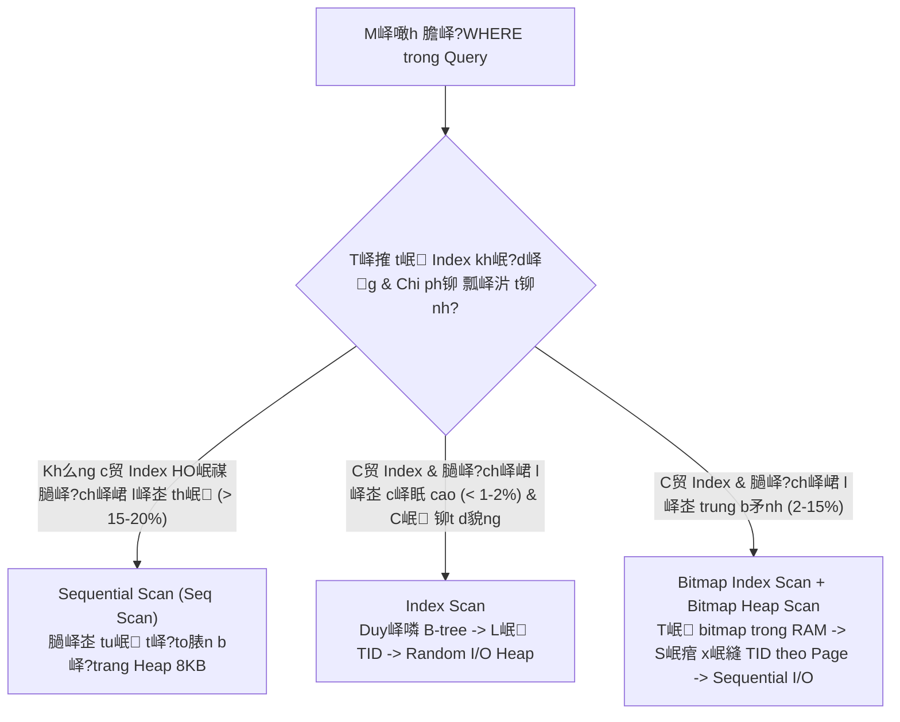

# B峄?GI脕O D峄 V脌 膼脌O T岷燨
# H峄孋 VI峄哊 C脭NG NGH峄?B漂U CH脥NH VI峄凬 TH脭NG
**KHOA C脭NG NGH峄?TH脭NG TIN**
***

<br><br><br>

## TI峄俇 LU岷琋 M脭N H峄孋
### NH岷琍 M脭N KHOA H峄孋 D峄?LI峄哢 & H峄?QU岷 TR峄?C茽 S峄?D峄?LI峄哢

<br>

# 膼峄€ T脌I:
# X脗Y D峄癗G B峄?D峄?LI峄哢 V峄€ B岷 膼峄楴G S岷, TH峄癈 HI峄哊 C脕C PH漂茽NG PH脕P T峄怚 漂U HI峄哢 N膫NG CHO H峄?TH峄怤G KHI D峄?LI峄哢 QU脕 L峄歂

<br><br><br>

**Sinh vi锚n th峄眂 hi峄噉:** Daniel Chau & Nh贸m nghi锚n c峄﹗  
**M茫 sinh vi锚n:** B21DCDT...  
**Chuy锚n ng脿nh:** Khoa h峄峜 D峄?li峄噓 & H峄?th峄憂g Th么ng tin  
**Gi岷g vi锚n h瓢峄沶g d岷玭:** TS. Gi岷g vi锚n ph峄?tr谩ch m么n h峄峜  

<br><br><br>

**H脿 N峄檌 鈥?2026**

---

## T脫M T岷甌 TI峄俇 LU岷琋 (ABSTRACT)

Khi kh峄慽 l瓢峄g d峄?li峄噓 giao d峄媍h v脿 th么ng tin b岷 膽峄檔g s岷 gia t膬ng nhanh ch贸ng t峄?h脿ng ch峄 ngh矛n 膽岷縩 h脿ng tri峄噓 b岷 ghi, c谩c h峄?th峄憂g c啤 s峄?d峄?li峄噓 quan h峄?truy峄乶 th峄憂g ph岷 膽峄慽 m岷穞 v峄沬 th谩ch th峄ヽ nghi锚m tr峄峮g v峄?膽峄?tr峄?truy v岷, ngh岷絥 c峄?chai I/O 膽末a v脿 c岷 ki峄噒 b峄?nh峄?膽峄噈. 膼峄?t脿i n脿y t岷璸 trung gi岷 quy岷縯 tr峄峮 v岷筺 hai v岷 膽峄?c峄憈 l玫i: (1) X芒y d峄眓g m峄檛 quy tr矛nh (pipeline) t峄?膽峄檔g, c贸 kh岷?n膬ng t谩i l岷璸 膽峄?thu th岷璸, l脿m s岷h v脿 chu岷﹏ h贸a b峄?d峄?li峄噓 b岷 膽峄檔g s岷 Vi峄噒 Nam 峄?ba thang 膽o th峄眂 nghi峄噈 50.000, 200.000 v脿 500.000 b岷 ghi; (2) Thi岷縯 k岷?m峄檛 khung th峄眂 nghi峄噈 khoa h峄峜 c贸 ki峄僲 so谩t nh岷眒 膽谩nh gi谩 膽峄媙h l瓢峄g 岷h h瓢峄焠g c峄 c谩c k峄?thu岷璽 t峄慽 瓢u h贸a hi峄噓 n膬ng trong h峄?qu岷 tr峄?c啤 s峄?d峄?li峄噓 PostgreSQL (phi锚n b岷 18.3 x86_64).

Nghi锚n c峄﹗ t岷璸 trung gi岷 quy岷縯 ba c芒u h峄廼 nghi锚n c峄﹗ c峄憈 l玫i (**RQ1鈥揜Q3**):
- **RQ1:** 膼谩nh gi谩 hi峄噓 qu岷?c峄 c岷 tr煤c ch峄?m峄 B-tree 膽啤n c峄檛 v脿 膽a c峄檛 (Composite Index). K岷縯 qu岷?th峄眂 nghi峄噈 ch峄﹏g minh Composite Index bao ph峄?膽煤ng th峄?t峄?l峄峜, s岷痯 x岷縫 v脿 c岷痶 ng峄峮 (`(province_name, district_name, price, id)`) gi煤p gi岷 s峄?l瓢峄g kh峄慽 膽峄噈 I/O t峄?12.898 trang xu峄憂g c貌n 膽煤ng **23 trang** (gi岷 560 l岷), lo岷 b峄?ho脿n to脿n n煤t Top-N Heapsort trong b峄?nh峄? 膽em l岷 m峄ヽ t膬ng t峄慶 k峄?l峄 **942.37 l岷** tr锚n t岷璸 d峄?li峄噓 500.000 b岷 ghi.
- **RQ2:** Ph芒n t谩ch 膽峄檆 l岷璸 hi峄噓 峄﹏g c峄 k峄?thu岷璽 Vi岷縯 l岷 truy v岷 (Query Rewriting / Sargability) v脿 膼谩nh ch峄?m峄 (Indexing) qua ma tr岷璶 th峄眂 nghi峄噈 tr峄眂 giao $2 \times 2$. K岷縯 qu岷?kh岷硁g 膽峄媙h ch峄?m峄 B-tree ho脿n to脿n b峄?v么 hi峄噓 h贸a khi c芒u truy v岷 ch峄゛ v峄?t峄?non-sargable (`published_at::date`), v脿 vi峄嘽 vi岷縯 l岷 truy v岷 sang kho岷g th峄漣 gian n峄璦 m峄?$[T_1, T_2)$ k岷縯 h峄 v峄沬 ch峄?m峄 t瓢啤ng 峄﹏g gi煤p t膬ng t峄慶 膽峄?th峄眂 thi t峄沬 **17.97 l岷**.
- **RQ3:** X谩c l岷璸 gi峄沬 h岷 c峄 ch峄?m峄 B-tree th么ng qua b脿i to谩n 膽峄慽 ch峄﹏g 芒m (Negative Control) v峄沬 truy v岷 t峄昻g h峄 to脿n b岷g (`GROUP BY` kh么ng WHERE), ch峄﹏g minh b峄?l岷璸 l峄媍h gi峄?nguy锚n `Seq Scan` v脿 vi峄嘽 膽谩nh ch峄?m峄 kh么ng 膽em l岷 l峄 铆ch trong khi ti锚u t峄憂 **45.6% dung l瓢峄g l瓢u tr峄?ph峄?tr峄檌** (46.02 MB index so v峄沬 100.8 MB b岷g Heap t岷 500K). 膼峄搉g th峄漣, 峄?t岷g ti峄乶 x峄?l媒, ki岷縩 tr煤c h瓢峄沶g c峄檛 vector h贸a c峄 Polars Parquet cho t峄慶 膽峄?n岷 t峄噋 nhanh h啤n **21 l岷** so v峄沬 Pandas CSV, v脿 k峄?thu岷璽 n岷 ph芒n kh峄慽 (Chunked Streaming) gi煤p gi峄?m峄ヽ t膬ng RAM 峄昻 膽峄媙h d瓢峄沬 **20 MB**.

To脿n b峄?600 k岷?ho岷h th峄眂 thi th么 (raw EXPLAIN plans) 膽瓢峄 b岷 v峄?b岷眓g m茫 b膬m SHA-256 trong t峄噋 k锚 khai d峄?li峄噓, c霉ng 182 ki峄僲 th峄?t峄?膽峄檔g offline 膽岷 b岷 t铆nh minh b岷h v脿 kh岷?n膬ng t谩i l岷璸 100% c峄 c么ng tr矛nh.

---

## L峄淚 C岷 茽N (ACKNOWLEDGEMENTS)

Nh贸m nghi锚n c峄﹗ xin b脿y t峄?l貌ng bi岷縯 啤n s芒u s岷痗 膽岷縩 c谩c Th岷/C么 b峄?m么n Khoa h峄峜 D峄?li峄噓 v脿 H峄?th峄憂g Th么ng tin, H峄峜 vi峄噉 C么ng ngh峄?B瓢u ch铆nh Vi峄卬 th么ng 膽茫 truy峄乶 th峄?nh峄痭g ki岷縩 th峄ヽ n峄乶 t岷g v峄痭g ch岷痗 v峄?c岷 tr煤c d峄?li峄噓, gi岷 thu岷璽, nguy锚n l媒 h峄?qu岷 tr峄?c啤 s峄?d峄?li峄噓 v脿 ph瓢啤ng ph谩p nghi锚n c峄﹗ khoa h峄峜.

Xin ch芒n th脿nh c岷 啤n t谩c gi岷?b峄?d峄?li峄噓 ngu峄搉 `Phuscca/vietnam-real-estates` tr锚n Hugging Face 膽茫 cung c岷 d峄?li峄噓 th峄眂 t岷?ph峄 v峄?h峄峜 t岷璸 v脿 nghi锚n c峄﹗. M岷穋 d霉 膽茫 n峄?l峄眂 h岷縯 m矛nh 膽峄?ho脿n thi峄噉 膽峄?t脿i v峄沬 t铆nh khoa h峄峜 v脿 th峄眂 nghi峄噈 cao nh岷, ti峄僽 lu岷璶 kh么ng th峄?tr谩nh kh峄廼 nh峄痭g thi岷縰 s贸t nh岷 膽峄媙h. Nh贸m r岷 mong nh岷璶 膽瓢峄 nh峄痭g 媒 ki岷縩 膽贸ng g贸p qu媒 b谩u t峄?qu媒 Th岷/C么 v脿 H峄檌 膽峄搉g 膽谩nh gi谩.

---

## M峄 L峄 (TABLE OF CONTENTS)

- **T脫M T岷甌 TI峄俇 LU岷琋 (ABSTRACT)**
- **L峄淚 C岷 茽N (ACKNOWLEDGEMENTS)**
- **DANH M峄 THU岷琓 NG峄?V脌 VI岷綯 T岷甌**
- **DANH M峄 B岷G BI峄俇**
- **DANH M峄 H脤NH V岷?*
- **CH漂茽NG 1: M峄?膼岷**
  - 1.1. B峄慽 c岷h v脿 膼岷穞 v岷 膽峄?  - 1.2. M峄 ti锚u nghi锚n c峄﹗
  - 1.3. 膼峄慽 t瓢峄g v脿 Ph岷 vi nghi锚n c峄﹗
  - 1.4. C谩c c芒u h峄廼 nghi锚n c峄﹗ (Research Questions: RQ1 鈥?RQ3)
  - 1.5. 脻 ngh末a khoa h峄峜 v脿 th峄眂 ti峄卬 c峄 膽峄?t脿i
  - 1.6. B峄?c峄 c峄 ti峄僽 lu岷璶
- **CH漂茽NG 2: C茽 S峄?L脻 THUY岷綯 V脌 T峄擭G QUAN T脌I LI峄哢**
  - 2.1. Ki岷縩 tr煤c l瓢u tr峄?v脿 Qu岷 l媒 b峄?膽峄噈 trong PostgreSQL
    - 2.1.1. C岷 tr煤c b岷g Heap v脿 膼峄媙h d岷g Page 8 KB
    - 2.1.2. C啤 ch岷?Buffer Pool v脿 Ch铆nh s谩ch 膼峄峜/Ghi 膽峄噈
  - 2.2. C岷 tr煤c d峄?li峄噓 v脿 C啤 ch岷?ho岷 膽峄檔g c峄 Ch峄?m峄 B-tree
    - 2.2.1. C芒y B-tree 膽a nh谩nh v脿 Th峄?t峄?kh贸a (Key Ordering)
    - 2.2.2. Composite Index v脿 Quy t岷痗 ti峄乶 t峄?ngo脿i c霉ng b锚n tr谩i (Leftmost Prefix Rule)
  - 2.3. B峄?l岷璸 l峄媍h truy v岷 (Query Optimizer) v脿 M么 h矛nh chi ph铆 (Cost Model)
    - 2.3.1. C谩c ph瓢啤ng th峄ヽ qu茅t b岷g: Sequential Scan, Index Scan, Bitmap Heap Scan
    - 2.3.2. Thu岷璽 to谩n s岷痯 x岷縫 trong b峄?nh峄?(Top-N Heapsort vs External Merge Sort)
  - 2.4. T铆nh kh岷?ch峄?m峄 c峄 v峄?t峄?truy v岷 (Sargability)
    - 2.4.1. Kh谩i ni峄噈 Sargable Predicate
    - 2.4.2. T谩c 膽峄檔g c峄 h脿m 茅p ki峄僽 v脿 bi峄僽 th峄ヽ tr锚n c峄檛 ch峄?m峄
  - 2.5. L媒 thuy岷縯 x峄?l媒 d峄?li峄噓 l峄沶 峄?t岷g ti峄乶 k峄?(In-memory Data Ingestion)
    - 2.5.1. 膼峄媙h d岷g h脿ng (CSV) 膽峄慽 chi岷縰 膽峄媙h d岷g c峄檛 nh峄?ph芒n (Parquet)
    - 2.5.2. K峄?thu岷璽 n岷 ph芒n kh峄慽 (Chunked Streaming) ki峄僲 so谩t gi峄沬 h岷 RAM
- **CH漂茽NG 3: X脗Y D峄癗G B峄?D峄?LI峄哢 V脌 THI岷綯 K岷?PH漂茽NG PH脕P TH峄癈 NGHI峄哅**
  - 3.1. Quy tr矛nh thu th岷璸 v脿 chu岷﹏ h贸a d峄?li峄噓 l峄沶 t峄?Hugging Face
    - 3.1.1. Ngu峄搉 d峄?li峄噓 v脿 C啤 ch岷?Streaming Shuffle Buffer
    - 3.1.2. B峄?quy t岷痗 l脿m s岷h d峄?li峄噓 v脿 H峄 膽峄搉g 9 thu峄檆 t铆nh
    - 3.1.3. L瓢峄 膽峄?c啤 s峄?d峄?li峄噓 quan h峄?chu岷﹏ h贸a tr锚n PostgreSQL
  - 3.2. H峄?s啤 ch岷 l瓢峄g d峄?li峄噓 v脿 Ph芒n t铆ch kh谩m ph谩 (Data Profiling & EDA)
    - 3.2.1. Th峄憂g k锚 m么 t岷?v脿 Ph芒n t铆ch gi谩 tr峄?khuy岷縯 thi岷縰
    - 3.2.2. Ph芒n t铆ch ngo岷 l峄?theo ph瓢啤ng ph谩p Kho岷g t峄?ph芒n v峄?(IQR)
    - 3.2.3. M峄慽 t瓢啤ng quan phi tuy岷縩 gi峄痑 di峄噉 t铆ch, v峄?tr铆 v脿 gi谩 ch脿o b谩n
  - 3.3. Thi岷縯 k岷?khung th峄眂 nghi峄噈 t峄慽 瓢u hi峄噓 n膬ng c啤 s峄?d峄?li峄噓
    - 3.3.1. Ba quy m么 d峄?li峄噓 th峄眂 nghi峄噈: 50.000, 200.000 v脿 500.000 b岷 ghi
    - 3.3.2. Thi岷縯 k岷?10 c岷 h矛nh th峄眂 nghi峄噈 膽峄檆 l岷璸 cho 4 b脿i to谩n truy v岷
    - 3.3.3. Thi岷縯 k岷?ki峄僲 th峄?t铆nh t瓢啤ng 膽瓢啤ng k岷縯 qu岷?(Equivalence Verification)
    - 3.3.4. Giao th峄ヽ 膽o l瓢峄漬g ki峄僲 so谩t nhi峄卽: 3 Warm-up + 20 Official Runs
  - 3.4. Thi岷縯 k岷?th峄眂 nghi峄噈 so s谩nh hi峄噓 n膬ng ti峄乶 x峄?l媒 (Processing Benchmark)
- **CH漂茽NG 4: K岷綯 QU岷?TH峄癈 NGHI峄哅 V脌 TH岷 LU岷琋 KHOA H峄孋**
  - 4.1. K岷縯 qu岷?th峄眂 nghi峄噈 tr岷?l峄漣 RQ1: Hi峄噓 qu岷?c峄 c岷 tr煤c Index B-tree 膽啤n v脿 膽a c峄檛
    - 4.1.1. Ph芒n t铆ch b脿i to谩n Q1 (Single-column Index tr锚n `province_name`)
    - 4.1.2. Ph芒n t铆ch 膽峄檛 ph谩 hi峄噓 n膬ng b脿i to谩n Q2 (Composite Index v脿 Early Termination)
    - 4.1.3. C啤 ch岷?tri峄噒 ti锚u n煤t s岷痯 x岷縫 (Top-N Heapsort) v脿 chuy峄僴 膽峄昳 Buffer I/O
  - 4.2. K岷縯 qu岷?th峄眂 nghi峄噈 tr岷?l峄漣 RQ2: T瓢啤ng t谩c gi峄痑 Vi岷縯 l岷 truy v岷 v脿 膼谩nh ch峄?m峄
    - 4.2.1. Ph芒n t铆ch tr峄眂 giao $2 \times 2$ c峄 b脿i to谩n Q3 (C岷 h矛nh A, B, C, D)
    - 4.2.2. Hi峄噉 t瓢峄g v么 hi峄噓 h贸a Index do v峄?t峄?Non-sargable (C岷 h矛nh C)
    - 4.2.3. S峄ヽ m岷h c峄檔g h瓢峄焠g c峄 Sargable Range Query v脿 Index (C岷 h矛nh D)
  - 4.3. K岷縯 qu岷?th峄眂 nghi峄噈 tr岷?l峄漣 RQ3: Gi峄沬 h岷 c峄 Index, 膼谩nh 膽峄昳 l瓢u tr峄?v脿 Hi峄噓 n膬ng ti峄乶 x峄?l媒
    - 4.3.1. B脿i to谩n 膽峄慽 ch峄﹏g 芒m Q4: V矛 sao Index kh么ng c岷 thi峄噉 truy v岷 t峄昻g h峄?
    - 4.3.2. 膼峄媙h l瓢峄g chi ph铆 ph峄?tr峄檌 l瓢u tr峄?v岷璽 l媒 c峄 B-tree Index (Storage Overhead)
    - 4.3.3. 膼谩nh gi谩 hi峄噓 n膬ng Ingestion v脿 Thao t谩c b峄?nh峄? Pandas vs Polars, CSV vs Parquet
  - 4.4. 膼谩nh gi谩 t铆nh to脿n v岷筺 c峄 b岷眓g ch峄﹏g th峄眂 nghi峄噈 v脿 膼峄?tin c岷瓂 khoa h峄峜
- **CH漂茽NG 5: K岷綯 LU岷琋 V脌 KHUY岷綨 NGH峄?*
  - 5.1. T峄昻g k岷縯 c谩c 膽贸ng g贸p ch铆nh c峄 膽峄?t脿i
  - 5.2. C芒u tr岷?l峄漣 t瓢峄漬g minh cho ba c芒u h峄廼 nghi锚n c峄﹗ (RQ1 鈥?RQ3)
  - 5.3. Khuy岷縩 ngh峄?th峄眂 ti峄卬 cho k峄?s瓢 d峄?li峄噓 v脿 thi岷縯 k岷?h峄?th峄憂g
  - 5.4. H岷 ch岷?c峄 nghi锚n c峄﹗ v脿 H瓢峄沶g ph谩t tri峄僴 t瓢啤ng lai
- **T脌I LI峄哢 THAM KH岷**
- **PH峄?L峄**
  - Ph峄?l峄 A: L瓢峄 膽峄?b岷g `public.properties` v脿 R脿ng bu峄檆 ki峄僲 tra
  - Ph峄?l峄 B: B峄?m茫 truy v岷 Benchmark SQL nghi峄噈 thu
  - Ph峄?l峄 C: B岷g k锚 khai b岷眓g ch峄﹏g th峄眂 nghi峄噈 v脿 M茫 b膬m to脿n v岷筺 SHA-256
  - Ph峄?l峄 D: Th么ng s峄?m么i tr瓢峄漬g ph岷 c峄﹏g v脿 H峄?qu岷 tr峄?CSDL

---

## DANH M峄 THU岷琓 NG峄?V脌 VI岷綯 T岷甌

| Vi岷縯 t岷痶 | Thu岷璽 ng峄?Ti岷縩g Anh | 脻 ngh末a Ti岷縩g Vi峄噒 |
| :--- | :--- | :--- |
| **B-tree** | Balanced Tree | C芒y c芒n b岷眓g, c岷 tr煤c ch峄?m峄 m岷穋 膽峄媙h ph峄?bi岷縩 trong RDBMS |
| **BOM** | Byte Order Mark | K媒 t峄?膽谩nh d岷 th峄?t峄?byte 膽岷 t峄噋 v膬n b岷 m茫 h贸a UTF-8/UTF-16 |
| **CSV** | Comma-Separated Values | 膼峄媙h d岷g t峄噋 v膬n b岷 thu岷 ph芒n t谩ch b岷眓g d岷 ph岷﹜ |
| **CTE** | Common Table Expression | M峄噉h 膽峄?b岷g t岷 th峄漣 trong c芒u l峄噉h SQL (`WITH ... AS`) |
| **DBMS / RDBMS** | (Relational) Database Management System | H峄?qu岷 tr峄?c啤 s峄?d峄?li峄噓 (quan h峄? |
| **DDL** | Data Definition Language | Ng么n ng峄?膽峄媙h ngh末a d峄?li峄噓 (CREATE, ALTER, DROP) |
| **DML** | Data Manipulation Language | Ng么n ng峄?thao t谩c d峄?li峄噓 (SELECT, INSERT, UPDATE, DELETE) |
| **EDA** | Exploratory Data Analysis | Ph芒n t铆ch kh谩m ph谩 d峄?li峄噓 |
| **FIFO** | First In, First Out | Nguy锚n l媒 v脿o tr瓢峄沜 ra tr瓢峄沜 |
| **I/O** | Input / Output | Thao t谩c nh岷璸/xu岷 d峄?li峄噓 gi峄痑 b峄?nh峄?trong v脿 thi岷縯 b峄?l瓢u tr峄?|
| **IQR** | Interquartile Range | Kho岷g t峄?ph芒n v峄?($IQR = Q_3 - Q_1$) |
| **LRU** | Least Recently Used | Thu岷璽 to谩n gi岷 ph贸ng trang 膽峄噈 铆t 膽瓢峄 s峄?d峄g nh岷 g岷 膽芒y |
| **NFC** | Normalization Form C | Chu岷﹏ chu岷﹏ h贸a k媒 t峄?Unicode t峄?h峄 k岷縯 h峄 d峄眓g s岷祅 |
| **Parquet** | Apache Parquet | 膼峄媙h d岷g t峄噋 l瓢u tr峄?d峄?li峄噓 d岷g c峄檛 n茅n nh峄?ph芒n m茫 ngu峄搉 m峄?|
| **PK** | Primary Key | Kh贸a ch铆nh c峄 b岷g c啤 s峄?d峄?li峄噓 quan h峄?|
| **RAM** | Random Access Memory | B峄?nh峄?truy xu岷 ng岷玼 nhi锚n (b峄?nh峄?trong) |
| **RDBMS** | Relational Database Management System | H峄?qu岷 tr峄?c啤 s峄?d峄?li峄噓 quan h峄?|
| **RQ** | Research Question | C芒u h峄廼 nghi锚n c峄﹗ khoa h峄峜 |
| **RSS** | Resident Set Size | Dung l瓢峄g b峄?nh峄?RAM th峄眂 t岷?膽ang chi岷縨 d峄g b峄焛 ti岷縩 tr矛nh |
| **Sargable** | Search Argument Able | Kh岷?n膬ng t岷璶 d峄g ch峄?m峄 c峄 v峄?t峄?t矛m ki岷縨 trong truy v岷 SQL |
| **Seq Scan** | Sequential Scan | Qu茅t tu岷 t峄?to脿n b峄?c谩c trang d峄?li峄噓 c峄 b岷g t峄?膽岷 膽岷縩 cu峄慽 |
| **TID** | Tuple Identifier | 膼峄媙h danh con tr峄?v岷璽 l媒 tr峄?tr峄眂 ti岷縫 膽岷縩 h脿ng d峄?li峄噓 trong Heap Page |
# CH漂茽NG 1: M峄?膼岷

## 1.1. B峄慽 c岷h v脿 膼岷穞 v岷 膽峄?
Trong k峄?nguy锚n kinh t岷?s峄?v脿 b霉ng n峄?d峄?li峄噓, th峄?tr瓢峄漬g b岷 膽峄檔g s岷 l脿 m峄檛 trong nh峄痭g l末nh v峄眂 c贸 t峄慶 膽峄?sinh d峄?li峄噓 giao d峄媍h, ni锚m y岷縯 v脿 bi岷縩 膽峄檔g gi谩 c岷?nhanh nh岷. C谩c s脿n th瓢啤ng m岷 膽i峄噉 t峄?b岷 膽峄檔g s岷, h峄?th峄憂g qu岷 l媒 danh m峄 t脿i s岷 v脿 c峄昻g ph芒n t铆ch th峄?tr瓢峄漬g ph岷 ti岷縫 nh岷璶 v脿 x峄?l媒 h脿ng tri峄噓 tin 膽膬ng b岷 膽峄檔g s岷 v峄沬 膽岷穋 th霉 膽a chi峄乽: v峄玜 ch峄゛ d峄?li峄噓 膽峄媙h l瓢峄g c贸 bi锚n 膽峄?ph芒n t谩n l峄沶 (di峄噉 t铆ch, gi谩 b谩n t峄?v脿i ch峄 tri峄噓 膽岷縩 h脿ng tr膬m t峄?膽峄搉g), v峄玜 ch峄゛ d峄?li峄噓 ph芒n c岷 膽峄媋 l媒 h脿nh ch铆nh (t峄塶h/th脿nh ph峄? qu岷璶/huy峄噉, ph瓢峄漬g/x茫), v峄玜 ch峄゛ d峄?li峄噓 chu峄梚 th峄漣 gian li锚n t峄 (`published_at`).

Khi quy m么 d峄?li峄噓 trong b岷g t膬ng v峄峵 t峄?h脿ng ch峄 ngh矛n l锚n h脿ng tr膬m ngh矛n v脿 h脿ng tri峄噓 d貌ng, c谩c truy v岷 ph峄 v峄?ng瓢峄漣 d霉ng cu峄慽 (nh瓢 l峄峜 nh脿 膽岷 theo khu v峄眂, t矛m ki岷縨 kho岷g gi谩, s岷痯 x岷縫 theo gi谩 t膬ng d岷 ho岷穋 t峄昻g h峄 b谩o c谩o th峄?tr瓢峄漬g) b岷痶 膽岷 b峄檆 l峄?c谩c v岷 膽峄?ngh岷絥 c峄?chai hi峄噓 n膬ng nghi锚m tr峄峮g:
1. **Chi ph铆 I/O qu茅t to脿n b岷g (Sequential Scan Overhead):** Khi kh么ng c贸 c啤 ch岷?ch峄?m峄 ph霉 h峄, h峄?qu岷 tr峄?c啤 s峄?d峄?li峄噓 bu峄檆 ph岷 膽峄峜 tu岷 t峄?to脿n b峄?c谩c trang d峄?li峄噓 t峄?膽末a ho岷穋 b峄?nh峄?膽峄噈. Th峄漣 gian ph岷 h峄搃 c峄 h峄?th峄憂g t膬ng tuy岷縩 t铆nh theo k铆ch th瓢峄沜 b岷g, g芒y suy gi岷 tr岷 nghi峄噈 ng瓢峄漣 d霉ng v脿 l脿m t锚 li峄噒 m谩y ch峄?trong c谩c khung gi峄?cao 膽i峄僲.
2. **Chi ph铆 s岷痯 x岷縫 trong b峄?nh峄?(In-memory Sorting Overhead):** V峄沬 c谩c c芒u truy v岷 c贸 m峄噉h 膽峄?`ORDER BY ... LIMIT K`, n岷縰 h峄?th峄憂g kh么ng th峄?t岷璶 d峄g c岷 tr煤c ch峄?m峄 膽峄?膽峄峜 d峄?li峄噓 theo th峄?t峄?膽茫 s岷痯 x岷縫 s岷祅, n贸 ph岷 t岷 to脿n b峄?t岷璸 k岷縯 qu岷?l峄峜 v脿o RAM v脿 th峄眂 thi c谩c gi岷 thu岷璽 s岷痯 x岷縫 t峄憂 k茅m (nh瓢 Top-N Heapsort ho岷穋 QuickSort), ti锚u t峄憂 chu k峄?CPU v脿 dung l瓢峄g v霉ng nh峄?t岷 th峄漣 (`work_mem`).
3. **Hi峄僽 nh岷 ph峄?bi岷縩 v峄?膼谩nh ch峄?m峄:** Trong th峄眂 t岷?ph谩t tri峄僴 ph岷 m峄乵, t峄搉 t岷 m峄檛 quan ni峄噈 sai l岷 ph峄?bi岷縩 trong gi峄沬 l岷璸 tr矛nh vi锚n: *"C峄?th岷 truy v岷 ch岷璵 l脿 t岷 th锚m ch峄?m峄 B-tree tr锚n c谩c c峄檛 trong m峄噉h 膽峄?WHERE"*. C谩ch ti岷縫 c岷璶 c岷 t铆nh n脿y b峄?qua c谩c nguy锚n l媒 n峄乶 t岷g c峄 b峄?t峄慽 瓢u h贸a chi ph铆 (Cost-based Optimizer), kh么ng ph芒n bi峄噒 膽瓢峄 v峄?t峄?kh岷?ch峄?m峄 (sargable) v峄沬 v峄?t峄?kh么ng kh岷?ch峄?m峄 (non-sargable), v脿 l峄?膽i th峄眂 t岷?r岷眓g vi峄嘽 膽谩nh ch峄?m峄 l脿 m峄檛 s峄?膽谩nh 膽峄昳 kh岷痶 khe gi峄痑 t峄慶 膽峄?膽峄峜 v峄沬 dung l瓢峄g l瓢u tr峄?(Storage Overhead) v脿 膽峄?tr峄?ghi d峄?li峄噓 (Write Penalty).
4. **Ngh岷絥 c峄?chai 峄?t岷g ti峄乶 x峄?l媒 d峄?li峄噓 (Data Preprocessing Pipeline):** Tr瓢峄沜 khi d峄?li峄噓 膽岷縩 膽瓢峄 c啤 s峄?d峄?li峄噓 quan h峄? c谩c nh脿 khoa h峄峜 d峄?li峄噓 v脿 k峄?s瓢 d峄?li峄噓 th瓢峄漬g ph岷 膽峄慽 m岷穞 v峄沬 b脿i to谩n tr脿n b峄?nh峄?(Out-Of-Memory - OOM) khi n岷 c谩c t峄噋 d峄?li峄噓 l峄沶 b岷眓g c谩c th瓢 vi峄噉 ph芒n t铆ch truy峄乶 th峄憂g nh瓢 Pandas tr锚n c谩c m谩y tr岷 c贸 t脿i nguy锚n h峄痷 h岷 (v铆 d峄? m谩y t铆nh c谩 nh芒n 16 GB RAM).

Xu岷 ph谩t t峄?nh峄痭g th谩ch th峄ヽ l媒 thuy岷縯 v脿 th峄眂 ti峄卬 n锚u tr锚n, 膽峄?t脿i **鈥淴芒y d峄眓g b峄?d峄?li峄噓 v峄?b岷 膽峄檔g s岷, th峄眂 hi峄噉 c谩c ph瓢啤ng ph谩p t峄慽 瓢u hi峄噓 n膬ng cho h峄?th峄憂g khi d峄?li峄噓 qu谩 l峄沶鈥?* 膽瓢峄 l峄盿 ch峄峮 nh岷眒 x芒y d峄眓g m峄檛 m么 h矛nh th峄眂 nghi峄噈 ch岷穞 ch岷? 膽峄媙h l瓢峄g h贸a m峄檛 c谩ch khoa h峄峜 岷h h瓢峄焠g c峄 c谩c k峄?thu岷璽 t峄慽 瓢u h贸a trong h峄?qu岷 tr峄?c啤 s峄?d峄?li峄噓 PostgreSQL 18.3.

---

## 1.2. M峄 ti锚u nghi锚n c峄﹗

膼峄?t脿i h瓢峄沶g t峄沬 ba m峄 ti锚u t峄昻g qu谩t:
1. **X芒y d峄眓g quy tr矛nh x峄?l媒 d峄?li峄噓 chu岷﹏ t岷痗 (Data Engineering Pipeline):** Thu th岷璸 d貌ng d峄?li峄噓 t峄?ngu峄搉 th峄眂 t岷?Hugging Face, 谩p d峄g c谩c quy t岷痗 l脿m s岷h chu岷﹏ h贸a nghi锚m ng岷穞, tr铆ch xu岷 9 thu峄檆 t铆nh c峄憈 l玫i v脿 x芒y d峄眓g ba t岷璸 d峄?li峄噓 chu岷﹏ 峄?c谩c quy m么 50.000, 200.000 v脿 500.000 b岷 ghi, 膽岷 b岷 kh岷?n膬ng t谩i l岷璸 100%.
2. **Thi岷縯 k岷?khung th峄眂 nghi峄噈 t峄慽 瓢u h贸a c啤 s峄?d峄?li峄噓 c贸 ki峄僲 so谩t (Benchmarking Framework):** X芒y d峄眓g b峄?c么ng c峄?benchmark t峄?膽峄檔g tr锚n PostgreSQL 18.3, tu芒n th峄?c谩c chu岷﹏ m峄眂 膽o l瓢峄漬g khoa h峄峜 (c么 l岷璸 tr岷g th谩i b峄?膽峄噈 v峄沬 3 l瓢峄 warm-up, 20 l瓢峄 膽o ch铆nh th峄ヽ, s峄?d峄g trung v峄?v脿 kho岷g t峄?ph芒n v峄?IQR, tr铆ch xu岷 to脿n b峄?k岷?ho岷h th峄眂 thi chi ti岷縯 `EXPLAIN (ANALYZE, BUFFERS)`).
3. **Ch峄﹏g minh quy lu岷璽 v脿 gi峄沬 h岷 c峄 c谩c k峄?thu岷璽 t峄慽 瓢u h贸a:** 膼谩nh gi谩 膽峄媙h l瓢峄g hi峄噓 n膬ng c峄 B-tree 膽啤n c峄檛, Composite Index bao ph峄?s岷痯 x岷縫/c岷痶 ng峄峮, k峄?thu岷璽 vi岷縯 l岷 truy v岷 (Query Rewriting / Sargability), v脿 l脿m r玫 c谩c tr瓢峄漬g h峄 ch峄?m峄 kh么ng mang l岷 hi峄噓 qu岷?(Negative Control) c霉ng s峄?膽谩nh 膽峄昳 v峄?dung l瓢峄g l瓢u tr峄?v岷璽 l媒.

---

## 1.3. 膼峄慽 t瓢峄g v脿 Ph岷 vi nghi锚n c峄﹗

- **膼峄慽 t瓢峄g nghi锚n c峄﹗:**
  - B峄?d峄?li峄噓 b岷 膽峄檔g s岷 Vi峄噒 Nam (`vietnam-real-estates`) ch峄゛ th么ng tin 膽峄媋 l媒, 膽岷穋 t铆nh t脿i s岷, gi谩 c岷?v脿 th峄漣 gian 膽膬ng tin.
  - C谩c k峄?thu岷璽 t峄慽 瓢u h贸a c啤 s峄?d峄?li峄噓: Single-column Index, Composite Index, Query Rewriting (Sargability), Aggregation Control.
  - C谩c c啤 ch岷?n峄檌 t岷 c峄 PostgreSQL: Qu岷 l媒 b峄?膽峄噈 (Shared Buffers), c谩c ki峄僽 qu茅t d峄?li峄噓 (Seq Scan, Index Scan, Bitmap Scan), gi岷 thu岷璽 s岷痯 x岷縫 (Top-N Heapsort).
  - Ki岷縩 tr煤c x峄?l媒 d峄?li峄噓 ti峄乶 k峄? DataFrame h瓢峄沶g d貌ng (Pandas tr锚n 膽峄媙h d岷g CSV) 膽峄慽 chi岷縰 v峄沬 DataFrame vector h贸a h瓢峄沶g c峄檛 (Polars tr锚n 膽峄媙h d岷g Parquet).
- **Ph岷 vi nghi锚n c峄﹗:**
  - Quy m么 d峄?li峄噓: C峄?膽峄媙h 峄?3 ng瓢峄g th峄眂 nghi峄噈: 50.000, 200.000 v脿 500.000 b岷 ghi.
  - H峄?qu岷 tr峄?c啤 s峄?d峄?li峄噓: PostgreSQL 18.3 ch岷 tr锚n h峄?膽i峄乽 h脿nh Windows x86_64, c岷 h矛nh m谩y tr岷 16 GB RAM, 峄?c峄﹏g SSD.
  - Gi峄沬 h岷 t岷: 膼o l瓢峄漬g hi峄噓 n膬ng truy v岷 膽啤n lu峄搉g c贸 ki峄僲 so谩t (Single-client benchmarking) trong tr岷g th谩i h峄?th峄憂g 峄昻 膽峄媙h, t岷璸 trung v脿o th峄漣 gian l岷璸 k岷?ho岷h (`Planning Time`), th峄漣 gian th峄眂 thi (`Execution Time`) v脿 s峄?l瓢峄g kh峄慽 膽峄噈 truy xu岷 (`Shared Buffer Blocks`).

---

## 1.4. C谩c c芒u h峄廼 nghi锚n c峄﹗ (Research Questions: RQ1 鈥?RQ3)

膼峄?膽峄媙h h瓢峄沶g to脿n b峄?qu谩 tr矛nh thi岷縯 k岷?th峄眂 nghi峄噈 v脿 ph芒n t铆ch d峄?li峄噓, 膽峄?t脿i x芒y d峄眓g ba c芒u h峄廼 nghi锚n c峄﹗ tr峄峮g t芒m:

### C芒u h峄廼 nghi锚n c峄﹗ 1 (RQ1): Hi峄噓 qu岷?c峄 C岷 tr煤c Ch峄?m峄 B-tree 膼啤n C峄檛 v脿 膼a C峄檛
> **RQ1:** Khi quy m么 d峄?li峄噓 b岷 膽峄檔g s岷 t膬ng t峄?50.000 膽岷縩 500.000 b岷 ghi, vi峄嘽 s峄?d峄g Ch峄?m峄 B-tree 膽啤n c峄檛 (Single-column Index) v脿 Ch峄?m峄 B-tree 膽a c峄檛 (Composite Index) bao ph峄?膽峄搉g th峄漣 m峄噉h 膽峄?l峄峜, s岷痯 x岷縫 (`ORDER BY`) v脿 c岷痶 ng峄峮 (`LIMIT`) l脿m thay 膽峄昳 th峄漣 gian th峄眂 thi truy v岷 v脿 s峄?l瓢峄g kh峄慽 d峄?li峄噓 n岷 v脿o b峄?膽峄噈 (Buffer Shared Hits/Reads) nh瓢 th岷?n脿o so v峄沬 ph瓢啤ng th峄ヽ Qu茅t tu岷 t峄?(Sequential Scan)?

### C芒u h峄廼 nghi锚n c峄﹗ 2 (RQ2): T谩c 膽峄檔g 膼峄檆 l岷璸 v脿 T瓢啤ng h峄?gi峄痑 Vi岷縯 l岷 Truy v岷 v脿 膼谩nh ch峄?m峄
> **RQ2:** Gi峄痑 k峄?thu岷璽 Vi岷縯 l岷 truy v岷 (Query Rewriting) nh岷眒 chuy峄僴 膽峄昳 v峄?t峄?t矛m ki岷縨 sang d岷g kh岷?ch峄?m峄 (Sargable Predicate) v脿 k峄?thu岷璽 膼谩nh ch峄?m峄 (Indexing), y岷縰 t峄?n脿o 膽贸ng vai tr貌 quy岷縯 膽峄媙h, v脿 c啤 ch岷?t瓢啤ng t谩c gi峄痑 ch煤ng di峄卬 ra nh瓢 th岷?n脿o trong b峄?t峄慽 瓢u h贸a chi ph铆 (Query Planner) c峄 PostgreSQL?

### C芒u h峄廼 nghi锚n c峄﹗ 3 (RQ3): Gi峄沬 h岷 c峄 Ch峄?m峄 B-tree, Chi ph铆 膼谩nh 膽峄昳 L瓢u tr峄?v脿 Hi峄噓 n膬ng T岷g Ti峄乶 x峄?l媒
> **RQ3:** 膼芒u l脿 gi峄沬 h岷 m脿 t岷 膽贸 ch峄?m峄 B-tree kh么ng c貌n mang l岷 l峄 铆ch hi峄噓 n膬ng (ho岷穋 g芒y l茫ng ph铆/suy gi岷) trong c谩c truy v岷 t峄昻g h峄 to脿n b岷g (`GROUP BY` kh么ng WHERE), chi ph铆 膽谩nh 膽峄昳 v峄?kh么ng gian l瓢u tr峄?v岷璽 l媒 (Storage Overhead) c峄 c谩c ch峄?m峄 l脿 bao nhi锚u, v脿 trong giai 膽o岷 ti峄乶 x峄?l媒 d峄?li峄噓, ki岷縩 tr煤c DataFrame h瓢峄沶g c峄檛 (Polars Parquet) c霉ng k峄?thu岷璽 n岷 ph芒n kh峄慽 (Chunked Streaming) c岷 thi峄噉 th峄漣 gian v脿 ki峄僲 so谩t 膽峄塶h RAM (Peak RSS) nh瓢 th岷?n脿o so v峄沬 ki岷縩 tr煤c truy峄乶 th峄憂g (Pandas CSV)?

---

## 1.5. 脻 ngh末a khoa h峄峜 v脿 th峄眂 ti峄卬 c峄 膽峄?t脿i

- **脻 ngh末a khoa h峄峜:**
  - Cung c岷 m峄檛 b峄?b岷眓g ch峄﹏g th峄眂 nghi峄噈 膽岷 膽峄?(600 t峄噋 JSON k岷?ho岷h th峄眂 thi chi ti岷縯) ch峄﹏g minh r玫 r脿ng quy lu岷璽 ho岷 膽峄檔g c峄 b峄?t峄慽 瓢u h贸a chi ph铆 trong h峄?qu岷 tr峄?c啤 s峄?d峄?li峄噓 hi峄噉 膽岷 (PostgreSQL 18.3).
  - Ph芒n r茫 膽峄檆 l岷璸 c谩c bi岷縩 s峄?岷h h瓢峄焠g (Sargability vs Indexing; Equality Filter vs Range Filter vs Sort Order) thay v矛 膽瓢a ra c谩c k岷縯 lu岷璶 g峄檖 chung thi岷縰 c膬n c峄?
  - Thi岷縯 l岷璸 ma tr岷璶 truy v岷縯 ch峄﹏g t铆ch khoa h峄峜 (Evidence Matrix) k岷縯 n峄慽 ch岷穞 ch岷?t峄?gi岷?thuy岷縯 膽岷縩 k岷縯 qu岷?膽峄媙h l瓢峄g.
- **脻 ngh末a th峄眂 ti峄卬:**
  - 膼瓢a ra khuy岷縩 ngh峄?thi岷縯 k岷?ch峄?m峄 chu岷﹏ m峄眂 cho c谩c k峄?s瓢 d峄?li峄噓: th峄?t峄?膽岷穞 c峄檛 trong Composite Index, c谩ch vi岷縯 c芒u l峄噉h SQL tr谩nh b岷珁 v么 hi峄噓 h贸a index do 茅p ki峄僽, v脿 c谩ch thi岷縯 k岷?b岷g t峄昻g h峄 (Materialized Views) thay th岷?cho vi峄嘽 膽谩nh ch峄?m峄 B-tree v么 铆ch tr锚n truy v岷 aggregate.
  - Cung c岷 gi岷 ph谩p n岷 v脿 x峄?l媒 d峄?li峄噓 theo l么 (Chunking Pipeline) gi煤p x峄?l媒 c谩c t岷璸 d峄?li峄噓 l峄沶 tr锚n m谩y t铆nh c贸 t脿i nguy锚n RAM h岷 ch岷?m脿 kh么ng b峄?tr脿n b峄?nh峄?
  - To脿n b峄?m茫 ngu峄搉, d峄?li峄噓 v脿 c么ng c峄?web dashboard t瓢啤ng t谩c 膽瓢峄 膽贸ng g贸i ho脿n ch峄塶h, c贸 th峄?峄﹏g d峄g tr峄眂 ti岷縫 v脿o gi岷g d岷 v脿 th峄眂 h脿nh chuy锚n s芒u m么n Khoa h峄峜 D峄?li峄噓 v脿 C啤 s峄?d峄?li峄噓.

---

## 1.6. B峄?c峄 c峄 ti峄僽 lu岷璶

B岷 th岷 ti峄僽 lu岷璶 膽瓢峄 c岷 tr煤c th脿nh 5 ch瓢啤ng ch铆nh:
- **Ch瓢啤ng 1: M峄?膽岷** 鈥?Gi峄沬 thi峄噓 b峄慽 c岷h, m峄 ti锚u, 膽峄慽 t瓢峄g, ph岷 vi v脿 ba c芒u h峄廼 nghi锚n c峄﹗ c峄憈 l玫i (RQ1鈥揜Q3).
- **Ch瓢啤ng 2: C啤 s峄?l媒 thuy岷縯 v脿 T峄昻g quan t脿i li峄噓** 鈥?Tr矛nh b脿y n峄乶 t岷g l媒 thuy岷縯 v峄?ki岷縩 tr煤c b岷g Heap, c啤 ch岷?Buffer Pool, c岷 tr煤c c芒y B-tree, m么 h矛nh chi ph铆 c峄 b峄?l岷璸 l峄媍h PostgreSQL, kh谩i ni峄噈 Sargability v脿 ki岷縩 tr煤c l瓢u tr峄?h瓢峄沶g c峄檛.
- **Ch瓢啤ng 3: X芒y d峄眓g b峄?d峄?li峄噓 v脿 Thi岷縯 k岷?ph瓢啤ng ph谩p th峄眂 nghi峄噈** 鈥?Tr矛nh b脿y quy tr矛nh streaming data t峄?Hugging Face, b峄?quy t岷痗 l脿m s岷h d峄?li峄噓, ph芒n t铆ch kh谩m ph谩 d峄?li峄噓 (EDA), c霉ng thi岷縯 k岷?chi ti岷縯 10 c岷 h矛nh th峄眂 nghi峄噈 PostgreSQL v脿 k峄媍h b岷 膽o 膽岷 hi峄噓 n膬ng ti峄乶 x峄?l媒.
- **Ch瓢啤ng 4: K岷縯 qu岷?th峄眂 nghi峄噈 v脿 Th岷 lu岷璶 khoa h峄峜** 鈥?Tr矛nh b脿y to脿n b峄?s峄?li峄噓 膽o 膽岷 th峄眂 t岷? ph芒n t铆ch k岷?ho岷h th峄眂 thi (EXPLAIN plan), buffer I/O, h峄?s峄?t膬ng t峄慶 (Speedup) nh岷眒 tr岷?l峄漣 d峄﹖ kho谩t ba c芒u h峄廼 nghi锚n c峄﹗ RQ1, RQ2 v脿 RQ3.
- **Ch瓢啤ng 5: K岷縯 lu岷璶 v脿 Khuy岷縩 ngh峄?* 鈥?T峄昻g k岷縯 c谩c ph谩t hi峄噉 khoa h峄峜, 膽瓢a ra khuy岷縩 ngh峄?th峄眂 ti峄卬 cho k峄?s瓢 h峄?th峄憂g, n锚u r玫 c谩c h岷 ch岷?v脿 膽峄媙h h瓢峄沶g ph谩t tri峄僴 ti岷縫 theo c峄 膽峄?t脿i.
- **T脿i li峄噓 tham kh岷 & Ph峄?l峄** 鈥?Li峄噒 k锚 c谩c t脿i li峄噓 khoa h峄峜 tr铆ch d岷玭, l瓢峄 膽峄?DDL, m茫 truy v岷 benchmark v脿 b岷g k锚 ch峄﹏g t铆ch th峄眂 nghi峄噈 SHA-256.
# CH漂茽NG 2: C茽 S峄?L脻 THUY岷綯 V脌 T峄擭G QUAN T脌I LI峄哢

## 2.1. Ki岷縩 tr煤c l瓢u tr峄?v脿 Qu岷 l媒 b峄?膽峄噈 trong PostgreSQL

### 2.1.1. C岷 tr煤c b岷g Heap v脿 膼峄媙h d岷g Page 8 KB
H峄?qu岷 tr峄?c啤 s峄?d峄?li峄噓 PostgreSQL t峄?ch峄ヽ l瓢u tr峄?c谩c b岷g quan h峄?d瓢峄沬 d岷g c谩c t峄噋 b岷g 膽峄憂g (**Heap Files**) kh么ng c贸 th峄?t峄?v岷璽 l媒 c峄?膽峄媙h. M峄梚 b岷g tr锚n 膽末a 膽瓢峄 chia th脿nh c谩c kh峄慽 d峄?li峄噓 c峄?膽峄媙h g峄峣 l脿 c谩c trang 膽峄噈 (**Pages** ho岷穋 **Blocks**) v峄沬 k铆ch th瓢峄沜 m岷穋 膽峄媙h l脿 **8.192 bytes (8 KB)**. 

C岷 tr煤c b锚n trong m峄檛 trang 8 KB c峄 PostgreSQL bao g峄搈 c谩c th脿nh ph岷:
1. **PageHeaderData (24 bytes):** Ch峄゛ si锚u d峄?li峄噓 c峄 trang nh瓢 con tr峄?t峄沬 v霉ng d峄?li峄噓 tr峄憂g ti岷縫 theo (`pd_lower`), con tr峄?t峄沬 膽u么i c峄 v霉ng d峄?li峄噓 (`pd_upper`), v脿 th么ng tin ki峄僲 tra t铆nh to脿n v岷筺 (checksum).
2. **M岷g ItemIdData (Line Pointers):** L脿 m峄檛 m岷g c谩c con tr峄?d貌ng (m峄梚 con tr峄?chi岷縨 4 bytes) t膬ng d岷 t峄?膽岷 trang xu峄憂g. M峄梚 con tr峄?ch峄゛ th么ng tin 膽峄?d峄媍h chuy峄僴 (offset) v脿 膽峄?d脿i tr峄?t峄沬 v峄?tr铆 b岷痶 膽岷 c峄 b岷 ghi d峄?li峄噓 th峄眂 t岷?b锚n d瓢峄沬 trang.
3. **V霉ng kh么ng gian tr峄憂g (Free Space):** V霉ng 膽峄噈 n岷眒 gi峄痑 m岷g con tr峄?d貌ng v脿 c谩c b岷 ghi d峄?li峄噓, s岷?thu h岷筽 d岷 khi c贸 th锚m c谩c d貌ng m峄沬 膽瓢峄 ch猫n v脿o.
4. **B岷 ghi d峄?li峄噓 (Items / Tuples):** Ch峄゛ d峄?li峄噓 c峄 c谩c h脿ng, 膽瓢峄 l岷 膽岷 t峄?膽谩y trang (offset 8191) ng瓢峄 d岷 l锚n tr锚n. M峄梚 h脿ng c贸 ph岷 膽岷 b岷 ghi (**HeapTupleHeaderData**) chi岷縨 t峄慽 thi峄僽 23 bytes ch峄゛ c谩c th么ng tin ki峄僲 so谩t phi锚n b岷 膽a chi峄乽 (MVCC - Multiversion Concurrency Control) nh瓢 `xmin`, `xmax`, `t_ctid`, v脿 bitmap 膽谩nh d岷 c谩c gi谩 tr峄?`NULL`.

M峄梚 h脿ng trong b岷g Heap 膽瓢峄 膽峄媙h danh duy nh岷 b峄焛 m峄檛 con tr峄?v岷璽 l媒 g峄峣 l脿 **TID (Tuple Identifier)** ho岷穋 **ItemPointer**, c贸 c岷 tr煤c `(BlockNumber, OffsetNumber)`. Trong 膽贸, `BlockNumber` l脿 s峄?th峄?t峄?trang trong t峄噋 b岷g v脿 `OffsetNumber` l脿 ch峄?s峄?c峄 con tr峄?d貌ng trong trang 膽贸. 

> [!IMPORTANT]
> Do c谩c h脿ng trong b岷g Heap 膽瓢峄 ch猫n v脿o b岷 k峄?trang n脿o c貌n ch峄?tr峄憂g, vi峄嘽 truy xu岷 d峄?li峄噓 m脿 kh么ng c贸 ch峄?m峄 bu峄檆 PostgreSQL ph岷 膽峄峜 tu岷 t峄?t峄?Block s峄?0 膽岷縩 Block cu峄慽 c霉ng. Kh贸a ch铆nh (Primary Key) trong PostgreSQL m岷穋 膽峄媙h t岷 ra m峄檛 c芒y ch峄?m峄 B-tree duy nh岷 tr锚n c峄檛 kh贸a, nh瓢ng **ho脿n to脿n kh么ng t峄?膽峄檔g s岷痯 x岷縫 v岷璽 l媒 c谩c h脿ng trong b岷g Heap** tr锚n 膽末a theo th峄?t峄?kh贸a ch铆nh (kh谩c bi峄噒 c膬n b岷 v峄沬 Clustered Index trong Microsoft SQL Server ho岷穋 MySQL InnoDB).

### 2.1.2. C啤 ch岷?Buffer Pool v脿 Ch铆nh s谩ch 膼峄峜/Ghi 膽峄噈
膼峄?gi岷 thi峄僽 膽峄?tr峄?c啤 h峄峜 v脿 膽i峄噉 t峄?khi truy xu岷 膽末a c峄﹏g (Disk I/O), PostgreSQL duy tr矛 m峄檛 v霉ng nh峄?膽峄噈 chia s岷?g峄峣 l脿 **Shared Buffers** trong RAM. Khi m峄檛 c芒u l峄噉h truy v岷 c岷 d峄?li峄噓 t峄?m峄檛 trang, lu峄搉g x峄?l媒 (backend process) s岷?th峄眂 hi峄噉 c谩c b瓢峄沜:
1. Tra c峄﹗ b岷g b膬m b峄?膽峄噈 (**Buffer Mapping Table**) xem trang `(relfilenode, forknum, blocknum)` 膽茫 c贸 s岷祅 trong Shared Buffers hay ch瓢a.
2. N岷縰 trang 膽茫 c贸 s岷祅 trong RAM: ghi nh岷璶 m峄檛 s峄?ki峄噉 **Shared Hit Block** (tr煤ng b峄?膽峄噈), t膬ng s峄?膽岷縨 s峄?d峄g (`usage_count`) c峄 trang 膽贸 theo thu岷璽 to谩n qu茅t 膽峄搉g h峄?(**Clock Sweep** - bi岷縩 th峄?hi峄噓 n膬ng cao c峄 LRU), v脿 膽峄峜 tr峄眂 ti岷縫 t峄?b峄?nh峄?v峄沬 膽峄?tr峄?c峄?nano-gi芒y.
3. N岷縰 trang ch瓢a c贸 trong RAM: ch峄峮 m峄檛 khung 膽峄噈 (buffer frame) n岷 nh芒n theo gi岷 thu岷璽 Clock Sweep, 膽岷﹜ trang c农 xu峄憂g 膽末a n岷縰 trang 膽贸 b峄?b岷﹏ (`dirty page`), sau 膽贸 膽峄峜 trang 8 KB t峄?t峄噋 tr锚n 膽末a c峄﹏g v脿o khung 膽峄噈, ghi nh岷璶 m峄檛 s峄?ki峄噉 **Shared Read Block** (膽峄峜 膽末a v岷璽 l媒) v峄沬 膽峄?tr峄?c峄?mili-gi芒y.

Trong c谩c th峄眂 nghi峄噈 膽o l瓢峄漬g hi峄噓 n膬ng chuy锚n s芒u, ch峄?s峄?`Shared Hit Blocks` v脿 `Shared Read Blocks` 膽瓢峄 tr铆ch xu岷 t峄?c芒u l峄噉h `EXPLAIN (ANALYZE, BUFFERS)` l脿 th瓢峄沜 膽o 膽峄媙h l瓢峄g kh谩ch quan nh岷 ph岷 谩nh ch铆nh x谩c kh峄慽 l瓢峄g c么ng vi峄嘽 I/O m脿 h峄?th峄憂g ph岷 g谩nh ch峄媢, lo岷 b峄?ho脿n to脿n c谩c sai s峄?do bi岷縩 膽峄檔g ng岷玼 nhi锚n c峄 CPU ho岷穋 t谩c v峄?n峄乶 c峄 h峄?膽i峄乽 h脿nh.

---

## 2.2. C岷 tr煤c d峄?li峄噓 v脿 C啤 ch岷?ho岷 膽峄檔g c峄 Ch峄?m峄 B-tree

### 2.2.1. C芒y B-tree 膽a nh谩nh v脿 Th峄?t峄?kh贸a (Key Ordering)
Ch峄?m峄 m岷穋 膽峄媙h v脿 ph峄?bi岷縩 nh岷 trong PostgreSQL l脿 **B-tree (Balanced Tree)**, c峄?th峄?l脿 bi岷縩 th峄?**B+ tree** 膽瓢峄 thi岷縯 k岷?t峄慽 瓢u cho l瓢u tr峄?kh峄慽. C芒y B-tree trong PostgreSQL l脿 m峄檛 c芒y t矛m ki岷縨 膽a nh谩nh t峄?c芒n b岷眓g ho脿n h岷, trong 膽贸 t岷 c岷?c谩c n煤t l谩 (Leaf Nodes) 膽峄乽 n岷眒 峄?c霉ng m峄檛 膽峄?s芒u.

C岷 tr煤c h矛nh h峄峜 c峄 c芒y B-tree bao g峄搈:
- **N煤t g峄慶 (Root Node):** N岷眒 峄?膽峄塶h c芒y, ch峄゛ c谩c kh贸a ph芒n c谩ch h瓢峄沶g d岷玭 膽瓢峄漬g 膽i xu峄憂g c谩c n煤t con.
- **C谩c n煤t trung gian (Internal Nodes):** Ch峄゛ c谩c c岷穚 `(Key, Child_BlockNumber)`, chia kh么ng gian kh贸a th脿nh c谩c kho岷g r峄漣 r岷. M峄梚 n煤t c贸 h峄?s峄?ph芒n nh谩nh (**Fan-out**) r岷 l峄沶, th瓢峄漬g ch峄゛ t峄?h脿ng tr膬m 膽岷縩 h脿ng ngh矛n ph岷 t峄?tr锚n m峄檛 trang 8 KB.
- **C谩c n煤t l谩 (Leaf Nodes):** Ch峄゛ c谩c c岷穚 `(IndexKey, TID)`. Trong 膽贸 `IndexKey` l脿 gi谩 tr峄?thu峄檆 t铆nh 膽瓢峄 膽谩nh ch峄?m峄 v脿 `TID` l脿 con tr峄?v岷璽 l媒 tr峄?tr峄眂 ti岷縫 v峄?trang Heap ch峄゛ h脿ng d峄?li峄噓 th峄眂 t岷?
- **Li锚n k岷縯 hai chi峄乽 (Bidirectional Sibling Pointers):** C谩c n煤t l谩 峄?c霉ng t岷g 膽谩y 膽瓢峄 li锚n k岷縯 ch岷穞 ch岷?v峄沬 nhau b岷眓g con tr峄?tr谩i v脿 ph岷 (`bpt_left`, `bpt_right`). 膼岷穋 t铆nh n脿y cho ph茅p h峄?th峄憂g th峄眂 hi峄噉 c谩c ph茅p qu茅t kho岷g (**Range Scan**) ho岷穋 duy峄噒 theo th峄?t峄?s岷痯 x岷縫 (**Ordered Scan**) v峄沬 膽峄?ph峄ヽ t岷 $O(\log N + K)$ c峄眂 k峄?hi峄噓 qu岷?m脿 kh么ng c岷 quay lui l锚n c谩c n煤t cha.

膼峄?ph峄ヽ t岷 th峄漣 gian 膽峄?t矛m ki岷縨 m峄檛 kh贸a trong c芒y B-tree v峄沬 $N$ b岷 ghi l脿:
$$T_{lookup} = O(\log_{B} N)$$
Trong 膽贸 $B$ l脿 h峄?s峄?ph芒n nh谩nh (Fan-out) c峄 m峄梚 trang. V峄沬 b岷g 500.000 d貌ng, 膽峄?s芒u c峄 c芒y B-tree th瓢峄漬g ch峄?t峄?2 膽岷縩 3 t岷g, 膽峄搉g ngh末a v峄沬 vi峄嘽 PostgreSQL ch峄?c岷 t峄慽 膽a 3 l岷 truy c岷璸 trang l脿 c贸 th峄?x谩c 膽峄媙h ch铆nh x谩c v峄?tr铆 con tr峄?c峄 b岷 ghi c岷 t矛m.

### 2.2.2. Composite Index v脿 Quy t岷痗 ti峄乶 t峄?ngo脿i c霉ng b锚n tr谩i (Leftmost Prefix Rule)
Ch峄?m峄 t峄?h峄 膽a c峄檛 (**Composite Index**) l脿 ch峄?m峄 膽瓢峄 x芒y d峄眓g tr锚n hai ho岷穋 nhi峄乽 thu峄檆 t铆nh: `CREATE INDEX idx ON table (col1, col2, col3, ...)`.

Trong c岷 tr煤c n峄檌 t岷 c峄 c芒y B-tree 膽a c峄檛, c谩c kh贸a 膽瓢峄 s岷痯 x岷縫 theo th峄?t峄?t峄?膽i峄僴 (lexicographical ordering):
1. Tr瓢峄沜 h岷縯 s岷痯 x岷縫 tuy峄噒 膽峄慽 theo gi谩 tr峄?c峄 `col1`.
2. N岷縰 c谩c gi谩 tr峄?`col1` tr霉ng nhau, ti岷縩 h脿nh s岷痯 x岷縫 ti岷縫 theo gi谩 tr峄?c峄 `col2`.
3. N岷縰 c岷?`col1` v脿 `col2` 膽峄乽 tr霉ng nhau, s岷痯 x岷縫 ti岷縫 theo `col3`.

T峄?nguy锚n l媒 s岷痯 x岷縫 t峄?膽i峄僴 n脿y, quy t岷痗 **Ti峄乶 t峄?ngo脿i c霉ng b锚n tr谩i (Leftmost Prefix Rule)** 膽瓢峄 x谩c l岷璸:
- Ch峄?m峄 c贸 th峄?ph峄 v峄?t峄慽 瓢u cho c谩c truy v岷 l峄峜 tr锚n: `(col1)`, `(col1, col2)` ho岷穋 `(col1, col2, col3)`.
- Ch峄?m峄 **ho脿n to脿n kh么ng th峄?s峄?d峄g** 膽峄?t矛m ki岷縨 tr峄眂 ti岷縫 tr锚n `col2` ho岷穋 `col3` n岷縰 thi岷縰 v岷痭g 膽i峄乽 ki峄噉 膽岷硁g th峄ヽ tr锚n `col1`, b峄焛 v矛 t岷 t岷g l谩, c谩c gi谩 tr峄?c峄 `col2` b峄?ph芒n t谩n ng岷玼 nhi锚n qua c谩c nh谩nh kh谩c nhau c峄 `col1`.

膼岷穋 bi峄噒, khi truy v岷 k岷縯 h峄 gi峄痑 ph茅p l峄峜 膽岷硁g th峄ヽ (`col1 = 'A'`), ph茅p l峄峜 kho岷g (`col2 BETWEEN X AND Y`), ph茅p s岷痯 x岷縫 (`ORDER BY col2, col3`) v脿 c岷痶 ng峄峮 (`LIMIT K`), n岷縰 ch峄?m峄 膽瓢峄 s岷痯 x岷縫 theo 膽煤ng th峄?t峄?
$$\text{Index Columns} = (\text{Equality\_Cols}, \text{Range\_or\_Sort\_Cols}, \text{Tie\_breaker\_Cols})$$
th矛 to脿n b峄?c谩c b岷 ghi th峄廰 m茫n 膽i峄乽 ki峄噉 l峄峜 v脿 th峄?t峄?s岷痯 x岷縫 s岷?n岷眒 li锚n t峄 c岷h nhau tr锚n c谩c trang l谩 c峄 c芒y B-tree. H峄?th峄憂g c贸 th峄?duy峄噒 tr峄眂 ti岷縫 v脿 d峄玭g qu茅t ngay khi gom 膽峄?$K$ b岷 ghi th峄廰 m茫n (**Early Termination**), tri峄噒 ti锚u ho脿n to脿n chi ph铆 qu茅t c谩c b岷 ghi c貌n l岷 v脿 chi ph铆 s岷痯 x岷縫 trong b峄?nh峄?

---

## 2.3. B峄?l岷璸 l峄媍h truy v岷 (Query Optimizer) v脿 M么 h矛nh chi ph铆 (Cost Model)

### 2.3.1. C谩c ph瓢啤ng th峄ヽ qu茅t b岷g: Sequential Scan, Index Scan, Bitmap Heap Scan
Tr瓢峄沜 khi th峄眂 thi m峄檛 c芒u l峄噉h SQL, b峄?t峄慽 瓢u h贸a chi ph铆 (Cost-Based Optimizer - CBO) c峄 PostgreSQL t岷 ra nhi峄乽 c芒y k岷?ho岷h th峄眂 thi 峄﹏g vi锚n (Execution Plans) v脿 瓢峄沜 t铆nh t峄昻g chi ph铆 theo m么 h矛nh h脿m:
$$\text{Cost} = N_{page\_seq} \cdot \text{seq\_page\_cost} + N_{page\_rand} \cdot \text{random\_page\_cost} + N_{tuples} \cdot \text{cpu\_tuple\_cost} + N_{ops} \cdot \text{cpu\_operator\_cost}$$
C谩c tham s峄?m岷穋 膽峄媙h trong PostgreSQL:
- `seq_page_cost = 1.0`: Chi ph铆 瓢峄沜 t铆nh cho vi峄嘽 膽峄峜 tu岷 t峄?1 trang 8 KB t峄?膽末a.
- `random_page_cost = 4.0`: Chi ph铆 瓢峄沜 t铆nh cho vi峄嘽 膽峄峜 ng岷玼 nhi锚n 1 trang 8 KB t峄?膽末a (ph岷 谩nh 膽峄?tr峄?t矛m ki岷縨 c啤 h峄峜 c峄 峄?HDD truy峄乶 th峄憂g; tr锚n SSD tham s峄?n脿y th瓢峄漬g 膽瓢峄 c岷 h矛nh t峄?1.1 膽岷縩 1.5).
- `cpu_tuple_cost = 0.01`: Chi ph铆 CPU 膽峄?x峄?l媒 m峄檛 h脿ng d峄?li峄噓.
- `cpu_operator_cost = 0.0025`: Chi ph铆 CPU 膽峄?ki峄僲 tra m峄檛 to谩n t峄?膽i峄乽 ki峄噉 trong m峄噉h 膽峄?WHERE.

B峄?l岷璸 l峄媍h s岷?so s谩nh chi ph铆 gi峄痑 ba ph瓢啤ng th峄ヽ qu茅t b岷g c啤 b岷:



1. **Qu茅t tu岷 t峄?(Sequential Scan - Seq Scan):**
   - 膼峄峜 l岷 l瓢峄 t峄玭g trang Heap t峄?膽岷 膽岷縩 cu峄慽 t峄噋 d峄?li峄噓.
   - Th铆ch h峄 khi b岷g c贸 k铆ch th瓢峄沜 nh峄? ho岷穋 khi c芒u truy v岷 y锚u c岷 l岷 m峄檛 t峄?l峄?l峄沶 b岷 ghi t峄?b岷g (v铆 d峄?tr锚n 15鈥?0% t峄昻g s峄?d貌ng). L煤c n脿y, chi ph铆 膽峄峜 ng岷玼 nhi锚n qua Index s岷?l峄沶 h啤n vi峄嘽 膽峄峜 tu岷 t峄?li锚n t峄 theo kh峄慽 l峄沶.
2. **Qu茅t ch峄?m峄 tr峄眂 ti岷縫 (Index Scan):**
   - Duy峄噒 t峄?n煤t g峄慶 c芒y B-tree xu峄憂g n煤t l谩 膽峄?t矛m c谩c kh贸a th峄廰 m茫n 膽i峄乽 ki峄噉.
   - V峄沬 m峄梚 kh贸a t矛m th岷, l岷 con tr峄?`TID` v脿 th峄眂 hi峄噉 truy c岷璸 ng岷玼 nhi锚n (**Random I/O**) ngay l岷璸 t峄ヽ v脿o trang Heap t瓢啤ng 峄﹏g 膽峄?l岷 c谩c c峄檛 d峄?li峄噓 c貌n thi岷縰.
   - C峄眂 k峄?nhanh khi 膽峄?ch峄峮 l峄峜 cao (s峄?l瓢峄g d貌ng tr岷?v峄?r岷 铆t, v铆 d峄?1 膽岷縩 100 d貌ng), nh瓢ng n岷縰 s峄?d貌ng t膬ng l锚n, vi峄嘽 nh岷 ng岷玼 nhi锚n gi峄痑 c谩c trang Heap s岷?g芒y ngh岷絥 I/O nghi锚m tr峄峮g.
3. **Qu茅t 膽峄憂g b岷 膽峄?bit (Bitmap Index Scan + Bitmap Heap Scan):**
   - 膼瓢峄 thi岷縯 k岷?nh岷眒 kh岷痗 ph峄 nh瓢峄 膽i峄僲 膽峄峜 ng岷玼 nhi锚n c峄 Index Scan khi s峄?l瓢峄g d貌ng th峄廰 m茫n 膽i峄乽 ki峄噉 n岷眒 峄?m峄ヽ trung b矛nh (t峄?v脿i tr膬m 膽岷縩 v脿i ch峄 ngh矛n d貌ng).
   - **Giai 膽o岷 1 (Bitmap Index Scan):** Duy峄噒 c芒y B-tree, gom to脿n b峄?c谩c con tr峄?`TID` th峄廰 m茫n 膽i峄乽 ki峄噉 v脿 x芒y d峄眓g m峄檛 m岷g bit (**Bitmap**) trong b峄?nh峄?RAM. M峄梚 bit trong m岷g 膽岷 di峄噉 cho m峄檛 trang d峄?li峄噓 ho岷穋 m峄檛 d貌ng trong b岷g Heap.
   - **Giai 膽o岷 2 (Bitmap Heap Scan):** S岷痯 x岷縫 l岷 danh s谩ch c谩c trang c岷 膽峄峜 theo 膽煤ng th峄?t峄?v岷璽 l媒 t膬ng d岷 c峄 ch煤ng tr锚n 膽末a, sau 膽贸 膽峄峜 tu岷 t峄?c谩c trang Heap c贸 膽谩nh d岷 bit. 膼i峄乽 n脿y bi岷縩 c谩c truy c岷璸 ng岷玼 nhi锚n ph芒n t谩n th脿nh c谩c truy c岷璸 tu岷 t峄?c峄 b峄? gi岷 膽谩ng k峄?th峄漣 gian di chuy峄僴 膽岷 膽峄峜 膽末a.

### 2.3.2. Thu岷璽 to谩n s岷痯 x岷縫 trong b峄?nh峄?(Top-N Heapsort vs External Merge Sort)
Khi c芒u truy v岷 ch峄゛ m峄噉h 膽峄?`ORDER BY col LIMIT K`:
- N岷縰 b峄?l岷璸 l峄媍h ph岷 d霉ng `Seq Scan`, n贸 s岷?ph岷 l峄峜 to脿n b峄?c谩c b岷 ghi th峄廰 m茫n 膽i峄乽 ki峄噉 v脿o b峄?nh峄?
- Khi dung l瓢峄g d峄?li峄噓 c岷 s岷痯 x岷縫 nh峄?h啤n tham s峄?`work_mem` (m岷穋 膽峄媙h 4 MB trong PostgreSQL), h峄?th峄憂g s岷?s峄?d峄g thu岷璽 to谩n **Top-N Heapsort**: duy tr矛 m峄檛 c岷 tr煤c 膽峄憂g nh峄?ph芒n (Binary Heap) c贸 k铆ch th瓢峄沜 c峄?膽峄媙h l脿 $K$ ph岷 t峄? V峄沬 m峄梚 h脿ng m峄沬 n岷 v脿o, chi ph铆 c岷璸 nh岷璽 膽峄憂g l脿 $O(\log K)$. 膼峄?ph峄ヽ t岷 t峄昻g th峄?l脿:
$$T_{heapsort} = O(M \cdot \log K)$$
Trong 膽贸 $M$ l脿 t峄昻g s峄?h脿ng th峄廰 m茫n 膽i峄乽 ki峄噉 l峄峜 ($M \gg K$). D霉 thu岷璽 to谩n n脿y kh么ng c岷 ghi t岷 ra 膽末a c峄﹏g, CPU v岷玭 ph岷 x峄?l媒 $M$ l岷 so s谩nh v脿 duy tr矛 膽峄憂g trong RAM.
- Ng瓢峄 l岷, n岷縰 c芒u truy v岷 t岷璶 d峄g 膽瓢峄 m峄檛 ch峄?m峄 B-tree 膽茫 c贸 th峄?t峄?s岷祅 theo 膽煤ng c谩c c峄檛 trong `ORDER BY`, PostgreSQL ho脿n to脿n **kh么ng c岷 kh峄焛 t岷 n煤t Sort**. N贸 ch峄?vi峄嘽 膽峄峜 tu岷 t峄?膽煤ng $K$ con tr峄?膽岷 ti锚n t峄?c芒y B-tree, 膽em l岷 膽峄?ph峄ヽ t岷 l媒 thuy岷縯 l脿 $O(K)$, 膽峄檆 l岷璸 ho脿n to脿n v峄沬 t峄昻g s峄?d貌ng $M$ th峄廰 m茫n 膽i峄乽 ki峄噉 trong b岷g.

---

## 2.4. T铆nh kh岷?ch峄?m峄 c峄 v峄?t峄?truy v岷 (Sargability)

### 2.4.1. Kh谩i ni峄噈 Sargable Predicate
Thu岷璽 ng峄?**Sargable** xu岷 ph谩t t峄?c峄 t峄?**S**earch **Arg**ument **Able** trong l媒 thuy岷縯 c啤 s峄?d峄?li峄噓 quan h峄? 膽瓢峄 膽岷穞 ra b峄焛 c谩c nh脿 nghi锚n c峄﹗ c峄 IBM System R (Selinger et al., 1979). M峄檛 v峄?t峄?t矛m ki岷縨 (predicate) trong m峄噉h 膽峄?`WHERE` 膽瓢峄 coi l脿 **sargable** khi b峄?t峄慽 瓢u h贸a truy v岷 c贸 th峄?s峄?d峄g tr峄眂 ti岷縫 c岷 tr煤c ch峄?m峄 B-tree 膽峄?gi峄沬 h岷 ph岷 vi t矛m ki岷縨 kh贸a (Index Seek / Index Range Scan), thay v矛 ph岷 qu茅t to脿n b峄?c谩c kh贸a ho岷穋 to脿n b峄?c谩c trang d峄?li峄噓 (Full Scan).

M峄檛 v峄?t峄?c贸 d岷g t峄昻g qu谩t:
$$\text{Column} \odot \text{Constant\_Expression}$$
Trong 膽贸 $\odot$ l脿 c谩c to谩n t峄?so s谩nh ti锚u chu岷﹏: `=`, `<`, `<=`, `>`, `>=`, ho岷穋 `BETWEEN`.

### 2.4.2. T谩c 膽峄檔g c峄 h脿m 茅p ki峄僽 v脿 bi峄僽 th峄ヽ tr锚n c峄檛 ch峄?m峄
M峄檛 trong nh峄痭g l峄梚 thi岷縯 k岷?truy v岷 ph峄?bi岷縩 nh岷 l脿m ph谩 h峄 t铆nh sargable l脿 vi峄嘽 bao b峄峜 c峄檛 d峄?li峄噓 b锚n trong m峄檛 h脿m s峄?h峄峜, h脿m chu峄梚 ho岷穋 to谩n t峄?茅p ki峄僽:
$$f(\text{Column}) = \text{Constant}$$
X茅t tr瓢峄漬g h峄 c峄?th峄?c峄 c峄檛 `published_at` c贸 ki峄僽 d峄?li峄噓 `TIMESTAMP WITHOUT TIME ZONE`:
- **Truy v岷 Non-sargable:**
  ```sql
  WHERE published_at::date = DATE '2025-10-15';
  ```
  Trong tr瓢峄漬g h峄 n脿y, c芒y B-tree 膽瓢峄 膽谩nh ch峄?m峄 tr锚n gi谩 tr峄?th么 `published_at` (ch峄゛ c岷?ng脿y, gi峄? ph煤t, gi芒y, microsecond). C芒y B-tree kh么ng h峄?l瓢u tr峄?k岷縯 qu岷?c峄 h脿m 茅p ki峄僽 `::date`. Do h脿m to谩n h峄峜 $f(x) = x\text{::date}$ ch瓢a 膽瓢峄 t铆nh to谩n t峄?tr瓢峄沜, b峄?t峄慽 瓢u h贸a c峄 PostgreSQL kh么ng th峄?so kh峄沺 gi谩 tr峄?`'2025-10-15'` v峄沬 c谩c n煤t tr锚n c芒y B-tree. K岷縯 qu岷?l脿 b峄?l岷璸 l峄媍h **bu峄檆 ph岷 v么 hi峄噓 h贸a ho脿n to脿n ch峄?m峄**, chuy峄僴 sang qu茅t tu岷 t峄?(`Seq Scan`) to脿n b峄?b岷g v脿 th峄眂 thi h脿m 茅p ki峄僽 tr锚n t峄玭g b岷 ghi m峄檛.
- **Bi岷縩 膽峄昳 sang Sargable Range Predicate (Kho岷g th峄漣 gian n峄璦 m峄?:**
  膼峄?b岷 to脿n t铆nh sargable, bi峄僽 th峄ヽ c岷 膽瓢峄 vi岷縯 l岷 sao cho c峄檛 d峄?li峄噓 膽峄﹏g ho脿n to脿n 膽峄檆 l岷璸 峄?m峄檛 v岷?c峄 to谩n t峄?
  ```sql
  WHERE published_at >= TIMESTAMP '2025-10-15 00:00:00'
    AND published_at <  TIMESTAMP '2025-10-16 00:00:00';
  ```
  Bi峄僽 th峄ヽ n脿y thi岷縯 l岷璸 m峄檛 kho岷g n峄璦 m峄?$[T_{start}, T_{end})$. B峄?t峄慽 瓢u h贸a PostgreSQL l岷璸 t峄ヽ nh岷璶 d岷g 膽芒y l脿 膽i峄乽 ki峄噉 l峄峜 kho岷g tr峄眂 ti岷縫 tr锚n kh贸a ch峄?m峄, cho ph茅p duy峄噒 c芒y B-tree 膽岷縩 v峄?tr铆 $T_{start}$ v脿 qu茅t 膽岷縩 v峄?tr铆 $T_{end}$, gi岷 s峄?l瓢峄g trang d峄?li峄噓 c岷 膽峄峜 xu峄憂g h脿ng tr膬m l岷.

---

## 2.5. L媒 thuy岷縯 x峄?l媒 d峄?li峄噓 l峄沶 峄?t岷g ti峄乶 k峄?(In-memory Data Ingestion)

### 2.5.1. 膼峄媙h d岷g h脿ng (CSV) 膽峄慽 chi岷縰 膽峄媙h d岷g c峄檛 nh峄?ph芒n (Parquet)
Trong v貌ng 膽峄漣 c峄 m峄檛 d峄?谩n Khoa h峄峜 D峄?li峄噓, giai 膽o岷 ti峄乶 x峄?l媒, ph芒n t铆ch kh谩m ph谩 (EDA) v脿 tr铆ch xu岷 膽岷穋 tr瓢ng th瓢峄漬g di峄卬 ra tr锚n c谩c khung d峄?li峄噓 (DataFrame) trong b峄?nh峄?tr瓢峄沜 khi n岷 v脿o h峄?qu岷 tr峄?c啤 s峄?d峄?li峄噓 quan h峄?

S峄?kh谩c bi峄噒 c峄憈 l玫i gi峄痑 hai 膽峄媙h d岷g t峄噋 l瓢u tr峄?d峄?li峄噓 ph峄?bi岷縩:
1. **CSV (Comma-Separated Values):**
   - L瓢u tr峄?d岷g v膬n b岷 thu岷 t煤y (Plain Text), c贸 c岷 tr煤c h瓢峄沶g h脿ng (Row-oriented).
   - Kh么ng ch峄゛ si锚u d峄?li峄噓 v峄?ki峄僽 d峄?li峄噓 (Schema-less): khi n岷 v脿o b峄?nh峄? th瓢 vi峄噉 ph芒n t铆ch bu峄檆 ph岷 膽峄峜 t峄玭g byte, ph芒n t铆ch c煤 ph谩p chu峄梚 k媒 t峄?(String Parsing) v脿 suy 膽o谩n ki峄僽 d峄?li峄噓 (Type Inference).
   - K铆ch th瓢峄沜 t峄噋 l峄沶 do kh么ng c贸 c啤 ch岷?n茅n chuy锚n bi峄噒, chi ph铆 CPU gi岷 m茫 chu峄梚 cao v脿 膽峄?tr峄?I/O 膽末a l峄沶.
2. **Apache Parquet:**
   - 膼峄媙h d岷g l瓢u tr峄?nh峄?ph芒n m茫 ngu峄搉 m峄? c贸 c岷 tr煤c h瓢峄沶g c峄檛 (Columnar Storage Format).
   - D峄?li峄噓 c峄 c霉ng m峄檛 thu峄檆 t铆nh 膽瓢峄 l瓢u tr峄?li锚n t峄 c岷h nhau trong c谩c nh贸m d貌ng (**Row Groups**), 膽瓢峄 chia th脿nh c谩c trang d峄?li峄噓 (**Data Pages**).
   - T岷璶 d峄g c谩c thu岷璽 to谩n n茅n hi峄噉 膽岷 nh瓢 Snappy ho岷穋 Zstandard (zstd), k岷縯 h峄 m茫 h贸a chuy锚n s芒u cho d峄?li峄噓 s峄?v脿 chu峄梚 (Run-Length Encoding - RLE, Dictionary Encoding, Bit-Packing).
   - T峄噋 Parquet l瓢u tr峄?s岷祅 si锚u d峄?li峄噓 l瓢峄 膽峄?(Schema Metadata) v脿 th峄憂g k锚 c峄眂 tr峄?(`min`, `max`, `null_count`) c峄 t峄玭g c峄檛 trong ph岷 膽u么i t峄噋 (Footer). 膼i峄乽 n脿y cho ph茅p c谩c c么ng c峄?ph芒n t铆ch hi峄噉 膽岷 th峄眂 hi峄噉 k峄?thu岷璽 c岷痶 t峄塧 trang (**Predicate Pushdown / Row Group Pruning**): ch峄?膽峄峜 c谩c c峄檛 c岷 thi岷縯 v脿 b峄?qua ho脿n to脿n c谩c nh贸m d貌ng kh么ng ch峄゛ d峄?li峄噓 th峄廰 m茫n 膽i峄乽 ki峄噉 l峄峜.

### 2.5.2. K峄?thu岷璽 n岷 ph芒n kh峄慽 (Chunked Streaming) ki峄僲 so谩t gi峄沬 h岷 RAM
Khi kh峄慽 l瓢峄g t峄噋 CSV v瓢峄 qu谩 dung l瓢峄g RAM kh岷?d峄g c峄 h峄?th峄憂g, vi峄嘽 n岷 to脿n b峄?t峄噋 v脿o DataFrame b岷眓g h脿m th么ng th瓢峄漬g (nh瓢 `pd.read_csv()`) s岷?g芒y ra hi峄噉 t瓢峄g tr脿n b峄?nh峄?(**Out-Of-Memory - OOM Error**). 

Nguy锚n nh芒n l脿 do b峄?qu岷 l媒 b峄?nh峄?c峄 Python c岷 c岷 ph谩t kh么ng gian RAM kh么ng ch峄?cho d峄?li峄噓 thu岷 m脿 c貌n cho c谩c 膽峄慽 t瓢峄g ph峄?tr峄?(`PyObject`), con tr峄?m岷g v脿 b峄?nh峄?膽峄噈 sao ch茅p t岷 th峄漣 trong qu谩 tr矛nh parse v膬n b岷, khi岷縩 dung l瓢峄g RAM ti锚u th峄?th峄眂 t岷?c贸 th峄?g岷 **3 膽岷縩 5 l岷 k铆ch th瓢峄沜 t峄噋 CSV tr锚n 膽末a**.

Gi岷 ph谩p k峄?ngh峄?chu岷﹏ m峄眂 膽峄?x峄?l媒 th谩ch th峄ヽ n脿y l脿 k峄?thu岷璽 **N岷 ph芒n kh峄慽 (Chunked Streaming)**:
- Chia nh峄?t峄噋 d峄?li峄噓 膽岷 v脿o th脿nh c谩c kh峄慽 c贸 s峄?d貌ng c峄?膽峄媙h (v铆 d峄?$C = 10.000$ ho岷穋 $50.000$ b岷 ghi).
- S峄?d峄g c啤 ch岷?ph谩t sinh d貌ng (Generator Iterator) 膽峄?n岷 t峄玭g kh峄慽 v脿o RAM, th峄眂 hi峄噉 c谩c bi岷縩 膽峄昳 ho岷穋 t铆nh to谩n t峄昻g h峄 c峄 b峄?(nh瓢 t铆nh t峄昻g $\sum x_i$ v脿 膽岷縨 s峄?l瓢峄g $n_i$), gi岷 ph贸ng ngay b峄?nh峄?c峄 kh峄慽 膽贸 tr瓢峄沜 khi n岷 kh峄慽 ti岷縫 theo.
- K峄?thu岷璽 n脿y gi峄沬 h岷 膽峄塶h ti锚u th峄?b峄?nh峄?RAM th峄眂 t岷?(**Peak RSS**) 峄?m峄ヽ h岷眓g s峄?$O(C)$, ho脿n to脿n 膽峄檆 l岷璸 v峄沬 t峄昻g k铆ch th瓢峄沜 d峄?li峄噓 $N$, cho ph茅p x峄?l媒 an to脿n c谩c t峄噋 d峄?li峄噓 h脿ng ch峄 gigabyte tr锚n m谩y tr岷 c谩 nh芒n ti锚u chu岷﹏.
# CH漂茽NG 3: X脗Y D峄癗G B峄?D峄?LI峄哢 V脌 THI岷綯 K岷?PH漂茽NG PH脕P TH峄癈 NGHI峄哅

## 3.1. Quy tr矛nh thu th岷璸 v脿 chu岷﹏ h贸a d峄?li峄噓 l峄沶 t峄?Hugging Face

### 3.1.1. Ngu峄搉 d峄?li峄噓 v脿 C啤 ch岷?Streaming Shuffle Buffer
B峄?d峄?li峄噓 th峄眂 nghi峄噈 膽瓢峄 thu th岷璸 t峄?kho l瓢u tr峄?m茫 ngu峄搉 m峄?Hugging Face v峄沬 膽峄媙h danh `Phuscca/vietnam-real-estates` (t岷璸 ph芒n chia `train`, m茫 phi锚n b岷 commit chu岷﹏ h贸a: `68bae25c3fa65a8e694973efe80bd6e237de11f5`). 膼芒y l脿 t岷璸 d峄?li峄噓 t峄昻g h峄 th峄眂 t岷?v峄?c谩c b岷 膽峄檔g s岷 膽瓢峄 rao b谩n tr锚n to脿n l茫nh th峄?Vi峄噒 Nam.

膼峄?kh岷痗 ph峄 h岷 ch岷?v峄?t脿i nguy锚n b峄?nh峄?RAM v脿 b岷 膽岷 kh岷?n膬ng t谩i l岷璸 100% c峄 th铆 nghi峄噈, quy tr矛nh thu th岷璸 d峄?li峄噓 膽瓢峄 thi岷縯 k岷?theo m么 h矛nh **膼峄峜 d貌ng d峄?li峄噓 (Streaming Ingestion)** k岷縯 h峄 v峄沬 **B峄?膽峄噈 x谩o tr峄檔 (Shuffle Buffer)** theo t脿i li峄噓 k峄?thu岷璽 chu岷﹏ c峄 Hugging Face `datasets`:
- **Tham s峄?d貌ng:** S峄?d峄g `load_dataset(..., split="train", streaming=True)`. D峄?li峄噓 膽瓢峄 n岷 li锚n t峄 qua k岷縯 n峄慽 HTTP/HTTPS theo t峄玭g l么 nh峄?ph芒n, kh么ng n岷 to脿n b峄?t岷璸 d峄?li峄噓 th么 v脿o b峄?nh峄?RAM.
- **Tham s峄?x谩o tr峄檔 c贸 ki峄僲 so谩t:** S峄?d峄g ph瓢啤ng th峄ヽ `.shuffle(seed=42, buffer_size=10000)`. K峄?thu岷璽 n脿y duy tr矛 m峄檛 h脿ng 膽峄 v貌ng (circular buffer) c贸 dung l瓢峄g c峄?膽峄媙h l脿 10.000 b岷 ghi. M峄梚 khi m峄檛 b岷 ghi 膽瓢峄 tr铆ch xu岷 ng岷玼 nhi锚n d峄盿 tr锚n gi谩 tr峄?m岷 (`seed = 42`), m峄檛 b岷 ghi m峄沬 t峄?lu峄搉g d峄?li峄噓 ngu峄搉 s岷?膽瓢峄 n岷 b峄?sung v脿o b峄?膽峄噈.
- **K铆ch th瓢峄沜 kh峄慽 x峄?l媒 (Batch Processing):** D峄?li峄噓 t峄?lu峄搉g shuffle 膽瓢峄 gom th脿nh c谩c l么 x峄?l媒 c贸 k铆ch th瓢峄沜 `batch_size = 2000` d貌ng tr瓢峄沜 khi 膽瓢a v脿o module l脿m s岷h.

Quy tr矛nh n脿y 膽岷 b岷 t铆nh x谩c 膽峄媙h (determinism): b岷 k峄?nh脿 nghi锚n c峄﹗ n脿o khi th峄眂 thi l岷 m茫 ngu峄搉 `scripts/build_large_dataset.py` v峄沬 c霉ng commit hash, seed v脿 buffer size 膽峄乽 s岷?thu 膽瓢峄 t岷璸 d峄?li峄噓 c贸 th峄?t峄?b岷 ghi v脿 gi谩 tr峄?ho脿n to脿n 膽峄搉g nh岷.

### 3.1.2. B峄?quy t岷痗 l脿m s岷h d峄?li峄噓 v脿 H峄 膽峄搉g 9 thu峄檆 t铆nh
Module l脿m s岷h d峄?li峄噓 (`scripts/cleaning.py`) 膽瓢峄 thi岷縯 k岷?theo nguy锚n t岷痗 b岷 to脿n t铆nh ch芒n th峄眂 c峄 d峄?li峄噓 th峄?tr瓢峄漬g, ch峄?lo岷 b峄?c谩c b岷 ghi vi ph岷 t铆nh to脿n v岷筺 b岷痶 bu峄檆 v脿 chu岷﹏ h贸a h矛nh th峄ヽ tr矛nh b脿y.

C谩c quy t岷痗 l脿m s岷h bao g峄搈:
1. **Chu岷﹏ h贸a chu峄梚 k媒 t峄?(String Trimming):** Lo岷 b峄?to脿n b峄?c谩c k媒 t峄?kho岷g tr岷痭g th峄玜, k媒 t峄?xu峄憂g d貌ng (`\r`, `\n`) v脿 k媒 t峄?tab 峄?膽岷/cu峄慽 c峄 c谩c tr瓢峄漬g v膬n b岷 b岷眓g ph瓢啤ng th峄ヽ `.str.strip()`. Qu谩 tr矛nh n脿y b岷 to脿n nguy锚n v岷筺 c谩c 膽i峄僲 m茫 UTF-8 ti岷縩g Vi峄噒 t峄?nhi锚n m脿 kh么ng c瓢峄g ch岷?chuy峄僴 膽峄昳 chu岷﹏ NFC 膽峄?tr谩nh nguy c啤 l脿m sai l峄嘽h d峄?li峄噓 g峄慶.
2. **H峄 膽峄搉g 6 thu峄檆 t铆nh b岷痶 bu峄檆 (Mandatory Columns):** M峄檛 b岷 ghi b峄?xem l脿 kh么ng h峄 l峄?v脿 b峄?lo岷 b峄?ngay l岷璸 t峄ヽ n岷縰 thi岷縰 m峄檛 trong 6 th么ng tin n峄乶 t岷g: `name` (ti锚u 膽峄?tin 膽膬ng), `property_type_name` (lo岷 h矛nh b岷 膽峄檔g s岷), `province_name` (t峄塶h/th脿nh ph峄?, `area` (di峄噉 t铆ch), `published_at` (th峄漣 膽i峄僲 膽膬ng tin), ho岷穋 kh么ng th峄?ph芒n t铆ch c煤 ph谩p ng脿y th谩ng h峄 l峄?
3. **Quy t岷痗 l脿m s岷h di峄噉 t铆ch (`area`):** Thu峄檆 t铆nh `area` ph岷 l脿 s峄?th峄眂 d瓢啤ng h峄痷 h岷 ($area > 0$ v脿 kh么ng ph岷 gi谩 tr峄?`NaN`, `Inf`). C谩c b岷 ghi c贸 di峄噉 t铆ch b岷眓g 0, s峄?芒m ho岷穋 膽峄?tr峄憂g b峄?lo岷 b峄?kh峄廼 t岷璸 d峄?li峄噓.
4. **Quy t岷痗 x峄?l媒 gi谩 b谩n (`price`):** Kh谩c v峄沬 di峄噉 t铆ch, gi谩 b谩n l脿 m峄檛 tr瓢峄漬g t霉y ch峄峮 trong th峄眂 t岷?giao d峄媍h b岷 膽峄檔g s岷 (th瓢峄漬g xu岷 hi峄噉 d瓢峄沬 d岷g "gi谩 th峄廰 thu岷璶", "li锚n h峄?tr峄眂 ti岷縫"). Quy t岷痗 k峄?thu岷璽 quy 膽峄媙h: c谩c gi谩 tr峄?gi谩 kh么ng h峄 l峄? kh么ng d瓢啤ng ($\le 0$) ho岷穋 膽峄?tr峄憂g s岷?膽瓢峄 **chuy峄僴 膽峄昳 th脿nh gi谩 tr峄?r峄梟g (SQL NULL)** thay v矛 lo岷 b峄?b岷 ghi. Quy岷縯 膽峄媙h n脿y gi煤p b岷 to脿n m岷玼 s峄?ph芒n t铆ch cho c谩c b脿i to谩n th峄憂g k锚 di峄噉 t铆ch v脿 ph芒n b峄?v霉ng mi峄乶.
5. **Quy t岷痗 x峄?l媒 膽峄媋 ch峄?chi ti岷縯 (`district_name`, `ward_name`):** C谩c gi谩 tr峄?chu峄梚 r峄梟g ho岷穋 chu峄梚 k媒 t峄?v么 ngh末a 膽瓢峄 膽瓢a v峄?chu岷﹏ SQL NULL.
6. **C啤 ch岷?ph谩t sinh 膽峄媙h danh duy nh岷 (`id`):** Thu峄檆 t铆nh `id` 膽瓢峄 c岷 ph谩t tu岷 t峄?li锚n t峄 t峄?$1$ 膽岷縩 $N$ sau khi b岷 ghi 膽茫 v瓢峄 qua to脿n b峄?c谩c b瓢峄沜 l峄峜 ki峄僲 tra, 膽岷 b岷 t铆nh li锚n t峄 tuy峄噒 膽峄慽 v脿 膽贸ng vai tr貌 kh贸a ch铆nh (Primary Key).

B岷g 3.1 t峄昻g h峄 h峄 膽峄搉g 9 thu峄檆 t铆nh chu岷﹏ h贸a cu峄慽 c霉ng 膽瓢峄 xu岷 ra c谩c t峄噋 d峄?li峄噓 th峄眂 nghi峄噈.

**B岷g 3.1: 膼岷穋 t岷?c岷 tr煤c l瓢峄 膽峄?d峄?li峄噓 chu岷﹏ h贸a (9 thu峄檆 t铆nh)**

| STT | T锚n thu峄檆 t铆nh | Ki峄僽 d峄?li峄噓 Python | Ki峄僽 d峄?li峄噓 PostgreSQL | T铆nh ch岷 | M么 t岷?nghi峄噋 v峄?|
| :---: | :--- | :--- | :--- | :---: | :--- |
| 1 | `id` | `int64` | `BIGINT` | NOT NULL, PK | Kh贸a ch铆nh 膽峄媙h danh duy nh岷 cho t峄玭g tin 膽膬ng (t膬ng t峄?膽峄檔g t峄?1) |
| 2 | `name` | `object` (str) | `TEXT` | NOT NULL | Ti锚u 膽峄?chi ti岷縯 c峄 tin 膽膬ng b岷 膽峄檔g s岷 |
| 3 | `property_type_name` | `object` (str) | `TEXT` | NOT NULL | Ph芒n lo岷 h矛nh th谩i b岷 膽峄檔g s岷 (Nh脿 ri锚ng, 膼岷, C膬n h峄? Bi峄噒 th峄? Shophouse) |
| 4 | `province_name` | `object` (str) | `TEXT` | NOT NULL | T锚n t峄塶h/th脿nh ph峄?tr峄眂 thu峄檆 trung 瓢啤ng |
| 5 | `district_name` | `object` (str) | `TEXT` | NULLABLE | T锚n qu岷璶/huy峄噉/th峄?x茫 (cho ph茅p NULL n岷縰 thi岷縰 th么ng tin) |
| 6 | `ward_name` | `object` (str) | `TEXT` | NULLABLE | T锚n ph瓢峄漬g/x茫/th峄?tr岷 (cho ph茅p NULL n岷縰 thi岷縰 th么ng tin) |
| 7 | `price` | `float64` | `NUMERIC` | NULLABLE | Gi谩 ch脿o b谩n ni锚m y岷縯 (膼啤n v峄? VN膼; NULL n岷縰 gi谩 th峄廰 thu岷璶) |
| 8 | `area` | `float64` | `DOUBLE PRECISION` | NOT NULL | Di峄噉 t铆ch s峄?d峄g ho岷穋 di峄噉 t铆ch 膽岷 (膼啤n v峄? $m^2$; b岷痶 bu峄檆 $> 0$) |
| 9 | `published_at` | `datetime64[ns]` | `TIMESTAMP WITHOUT TIME ZONE` | NOT NULL | D岷 th峄漣 gian 膽膬ng tin ni锚m y岷縯 (膼峄媙h d岷g: YYYY-MM-DD HH:MM:SS) |

### 3.1.3. L瓢峄 膽峄?c啤 s峄?d峄?li峄噓 quan h峄?tr锚n PostgreSQL
C岷 tr煤c b岷g l瓢u tr峄?trong c啤 s峄?d峄?li峄噓 PostgreSQL (`real_estate_db`) 膽瓢峄 thi岷縯 l岷璸 theo 膽煤ng t峄噋 膽岷穋 t岷?chu岷﹏ [`sql/schema.sql`](file:///d:/Documents/PTIT%20DOC/IDS/real-estate-performance/sql/schema.sql):

```sql
CREATE TABLE IF NOT EXISTS public.properties (
    id BIGINT PRIMARY KEY,
    name TEXT NOT NULL,
    property_type_name TEXT NOT NULL,
    province_name TEXT NOT NULL,
    district_name TEXT,
    ward_name TEXT,
    price NUMERIC,
    area DOUBLE PRECISION NOT NULL,
    published_at TIMESTAMP WITHOUT TIME ZONE NOT NULL,
    CONSTRAINT properties_area_positive CHECK (area > 0),
    CONSTRAINT properties_price_positive CHECK (price IS NULL OR price > 0)
);
```

B岷g c啤 s峄?d峄?li峄噓 膽瓢峄 trang b峄?hai r脿ng bu峄檆 to脿n v岷筺 m峄ヽ d貌ng (Table Check Constraints):
- `properties_area_positive`: B岷 膽岷 di峄噉 t铆ch lu么n l峄沶 h啤n 0 tr锚n t岷g l瓢u tr峄?v岷璽 l媒.
- `properties_price_positive`: B岷 膽岷 gi谩 tr峄?gi谩 n岷縰 kh谩c NULL th矛 b岷痶 bu峄檆 ph岷 l脿 m峄檛 s峄?d瓢啤ng.

D峄?li峄噓 膽瓢峄 n岷 v脿o c啤 s峄?d峄?li峄噓 th么ng qua giao th峄ヽ truy峄乶 t岷 d貌ng nh峄?ph芒n hi峄噓 n膬ng cao **Psycopg 3 Binary COPY** (`COPY public.properties FROM STDIN (FORMAT CSV, HEADER TRUE)`), v峄沬 c啤 ch岷?ki峄僲 so谩t giao d峄媍h to脿n v岷筺 (Transactional Commit / Rollback) v脿 kh贸a b岷g `SHARE ROW EXCLUSIVE` trong su峄憈 qu谩 tr矛nh n岷 膽峄?ng膬n ng峄玜 xung 膽峄檛 d峄?li峄噓.

---

## 3.2. H峄?s啤 ch岷 l瓢峄g d峄?li峄噓 v脿 Ph芒n t铆ch kh谩m ph谩 (Data Profiling & EDA)

### 3.2.1. Th峄憂g k锚 m么 t岷?v脿 Ph芒n t铆ch gi谩 tr峄?khuy岷縯 thi岷縰
Tr瓢峄沜 khi ti岷縩 h脿nh c谩c th铆 nghi峄噈 benchmark, to脿n b峄?t岷璸 d峄?li峄噓 500.000 b岷 ghi 膽瓢峄 ph芒n t铆ch ch岷 l瓢峄g to脿n di峄噉 th么ng qua module `scripts/data_quality.py`.

K岷縯 qu岷?th峄憂g k锚 gi谩 tr峄?khuy岷縯 thi岷縰 x谩c nh岷璶 t铆nh tu芒n th峄?tuy峄噒 膽峄慽 c峄 pipeline l脿m s岷h:
- C谩c tr瓢峄漬g b岷痶 bu峄檆 (`id`, `name`, `property_type_name`, `province_name`, `area`, `published_at`) 膽岷 t峄?l峄?膽岷 膽峄?**100.0%** (0 b岷 ghi khuy岷縯 thi岷縰).
- Tr瓢峄漬g `ward_name` c贸 47.904 gi谩 tr峄?khuy岷縯 (chi岷縨 **9.58%**).
- Tr瓢峄漬g `price` c贸 39.061 gi谩 tr峄?khuy岷縯 (chi岷縨 **7.81%**), t瓢啤ng 峄﹏g v峄沬 460.939 tin 膽膬ng c贸 gi谩 ch脿o b谩n c峄?th峄?
- Tr瓢峄漬g `district_name` ch峄?c贸 53 gi谩 tr峄?khuy岷縯 (chi岷縨 **0.01%**).

B岷g 3.2 m么 t岷?k岷縯 qu岷?ki峄僲 to谩n qu谩 tr矛nh n岷 d貌ng th峄眂 t岷?tr锚n t岷璸 500.000 b岷 ghi.

**B岷g 3.2: K岷縯 qu岷?ki峄僲 to谩n qu谩 tr矛nh thu th岷璸 v脿 l峄峜 d貌ng d峄?li峄噓**

| Ch峄?s峄?ki峄僲 to谩n d峄?li峄噓 | Gi谩 tr峄?膽峄媙h l瓢峄g | T峄?l峄?(%) | 脻 ngh末a k峄?thu岷璽 |
| :--- | :---: | :---: | :--- |
| **T峄昻g s峄?d貌ng ngu峄搉 膽茫 膽峄峜 (`source_rows_read`)** | **502.000** | 100.0% | S峄?l瓢峄g b岷 ghi ti岷縫 nh岷璶 t峄?lu峄搉g Hugging Face |
| **T峄昻g s峄?d貌ng kh么ng h峄 l峄?b峄?lo岷 (`invalid_rows`)** | **203** | 0.04% | B岷 ghi vi ph岷 c谩c 膽i峄乽 ki峄噉 to脿n v岷筺 b岷痶 bu峄檆 |
| - *L峄梚 thi岷縰 tr瓢峄漬g b岷痶 bu峄檆 (`invalid_required`)* | 202 | 0.04% | Thi岷縰 ti锚u 膽峄? ph芒n lo岷, t峄塶h/th脿nh ph峄?ho岷穋 ng脿y 膽膬ng |
| - *L峄梚 di峄噉 t铆ch kh么ng h峄 l峄?(`invalid_area`)* | 1 | <0.001% | Di峄噉 t铆ch kh么ng h峄痷 h岷 ho岷穋 $\le 0$ |
| - *L峄梚 膽峄媙h d岷g ng脿y 膽膬ng (`invalid_date`)* | 0 | 0.00% | To脿n b峄?d岷 th峄漣 gian 膽峄乽 h峄 l峄?|
| **S峄?d貌ng h峄 l峄?ti岷縫 nh岷璶 (`valid_rows_seen`)** | **501.797** | 99.96% | D貌ng 膽岷 chu岷﹏ sau khi 膽i qua b峄?l峄峜 l脿m s岷h |
| **S峄?d貌ng h峄 l峄?d瓢 d么i (`valid_rows_not_exported`)** | **1.797** | 0.36% | D貌ng n岷眒 trong batch cu峄慽 c霉ng sau khi 膽茫 膽峄?500K |
| **T峄昻g s峄?b岷 ghi th峄眂 xu岷 (`exported_rows`)** | **500.000** | 99.60% | T岷璸 d峄?li峄噓 chu岷﹏ h贸a ph峄 v峄?th峄眂 nghi峄噈 |

### 3.2.2. Ph芒n t铆ch ngo岷 l峄?theo ph瓢啤ng ph谩p Kho岷g t峄?ph芒n v峄?(IQR)
Do 膽岷穋 th霉 gi谩 c岷?v脿 di峄噉 t铆ch b岷 膽峄檔g s岷 c贸 膽峄?l峄嘽h ph芒n ph峄慽 (Skewness) r岷 l峄沶, vi峄嘽 s峄?d峄g c谩c ch峄?s峄?trung b矛nh (Mean) v脿 膽峄?l峄嘽h chu岷﹏ (Standard Deviation) s岷?b峄?b贸p m茅o nghi锚m tr峄峮g b峄焛 c谩c gi谩 tr峄?c峄眂 膽oan. Nghi锚n c峄﹗ 谩p d峄g ph瓢啤ng ph谩p th峄憂g k锚 v峄痭g (**Robust Statistics**) d峄盿 tr锚n Kho岷g t峄?ph芒n v峄?(**Interquartile Range - IQR**):
$$IQR = Q_3 - Q_1$$
Trong 膽贸 $Q_1$ l脿 ph芒n v峄?25% v脿 $Q_3$ l脿 ph芒n v峄?75%. H脿ng r脿o x谩c 膽峄媙h ngo岷 l峄?膽瓢峄 t铆nh to谩n theo c么ng th峄ヽ kinh 膽i峄僴 c峄 Tukey:
$$\text{Lower Bound} = Q_1 - 1.5 \times IQR, \quad \text{Upper Bound} = Q_3 + 1.5 \times IQR$$

B岷g 3.3 t峄昻g h峄 c谩c tham s峄?th峄憂g k锚 m么 t岷?v峄痭g tr锚n t岷璸 d峄?li峄噓 500.000 b岷 ghi.

**B岷g 3.3: Th峄憂g k锚 m么 t岷?v峄痭g tr锚n t岷璸 d峄?li峄噓 500.000 b岷 ghi**

| Tham s峄?th峄憂g k锚 | Di峄噉 t铆ch ($m^2$) | Gi谩 ch脿o b谩n (T峄?VN膼) | 膼啤n gi谩 ($Tri峄噓/m^2$) |
| :--- | :---: | :---: | :---: |
| **S峄?l瓢峄g quan s谩t ($N$)** | 500.000 | 460.939 | 460.939 |
| **Gi谩 tr峄?nh峄?nh岷 (Min)** | 1.00 | 0.001 (1 tri峄噓) | 0.004 |
| **Ph芒n v峄?1% ($P_1$)** | 20.00 | 0.90 | 11.25 |
| **Ph芒n v峄?5% ($P_5$)** | 30.00 | 1.70 | 25.00 |
| **T峄?ph芒n v峄?th峄?nh岷 ($Q_1$)** | **45.00** | **4.10** | **58.33** |
| **Trung v峄?($Median - Q_2$)** | **68.00** | **6.50** | **100.00** |
| **Gi谩 tr峄?trung b矛nh ($Mean$)** | 126.85 | 15.34 | 141.22 |
| **T峄?ph芒n v峄?th峄?ba ($Q_3$)** | **110.00** | **14.30** | **175.00** |
| **Ph芒n v峄?95% ($P_{95}$)** | 350.00 | 52.00 | 360.00 |
| **Ph芒n v峄?99% ($P_{99}$)** | 1.000.00 | 150.00 | 600.00 |
| **Gi谩 tr峄?l峄沶 nh岷 (Max)** | 98.000.00 | 9.999.00 | 5.500.000.00 |
| **Kho岷g t峄?ph芒n v峄?($IQR$)** | **65.00** | **10.20** | **116.67** |
| **S峄?l瓢峄g ngo岷 l峄?cao ($> Q_3 + 1.5 \times IQR$)** | 46.907 (9.38%) | 43.125 (9.36%) | 28.914 (6.27%) |

> [!NOTE]
> K岷縯 qu岷?th峄憂g k锚 ch峄?ra r岷眓g gi谩 tr峄?trung v峄?c峄 gi谩 ch脿o b谩n l脿 **6.50 t峄?VN膼**, trong khi gi谩 tr峄?trung b矛nh l锚n t峄沬 **15.34 t峄?VN膼** (g岷 2.36 l岷 trung v峄?. Hi峄噉 t瓢峄g n脿y ph岷 谩nh s峄?t峄搉 t岷 c峄 c谩c si锚u b岷 膽峄檔g s岷 (kh谩ch s岷, t貌a nh脿 th瓢啤ng m岷, bi峄噒 th峄?ven bi峄僴 c贸 gi谩 h脿ng tr膬m t峄?膽峄搉g). Kho岷g t峄?ph芒n v峄?$Q_1 \rightarrow Q_3$ n岷眒 trong kho岷g **4.10 t峄?膽岷縩 14.30 t峄?VN膼**. 膼芒y ch铆nh l脿 c啤 s峄?d峄?li峄噓 th峄眂 nghi峄噈 膽峄?nh贸m nghi锚n c峄﹗ thi岷縯 l岷璸 kho岷g l峄峜 gi谩 trong b脿i to谩n t峄慽 瓢u Q2.

### 3.2.3. M峄慽 t瓢啤ng quan phi tuy岷縩 gi峄痑 di峄噉 t铆ch, v峄?tr铆 v脿 gi谩 ch脿o b谩n
膼峄?膽谩nh gi谩 m峄ヽ 膽峄?ph峄?thu峄檆 gi峄痑 c谩c bi岷縩 s峄?膽峄媙h l瓢峄g, 膽峄?t脿i 谩p d峄g h峄?s峄?t瓢啤ng quan h岷g Spearman ($\rho$ - Spearman's Rank Correlation Coefficient), m峄檛 th瓢峄沜 膽o phi tham s峄?c贸 kh岷?n膬ng 膽o l瓢峄漬g m峄慽 quan h峄?膽啤n 膽i峄噓 phi tuy岷縩 v脿 kh么ng b峄?b贸p m茅o b峄焛 c谩c gi谩 tr峄?ngo岷 l峄?
$$\rho = 1 - \frac{6 \sum d_i^2}{n(n^2 - 1)}$$
Trong 膽贸 $d_i$ l脿 膽峄?ch锚nh l峄嘽h gi峄痑 th峄?h岷g c峄 hai bi岷縩 s峄?tr锚n quan s谩t th峄?$i$.

K岷縯 qu岷?t铆nh to谩n tr锚n t岷璸 d峄?li峄噓 500.000 b岷 ghi:
- T瓢啤ng quan h岷g gi峄痑 Di峄噉 t铆ch (`area`) v脿 Gi谩 ch脿o b谩n (`price`): $\rho = 0.584$ (m峄ヽ t瓢啤ng quan thu岷璶 trung b矛nh kh谩).
- T瓢啤ng quan h岷g gi峄痑 Gi谩 ch脿o b谩n (`price`) v脿 膼啤n gi谩 (`price_per_m2`): $\rho = 0.621$.
- T瓢啤ng quan h岷g gi峄痑 Di峄噉 t铆ch (`area`) v脿 膼啤n gi谩 (`price_per_m2`): $\rho = -0.182$ (t瓢啤ng quan ngh峄媍h y岷縰, ph岷 谩nh quy lu岷璽 kinh t岷? b岷 膽峄檔g s岷 di峄噉 t铆ch c脿ng l峄沶 th矛 膽啤n gi谩 tr锚n m峄梚 m茅t vu么ng th瓢峄漬g c贸 xu h瓢峄沶g gi岷 nh岷?.

---

## 3.3. Thi岷縯 k岷?khung th峄眂 nghi峄噈 t峄慽 瓢u hi峄噓 n膬ng c啤 s峄?d峄?li峄噓

### 3.3.1. Ba quy m么 d峄?li峄噓 th峄眂 nghi峄噈: 50.000, 200.000 v脿 500.000 b岷 ghi
膼峄?kh岷 s谩t h脿nh vi c峄 h峄?qu岷 tr峄?c啤 s峄?d峄?li峄噓 khi k铆ch th瓢峄沜 d峄?li峄噓 t膬ng d岷 v脿 ch峄﹏g minh t铆nh m峄?r峄檔g (Scalability), th峄眂 nghi峄噈 膽瓢峄 thi岷縯 k岷?c峄?膽峄媙h tr锚n 3 ng瓢峄g quy m么 d峄?li峄噓:
1. **Quy m么 nh峄?(50.000 b岷 ghi):** 膼岷 di峄噉 cho c谩c 峄﹏g d峄g c岷 qu岷璶/huy峄噉 ho岷穋 s脿n giao d峄媍h quy m么 nh峄? d峄?li峄噓 b岷g v脿 c谩c ch峄?m峄 n岷眒 tr峄峮 v岷筺 trong b峄?nh峄?膽峄噈 RAM.
2. **Quy m么 trung b矛nh (200.000 b岷 ghi):** 膼岷 di峄噉 cho h峄?th峄憂g c岷 v霉ng/膽么 th峄? kh峄慽 l瓢峄g d峄?li峄噓 b岷痶 膽岷 g芒y 谩p l峄眂 l锚n b峄?nh峄?膽峄噈.
3. **Quy m么 l峄沶 (500.000 b岷 ghi):** 膼岷 di峄噉 cho s脿n giao d峄媍h to脿n qu峄慶 v峄沬 dung l瓢峄g b岷g Heap v瓢峄 100 MB, th峄?th谩ch n膬ng l峄眂 qu茅t kh峄慽 v脿 thu岷璽 to谩n s岷痯 x岷縫 c峄 h峄?th峄憂g.

C谩c t岷璸 d峄?li峄噓 nh峄?l脿 c谩c t岷璸 con ti峄乶 t峄?(prefix subsets) nghi锚m ng岷穞 c峄 t岷璸 d峄?li峄噓 l峄沶 h啤n theo th峄?t峄?ID:
$$\mathcal{D}_{50K} \subset \mathcal{D}_{200K} \subset \mathcal{D}_{500K}$$
M峄梚 quy m么 d峄?li峄噓 膽瓢峄 n岷 膽峄檆 l岷璸 v脿o b岷g `public.properties` tr瓢峄沜 khi ti岷縩 h脿nh lo岷 膽o 膽岷 t瓢啤ng 峄﹏g.

### 3.3.2. Thi岷縯 k岷?10 c岷 h矛nh th峄眂 nghi峄噈 膽峄檆 l岷璸 cho 4 b脿i to谩n truy v岷
Khung th峄眂 nghi峄噈 x芒y d峄眓g 4 b脿i to谩n truy v岷 SQL 膽i峄僴 h矛nh, ph芒n r茫 th脿nh **10 c岷 h矛nh th峄眂 nghi峄噈 膽峄檆 l岷璸** nh岷眒 tr岷?l峄漣 tr峄眂 ti岷縫 ba c芒u h峄廼 nghi锚n c峄﹗ RQ1, RQ2 v脿 RQ3.

B岷g 3.4 m么 t岷?chi ti岷縯 th么ng s峄?k峄?thu岷璽 c峄 10 c岷 h矛nh.

**B岷g 3.4: 膼岷穋 t岷?10 c岷 h矛nh th峄眂 nghi峄噈 Benchmark PostgreSQL**

| B脿i to谩n | M茫 c岷 h矛nh | M么 t岷?ph瓢啤ng ph谩p | C芒u l峄噉h SQL v脿 Ch峄?m峄 谩p d峄g | M峄 ti锚u ki峄僲 ch峄﹏g khoa h峄峜 |
| :---: | :--- | :--- | :--- | :--- |
| **Q1** | `Q1_baseline` | Qu茅t tu岷 t峄?c啤 s峄?| `SELECT * FROM properties WHERE province_name = 'H岷 Ph貌ng';`<br>*(Kh么ng c贸 ch峄?m峄 ph峄?* | Thi岷縯 l岷璸 m峄慶 th峄漣 gian chu岷﹏ (Baseline) cho l峄峜 膽岷硁g th峄ヽ 膽啤n c峄檛 khi quy m么 d峄?li峄噓 m峄?r峄檔g. |
| **Q1** | `Q1_indexed` | Ch峄?m峄 B-tree 膽啤n c峄檛 | C芒u truy v岷 gi峄?nguy锚n.<br>Ch峄?m峄: `CREATE INDEX idx_properties_province_name ON properties (province_name);` | Ki峄僲 ch峄﹏g kh岷?n膬ng gi岷 I/O v脿 chuy峄僴 膽峄昳 t峄?`Seq Scan` sang `Bitmap Scan`. |
| **Q2** | `Q2_baseline` | L峄峜 kho岷g, s岷痯 x岷縫 v脿 c岷痶 ng峄峮 c啤 s峄?| `SELECT id, name, price, area, district_name FROM properties WHERE province_name = 'H脿 N峄檌' AND district_name = 'C岷 Gi岷' AND price BETWEEN 4100000000 AND 14300000000 ORDER BY price ASC, id ASC LIMIT 20;`<br>*(Kh么ng c贸 ch峄?m峄 ph峄?* | 膼谩nh gi谩 chi ph铆 qu茅t to脿n b岷g v脿 chi ph铆 thu岷璽 to谩n Top-N Heapsort trong RAM khi kh么ng c贸 ch峄?m峄 bao ph峄? |
| **Q2** | `Q2_indexed` | Ch峄?m峄 B-tree t峄?h峄 (Composite Index) | C芒u truy v岷 gi峄?nguy锚n.<br>Ch峄?m峄: `CREATE INDEX idx_properties_location_price ON properties (province_name, district_name, price, id);` | Ch峄﹏g minh c啤 ch岷?Early Termination: duy峄噒 c芒y B-tree theo 膽煤ng th峄?t峄?s岷痯 x岷縫, d峄玭g qu茅t khi 膽峄?20 d貌ng, tri峄噒 ti锚u n煤t Sort. |
| **Q3** | `Q3_A` | G峄慶, Kh么ng Index (Original, No Index) | `SELECT * FROM properties WHERE published_at::date = DATE '2025-10-15';`<br>*(Kh么ng c贸 ch峄?m峄 ph峄?* | M峄慶 chu岷﹏ cho truy v岷 l峄峜 ng脿y th谩ng s峄?d峄g h脿m 茅p ki峄僽 `::date`. |
| **Q3** | `Q3_B` | Vi岷縯 l岷, Kh么ng Index (Rewritten, No Index) | `SELECT * FROM properties WHERE published_at >= TIMESTAMP '2025-10-15 00:00:00' AND published_at < TIMESTAMP '2025-10-16 00:00:00';`<br>*(Kh么ng c贸 ch峄?m峄 ph峄?* | Ki峄僲 ch峄﹏g gi岷?thuy岷縯: Vi岷縯 l岷 truy v岷 sang d岷g sargable c贸 gi煤p t膬ng t峄慶 hay kh么ng khi thi岷縰 v岷痭g ch峄?m峄. |
| **Q3** | `Q3_C` | G峄慶, C贸 Index (Original, With Index) | Gi峄?nguy锚n c芒u truy v岷 c岷 h矛nh A (`published_at::date`).<br>Ch峄?m峄: `CREATE INDEX idx_properties_published_at ON properties (published_at);` | Ch峄﹏g minh hi峄噉 t瓢峄g v么 hi峄噓 h贸a ch峄?m峄: Ch峄?m峄 B-tree t峄搉 t岷 nh瓢ng Planner kh么ng th峄?s峄?d峄g do v峄?t峄?non-sargable. |
| **Q3** | `Q3_D` | Vi岷縯 l岷, C贸 Index (Rewritten, With Index) | S峄?d峄g c芒u truy v岷 kho岷g n峄璦 m峄?c峄 c岷 h矛nh B k岷縯 h峄 v峄沬 ch峄?m峄 c峄 c岷 h矛nh C. | Ch峄﹏g minh hi峄噓 峄﹏g c峄檔g h瓢峄焠g t峄慽 膽a khi k岷縯 h峄 膽峄搉g th峄漣 v峄?t峄?sargable v脿 ch峄?m峄 B-tree t瓢啤ng 峄﹏g. |
| **Q4** | `Q4_baseline` | T峄昻g h峄 to脿n b岷g c啤 s峄?| `SELECT property_type_name, COUNT(*), ROUND(AVG(price), 0) FROM properties GROUP BY property_type_name;`<br>*(Kh么ng c贸 ch峄?m峄 ph峄?* | M峄慶 chu岷﹏ cho truy v岷 t峄昻g h峄 `GROUP BY` to脿n b岷g k岷縯 h峄 t铆nh to谩n trung b矛nh. |
| **Q4** | `Q4_indexed` | T峄昻g h峄 to脿n b岷g c贸 Index (膼峄慽 ch峄﹏g 芒m) | C芒u truy v岷 gi峄?nguy锚n.<br>Ch峄?m峄: `CREATE INDEX idx_properties_property_type ON properties (property_type_name);` | **Negative Control:** Ch峄﹏g minh tr瓢峄漬g h峄 ch峄?m峄 B-tree ho脿n to脿n kh么ng mang l岷 l峄 铆ch hi峄噓 n膬ng cho truy v岷 t峄昻g h峄 to脿n b岷g. |

### 3.3.3. Thi岷縯 k岷?ki峄僲 th峄?t铆nh t瓢啤ng 膽瓢啤ng k岷縯 qu岷?(Equivalence Verification)
Trong nghi锚n c峄﹗ t峄慽 瓢u h贸a c啤 s峄?d峄?li峄噓, m峄檛 k峄?thu岷璽 t峄慽 瓢u ch峄?膽瓢峄 coi l脿 h峄 l峄?n岷縰 n贸 b岷 to脿n tuy峄噒 膽峄慽 ng峄?ngh末a logic c峄 truy v岷: t岷璸 k岷縯 qu岷?tr岷?v峄?c峄 truy v岷 t峄慽 瓢u ph岷 gi峄憂g h峄噒 t岷璸 k岷縯 qu岷?c峄 truy v岷 c啤 s峄?

膼峄?b岷 膽岷 t铆nh chu岷﹏ x谩c khoa h峄峜, c么ng c峄?`scripts/benchmark_runner.py` t峄?膽峄檔g k铆ch ho岷 th峄?t峄 ki峄僲 th峄?t瓢啤ng 膽瓢啤ng tr瓢峄沜 khi 膽o 膽岷:
- 膼峄慽 v峄沬 Q1, Q2, Q4: So s谩nh s峄?l瓢峄g d貌ng k岷縯 qu岷?(`row_count`) v脿 gi谩 tr峄?b膬m d峄?li峄噓 k岷縯 qu岷?gi峄痑 b岷 Baseline v脿 Optimized.
- 膼峄慽 v峄沬 b脿i to谩n vi岷縯 l岷 Q3: Th峄眂 hi峄噉 ph茅p ki峄僲 tra t岷璸 h峄 hai chi峄乽 膽峄慽 x峄﹏g th么ng qua to谩n t峄?`EXCEPT ALL`:
```sql
(SELECT id FROM properties WHERE published_at::date = DATE '2025-10-15'
 EXCEPT ALL
 SELECT id FROM properties WHERE published_at >= TIMESTAMP '2025-10-15 00:00:00' 
                             AND published_at <  TIMESTAMP '2025-10-16 00:00:00')
UNION ALL
(SELECT id FROM properties WHERE published_at >= TIMESTAMP '2025-10-15 00:00:00' 
                             AND published_at <  TIMESTAMP '2025-10-16 00:00:00'
 EXCEPT ALL
 SELECT id FROM properties WHERE published_at::date = DATE '2025-10-15');
```
Ch峄?khi k岷縯 qu岷?c峄 ph茅p to谩n tr锚n tr岷?v峄?膽煤ng 0 d貌ng (r峄梟g), h峄?th峄憂g m峄沬 ch峄﹏g nh岷璶 hai c芒u truy v岷 ho脿n to脿n 膽峄搉g nh岷 v峄?m岷穞 ng峄?ngh末a v脿 cho ph茅p ti岷縩 h脿nh 膽o 膽岷 benchmark.

### 3.3.4. Giao th峄ヽ 膽o l瓢峄漬g ki峄僲 so谩t nhi峄卽: 3 Warm-up + 20 Official Runs
膼峄?lo岷 b峄?tri峄噒 膽峄?c谩c sai s峄?ng岷玼 nhi锚n do 膽峄?tr峄?n岷 ngu峄檌 (Cold-cache effect), tr矛nh d峄峮 r谩c (Garbage Collector), ho岷穋 dao 膽峄檔g 膽i峄乽 膽峄?ti岷縩 tr矛nh c峄 h峄?膽i峄乽 h脿nh, giao th峄ヽ 膽o l瓢峄漬g 膽瓢峄 thi岷縯 k岷?nghi锚m ng岷穞:
1. **C谩ch ly ch峄?m峄 tuy峄噒 膽峄慽 (Index Isolation):** Tr瓢峄沜 m峄梚 c岷 h矛nh, h峄?th峄憂g th峄眂 thi script `sql/benchmark/reset_indexes.sql` 膽峄?x贸a b峄?ho脿n to脿n c谩c ch峄?m峄 ph峄?tr峄?c农, ch峄?gi峄?l岷 duy nh岷 ch峄?m峄 Kh贸a ch铆nh tr锚n c峄檛 `id`. Ch峄?s峄?l瓢峄g v脿 lo岷 ch峄?m峄 thu峄檆 c岷 h矛nh 膽ang 膽o m峄沬 膽瓢峄 t岷 m峄沬.
2. **C岷璸 nh岷璽 th峄憂g k锚 b峄?l岷璸 l峄媍h:** Sau khi t岷 ch峄?m峄, l峄噉h `ANALYZE public.properties;` 膽瓢峄 g峄峣 ngay l岷璸 t峄ヽ 膽峄?c岷璸 nh岷璽 l瓢峄 膽峄?ph芒n ph峄慽 gi谩 tr峄?v脿 膽峄?ch峄峮 l峄峜 cho b峄?l岷璸 l峄媍h c峄 PostgreSQL.
3. **Pha n岷 n贸ng ki峄僲 so谩t (Warm-up Phase):** Th峄眂 thi c芒u truy v岷 3 l岷 li锚n ti岷縫 v脿 h峄 b峄?k岷縯 qu岷? Pha n脿y nh岷眒 m峄 膽铆ch 膽瓢a c谩c trang d峄?li峄噓 c岷 thi岷縯 v脿o Shared Buffers v脿 ho脿n t岷 qu谩 tr矛nh t峄慽 瓢u h贸a m茫 m谩y c峄 m谩y ch峄?c啤 s峄?d峄?li峄噓.
4. **Pha 膽o l瓢峄漬g ch铆nh th峄ヽ (Official Runs):** Th峄眂 thi c芒u truy v岷 **20 l岷 li锚n ti岷縫**, tr铆ch xu岷 to脿n b峄?k岷?ho岷h th峄眂 thi chi ti岷縯 峄?膽峄媙h d岷g JSON th么ng qua c煤 ph谩p:
   ```sql
   EXPLAIN (ANALYZE, BUFFERS, FORMAT JSON) <query_statement>;
   ```
5. **Thu th岷璸 ch峄?s峄?膽峄媙h l瓢峄g:** T峄?m峄梚 t峄噋 JSON k岷?ho岷h, h峄?th峄憂g thu th岷璸:
   - `Planning Time` (Th峄漣 gian l岷璸 k岷?ho岷h th峄眂 thi, ms)
   - `Execution Time` (Th峄漣 gian ch岷 truy v岷 th峄眂 t岷? ms)
   - `Shared Hit Blocks` (S峄?kh峄慽 8 KB 膽峄峜 t峄?RAM Shared Buffers)
   - `Shared Read Blocks` (S峄?kh峄慽 8 KB 膽峄峜 v岷璽 l媒 t峄?膽末a)
   - `Node Type` / `Scan Type` (Ki峄僽 qu茅t d峄?li峄噓 ch峄?膽岷)
6. **X峄?l媒 th峄憂g k锚 m么 t岷?** 膼峄?膽岷 di峄噉 cho hi峄噓 n膬ng th峄眂 t岷? 膽峄?t脿i s峄?d峄g **Trung v峄?(Median)** l脿m gi谩 tr峄?tr峄峮g t芒m thay v矛 gi谩 tr峄?trung b矛nh (Mean), 膽峄搉g th峄漣 t铆nh to谩n **Kho岷g t峄?ph芒n v峄?(IQR)** v脿 c谩c c峄眂 tr峄?`Min`, `Max` 膽峄?ph岷 谩nh 膽峄?bi岷縩 thi锚n 峄昻 膽峄媙h c峄 ph茅p 膽o.

---

## 3.4. Thi岷縯 k岷?th峄眂 nghi峄噈 so s谩nh hi峄噓 n膬ng ti峄乶 x峄?l媒 (Processing Benchmark)

膼峄?膽谩nh gi谩 to脿n di峄噉 pipeline x峄?l媒 d峄?li峄噓 tr瓢峄沜 khi n岷 v脿o c啤 s峄?d峄?li峄噓, m峄檛 khung ki峄僲 th峄?hi峄噓 n膬ng 膽峄檆 l岷璸 (`scripts/benchmark_processing.py`) 膽瓢峄 thi岷縯 l岷璸 nh岷眒 so s谩nh:
- **膼峄媙h d岷g l瓢u tr峄?** CSV (v膬n b岷 thu岷 h瓢峄沶g d貌ng) 膽峄慽 chi岷縰 Parquet (nh峄?ph芒n n茅n h瓢峄沶g c峄檛).
- **C么ng c峄?t铆nh to谩n:** Th瓢 vi峄噉 Pandas (膽啤n lu峄搉g, m么 h矛nh 膽峄慽 t瓢峄g C/Python) 膽峄慽 chi岷縰 th瓢 vi峄噉 Polars (膽a lu峄搉g, ki岷縩 tr煤c Apache Arrow, vi岷縯 b岷眓g ng么n ng峄?Rust).
- **C啤 ch岷?n岷 c贸 gi峄沬 h岷 b峄?nh峄?** N岷 to脿n b峄?t峄噋 v脿o RAM 膽峄慽 chi岷縰 N岷 ph芒n kh峄慽 theo lu峄搉g (`chunksize = 10,000` d貌ng).

**Giao th峄ヽ 膽o l瓢峄漬g t脿i nguy锚n RAM th峄眂 th峄漣:**
Nh岷眒 kh岷痗 ph峄 nh瓢峄 膽i峄僲 c峄 c谩c ph茅p 膽o RAM t末nh sau khi h脿m th峄眂 thi ho脿n t岷, 膽峄?t脿i c脿i 膽岷穞 m峄檛 ti岷縩 tr矛nh gi谩m s谩t n峄乶 (**Background Monitor Thread**) s峄?d峄g th瓢 vi峄噉 `psutil`. Lu峄搉g gi谩m s谩t ti岷縩 h脿nh l岷 m岷玼 ch峄?s峄?b峄?nh峄?th峄眂 t岷?(**Resident Set Size - RSS**) c峄 ti岷縩 tr矛nh Python v峄沬 chu k峄?c峄眂 ng岷痭 **1 mili-gi芒y (1 ms)** trong su峄憈 th峄漣 gian h脿m x峄?l媒 膽ang ch岷:
- `baseline_ram_mb`: M峄ヽ chi岷縨 d峄g RAM t岷 th峄漣 膽i峄僲 b岷痶 膽岷 t谩c v峄?
- `peak_ram_mb`: M峄ヽ chi岷縨 d峄g RAM c峄眂 膽岷 ghi nh岷璶 膽瓢峄 trong su峄憈 qu谩 tr矛nh x峄?l媒.
- `delta_ram_mb`: Ch锚nh l峄嘽h t脿i nguy锚n ph谩t sinh do t谩c v峄?($\Delta \text{RAM} = \text{peak\_ram} - \text{baseline\_ram}$).

M峄梚 k峄媍h b岷 膽瓢峄 l岷穚 l岷 5 l岷, ghi nh岷璶 th峄漣 gian trung v峄?(`median_ms`), th峄漣 gian trung b矛nh (`mean_ms`) v脿 膽峄?l峄嘽h chu岷﹏ (`std_ms`).
# CH漂茽NG 4: K岷綯 QU岷?TH峄癈 NGHI峄哅 V脌 TH岷 LU岷琋 KHOA H峄孋

## 4.0. B岷g t峄昻g h峄 k岷縯 qu岷?Benchmark PostgreSQL qua 3 quy m么 d峄?li峄噓

Qu谩 tr矛nh th峄眂 nghi峄噈 膽o 膽岷 t峄?膽峄檔g tr锚n h峄?qu岷 tr峄?c啤 s峄?d峄?li峄噓 PostgreSQL 18.3 膽茫 thu th岷璸 膽岷 膽峄?**600 t峄噋 JSON k岷?ho岷h th峄眂 thi th么** (3 quy m么 d峄?li峄噓 $\times$ 10 c岷 h矛nh th峄眂 nghi峄噈 $\times$ 20 l岷 ch岷 ch铆nh th峄ヽ sau 3 l瓢峄 warm-up). B岷g 4.1 tr矛nh b脿y to脿n b峄?s峄?li峄噓 th峄憂g k锚 trung v峄?(Median), kho岷g t峄?ph芒n v峄?(IQR), s峄?l瓢峄g kh峄慽 膽峄噈 Shared Buffers v脿 h峄?s峄?t膬ng t峄慶 (Speedup Factor) tr铆ch xu岷 t峄?t峄噋 k岷縯 qu岷?g峄慶 [`results/benchmark/benchmark_results.csv`](file:///d:/Documents/PTIT%20DOC/IDS/real-estate-performance/results/benchmark/benchmark_results.csv).

**B岷g 4.1: T峄昻g h峄 k岷縯 qu岷?膽o 膽岷 Benchmark PostgreSQL tr锚n 3 quy m么 d峄?li峄噓**

| Quy m么 (D貌ng) | M茫 c岷 h矛nh | B脿i to谩n | Ki峄僽 qu茅t ch峄?膽岷 (Scan Type) | Ch峄?m峄 s峄?d峄g | Dung l瓢峄g Index (MB) | Th峄漣 gian Median (ms) | IQR (ms) | Min (ms) | Max (ms) | Shared Hit Blocks | H峄?s峄?t膬ng t峄慶 (Speedup) |
| :---: | :--- | :---: | :--- | :--- | :---: | :---: | :---: | :---: | :---: | :---: | :---: |
| **50.000** | `Q1_baseline` | Q1 | Seq Scan | Kh么ng | 0.00 | 2.649 | 0.095 | 2.315 | 3.035 | 1.288 | 1.00x |
| 50.000 | `Q1_indexed` | Q1 | Bitmap Scan | `idx_properties_province_name` | 0.36 | 0.323 | 0.067 | 0.291 | 0.620 | 704 | **8.21x** |
| 50.000 | `Q2_baseline` | Q2 | Seq Scan | Kh么ng | 0.00 | 4.954 | 0.500 | 4.787 | 8.297 | 1.288 | 1.00x |
| 50.000 | `Q2_indexed` | Q2 | Index Scan | `idx_properties_location_price` | 2.88 | 0.029 | 0.014 | 0.021 | 0.059 | **23** | **170.81x** |
| 50.000 | `Q3_A` | Q3 | Seq Scan | Kh么ng | 0.00 | 3.678 | 0.088 | 3.590 | 3.843 | 1.288 | 1.00x |
| 50.000 | `Q3_B` | Q3 | Seq Scan | Kh么ng | 0.00 | 3.263 | 0.249 | 3.087 | 4.389 | 1.288 | 1.13x |
| 50.000 | `Q3_C` | Q3 | Seq Scan | `idx_properties_published_at` | 1.09 | 3.673 | 0.087 | 3.620 | 3.940 | 1.288 | 1.00x |
| 50.000 | `Q3_D` | Q3 | Bitmap Scan | `idx_properties_published_at` | 1.09 | 0.126 | 0.026 | 0.106 | 0.169 | 272 | **29.31x** |
| 50.000 | `Q4_baseline` | Q4 | Seq Scan | Kh么ng | 0.00 | 8.733 | 0.496 | 8.383 | 11.470 | 1.288 | 1.00x |
| 50.000 | `Q4_indexed` | Q4 | Seq Scan | `idx_properties_property_type` | 0.35 | 8.661 | 0.458 | 8.336 | 14.879 | 1.288 | 1.01x |
| **200.000** | `Q1_baseline` | Q1 | Seq Scan | Kh么ng | 0.00 | 16.959 | 3.647 | 13.201 | 18.504 | 5.128 | 1.00x |
| 200.000 | `Q1_indexed` | Q1 | Bitmap Scan | `idx_properties_province_name` | 1.38 | 2.860 | 0.928 | 2.201 | 4.264 | 2.909 | **5.93x** |
| 200.000 | `Q2_baseline` | Q2 | Seq Scan | Kh么ng | 0.00 | 28.375 | 59.029 | 25.931 | 145.245 | 5.218 | 1.00x |
| 200.000 | `Q2_indexed` | Q2 | Index Scan | `idx_properties_location_price` | 11.42 | 0.040 | 0.023 | 0.025 | 0.116 | **23** | **718.35x** |
| 200.000 | `Q3_A` | Q3 | Seq Scan | Kh么ng | 0.00 | 23.805 | 1.945 | 22.375 | 139.022 | 5.128 | 1.00x |
| 200.000 | `Q3_B` | Q3 | Seq Scan | Kh么ng | 0.00 | 28.830 | 107.282 | 23.020 | 141.803 | 5.128 | 0.83x |
| 200.000 | `Q3_C` | Q3 | Seq Scan | `idx_properties_published_at` | 4.30 | 24.251 | 3.467 | 21.868 | 138.394 | 5.128 | 0.98x |
| 200.000 | `Q3_D` | Q3 | Bitmap Scan | `idx_properties_published_at` | 4.30 | 0.874 | 0.406 | 0.524 | 1.707 | 1.082 | **27.24x** |
| 200.000 | `Q4_baseline` | Q4 | Seq Scan | Kh么ng | 0.00 | 34.967 | 53.310 | 31.501 | 142.100 | 5.144 | 1.00x |
| 200.000 | `Q4_indexed` | Q4 | Seq Scan | `idx_properties_property_type` | 1.34 | 36.247 | 53.717 | 33.540 | 144.977 | 5.144 | 0.96x |
| **500.000** | `Q1_baseline` | Q1 | Seq Scan | Kh么ng | 0.00 | 36.600 | 3.043 | 32.753 | 137.343 | 12.808 | 1.00x |
| 500.000 | `Q1_indexed` | Q1 | Bitmap Scan | `idx_properties_province_name` | 3.40 | 9.059 | 3.008 | 6.182 | 12.403 | 7.236 | **4.04x** |
| 500.000 | `Q2_baseline` | Q2 | Seq Scan | Kh么ng | 0.00 | 48.061 | 4.367 | 43.765 | 128.079 | 12.898 | 1.00x |
| 500.000 | `Q2_indexed` | Q2 | Index Scan | `idx_properties_location_price` | 28.53 | 0.051 | 0.047 | 0.029 | 0.102 | **23** | **942.37x** |
| 500.000 | `Q3_A` | Q3 | Seq Scan | Kh么ng | 0.00 | 40.060 | 6.133 | 37.293 | 145.030 | 12.808 | 1.00x |
| 500.000 | `Q3_B` | Q3 | Seq Scan | Kh么ng | 0.00 | 38.522 | 2.161 | 35.736 | 150.678 | 12.808 | 1.04x |
| 500.000 | `Q3_C` | Q3 | Seq Scan | `idx_properties_published_at` | 10.73 | 42.263 | 5.978 | 37.766 | 143.458 | 12.808 | 0.95x |
| 500.000 | `Q3_D` | Q3 | Bitmap Scan | `idx_properties_published_at` | 10.73 | 2.230 | 1.045 | 1.618 | 3.691 | 2.666 | **17.97x** |
| 500.000 | `Q4_baseline` | Q4 | Seq Scan | Kh么ng | 0.00 | 63.278 | 3.097 | 60.540 | 142.209 | 12.824 | 1.00x |
| 500.000 | `Q4_indexed` | Q4 | Seq Scan | `idx_properties_property_type` | 3.36 | 66.480 | 4.542 | 60.333 | 70.819 | 12.824 | 0.95x |

---

## 4.1. K岷縯 qu岷?th峄眂 nghi峄噈 tr岷?l峄漣 RQ1: Hi峄噓 qu岷?c峄 c岷 tr煤c Index B-tree 膽啤n v脿 膽a c峄檛

### 4.1.1. Ph芒n t铆ch b脿i to谩n Q1 (Single-column Index tr锚n `province_name`)
B脿i to谩n Q1 ki峄僲 th峄?truy v岷 t矛m ki岷縨 b岷 膽峄檔g s岷 theo 膽i峄乽 ki峄噉 膽岷硁g th峄ヽ 膽峄媋 l媒:
```sql
SELECT * FROM properties WHERE province_name = 'H岷 Ph貌ng';
```
Trong t岷璸 d峄?li峄噓 500.000 b岷 ghi, s峄?l瓢峄g tin 膽膬ng t岷 H岷 Ph貌ng l脿 **15.541 d貌ng**, chi岷縨 t峄?l峄?ch峄峮 l峄峜 (Selectivity) x岷 x峄?**3.11%** t峄昻g s峄?h脿ng trong b岷g.

**B岷g 4.2: Di峄卬 bi岷縩 hi峄噓 n膬ng c峄 b脿i to谩n Q1 qua 3 thang 膽o**

| Quy m么 d峄?li峄噓 | C岷 h矛nh Baseline (ms) | C岷 h矛nh Indexed (ms) | H峄?s峄?t膬ng t峄慶 (Speedup) | Kh峄慽 膽峄噈 Baseline (Blocks) | Kh峄慽 膽峄噈 Indexed (Blocks) | Gi岷 t岷 I/O (%) |
| :---: | :---: | :---: | :---: | :---: | :---: | :---: |
| **50.000 d貌ng** | 2.649 ms | 0.323 ms | **8.21x** | 1.288 blk | 704 blk | 45.3% |
| **200.000 d貌ng** | 16.959 ms | 2.860 ms | **5.93x** | 5.128 blk | 2.909 blk | 43.3% |
| **500.000 d貌ng** | 36.600 ms | 9.059 ms | **4.04x** | 12.808 blk | 7.236 blk | 43.5% |

**C啤 ch岷?th峄眂 thi v脿 Chuy峄僴 膽峄昳 Scan Type:**
- Trong c岷 h矛nh Baseline, PostgreSQL bu峄檆 ph岷 qu茅t tu岷 t峄?(`Seq Scan`) to脿n b峄?12.808 trang d峄?li峄噓 c峄 b岷g t岷 500K. Th峄漣 gian th峄眂 thi t膬ng g岷 nh瓢 tuy岷縩 t铆nh tuy峄噒 膽峄慽: t峄?2.65 ms (50K) l锚n 16.96 ms (200K - g岷 6.4 l岷) v脿 膽岷 36.60 ms (500K - g岷 13.8 l岷).
- Trong c岷 h矛nh Indexed, s峄?hi峄噉 di峄噉 c峄 ch峄?m峄 B-tree `idx_properties_province_name` (dung l瓢峄g 3.40 MB t岷 500K) 膽茫 k铆ch ho岷 b峄?l岷璸 l峄媍h chuy峄僴 膽峄昳 ph瓢啤ng th峄ヽ qu茅t sang **Bitmap Index Scan k岷縯 h峄 Bitmap Heap Scan**:
  - Giai 膽o岷 1: `Bitmap Index Scan` qu茅t nhanh qua c谩c n煤t l谩 c峄 B-tree, gom c谩c con tr峄?d貌ng TID th峄廰 m茫n `province_name = 'H岷 Ph貌ng'` 膽峄?t岷 m峄檛 m岷g bit trong RAM.
  - Giai 膽o岷 2: `Bitmap Heap Scan` 膽峄峜 tu岷 t峄?c谩c trang Heap theo th峄?t峄?v岷璽 l媒, ch峄?n岷 7.236 kh峄慽 膽峄噈 thay v矛 to脿n b峄?12.808 kh峄慽 (gi岷 43.5% l瓢u l瓢峄g I/O).
- H峄?s峄?t膬ng t峄慶 膽岷 **8.21 l岷** t岷 50K v脿 duy tr矛 m峄ヽ **4.04 l岷** t岷 500K. Xu h瓢峄沶g gi岷 nh岷?c峄 h峄?s峄?t膬ng t峄慶 khi d峄?li峄噓 t膬ng l脿 ho脿n to脿n ph霉 h峄 v峄沬 l媒 thuy岷縯 c啤 s峄?d峄?li峄噓: khi s峄?l瓢峄g b岷 ghi th峄廰 m茫n 膽i峄乽 ki峄噉 l峄峜 t膬ng t峄?1.550 d貌ng (50K) l锚n 15.541 d貌ng (500K), c谩c con tr峄?d貌ng b岷痶 膽岷 ph芒n t谩n r岷 r谩c tr锚n nhi峄乽 trang Heap kh谩c nhau, khi岷縩 s峄?l瓢峄g trang Heap c岷 truy c岷璸 t膬ng d岷 v脿 ti峄噈 c岷璶 v峄沬 vi峄嘽 qu茅t tu岷 t峄?

### 4.1.2. Ph芒n t铆ch 膽峄檛 ph谩 hi峄噓 n膬ng b脿i to谩n Q2 (Composite Index v脿 Early Termination)
B脿i to谩n Q2 m么 ph峄弉g k峄媍h b岷 ng瓢峄漣 d霉ng th峄眂 t岷?t矛m ki岷縨 20 b岷 膽峄檔g s岷 c贸 gi谩 th岷 nh岷 t岷 m峄檛 khu v峄眂 c峄?th峄?trong m峄檛 kho岷g ng芒n s谩ch x谩c 膽峄媙h:
```sql
SELECT id, name, price, area, district_name 
FROM public.properties 
WHERE province_name = 'H脿 N峄檌' 
  AND district_name = 'C岷 Gi岷' 
  AND price BETWEEN 4100000000 AND 14300000000 
ORDER BY price ASC, id ASC 
LIMIT 20;
```

**B岷g 4.3: So s谩nh chi ti岷縯 hi峄噓 n膬ng b脿i to谩n Q2 v脿 C啤 ch岷?Early Termination**

| Quy m么 d峄?li峄噓 | C岷 h矛nh | Th峄漣 gian Median (ms) | Shared Hit Blocks | Thu岷璽 to谩n S岷痯 x岷縫 (Sort Node) | H峄?s峄?t膬ng t峄慶 (Speedup) |
| :---: | :--- | :---: | :---: | :--- | :---: |
| **50.000 d貌ng** | Baseline | 4.954 ms | 1.288 blk | `Sort: Top-N heapsort` trong RAM | 1.00x |
| | Indexed | **0.029 ms** | **23 blk** | **Kh么ng c贸 (Tri峄噒 ti锚u ho脿n to脿n)** | **170.81x** |
| **200.000 d貌ng** | Baseline | 28.375 ms | 5.218 blk | `Sort: Top-N heapsort` trong RAM | 1.00x |
| | Indexed | **0.040 ms** | **23 blk** | **Kh么ng c贸 (Tri峄噒 ti锚u ho脿n to脿n)** | **718.35x** |
| **500.000 d貌ng** | Baseline | 48.061 ms | 12.898 blk | `Sort: Top-N heapsort` trong RAM | 1.00x |
| | Indexed | **0.051 ms** | **23 blk** | **Kh么ng c贸 (Tri峄噒 ti锚u ho脿n to脿n)** | **942.37x** |

**Ph芒n t铆ch s芒u K岷?ho岷h Th峄眂 thi (Execution Plan Deep Dive):**
S峄?ch锚nh l峄嘽h hi峄噓 n膬ng kh峄昻g l峄?l锚n t峄沬 **942.37 l岷** t岷 quy m么 500.000 b岷 ghi 膽瓢峄 gi岷 th铆ch t瓢峄漬g minh qua c岷 tr煤c n峄檌 t岷 c峄 hai c芒y k岷?ho岷h th峄眂 thi tr铆ch xu岷 t峄?`results/benchmark/raw/500000/`:

1. **C芒y k岷?ho岷h Baseline (`Q2_baseline_run_*.json`):**
   ```text
   Limit (cost=14187.31..14187.36 rows=20 width=95) (actual time=48.061 ms)
     -> Sort (cost=14187.31..14190.15 rows=1138 width=95)
          Sort Key: price, id
          Sort Method: top-N heapsort  Memory: 27kB
          -> Seq Scan on properties (cost=0.00..14144.00 rows=1138 width=95)
               Filter: ((price >= 4100000000) AND (price <= 14300000000) 
                        AND (province_name = 'H脿 N峄檌') AND (district_name = 'C岷 Gi岷'))
               Rows Removed by Filter: 498862
               Buffers: shared hit=12898
   ```
   膼峄?l岷 膽瓢峄 20 d貌ng, PostgreSQL ph岷 qu茅t to脿n b峄?500.000 d貌ng tr锚n **12.898 kh峄慽 膽峄噈**, ki峄僲 tra 膽i峄乽 ki峄噉 l峄峜 tr锚n t峄玭g b岷 ghi v脿 lo岷 b峄?498.862 d貌ng kh么ng th峄廰 m茫n. Sau 膽贸, 1.138 d貌ng h峄 l峄?膽瓢峄 n岷 v脿o RAM 膽峄?th峄眂 hi峄噉 thu岷璽 to谩n **Top-N Heapsort** (chi岷縨 27 KB b峄?nh峄? nh岷眒 s岷痯 x岷縫 l岷 theo c岷穚 kh贸a `(price, id)` tr瓢峄沜 khi c岷痶 ng峄峮 l岷 20 d貌ng 膽岷.

2. **C芒y k岷?ho岷h Indexed (`Q2_indexed_run_*.json`):**
   ```text
   Limit (cost=0.42..36.15 rows=20 width=95) (actual time=0.035..0.051 ms)
     Buffers: shared hit=23
     -> Index Scan using idx_properties_location_price on properties
          Index Cond: ((province_name = 'H脿 N峄檌') AND (district_name = 'C岷 Gi岷') 
                       AND (price >= 4100000000) AND (price <= 14300000000))
          Buffers: shared hit=23
   ```
   Ch峄?m峄 膽瓢峄 kh峄焛 t岷 ch铆nh x谩c:
   ```sql
   CREATE INDEX idx_properties_location_price 
   ON public.properties (province_name, district_name, price, id);
   ```
   Nh峄?tu芒n th峄?nguy锚n t岷痗 s岷痯 x岷縫 t峄?膽i峄僴: hai c峄檛 l峄峜 膽岷硁g th峄ヽ 膽岷穞 tr瓢峄沜 (`province_name, district_name`), ti岷縫 theo l脿 c峄檛 l峄峜 kho岷g v脿 s岷痯 x岷縫 (`price`), v脿 cu峄慽 c霉ng l脿 kh贸a ph谩 v峄?tr霉ng l岷穚 (`id`), to脿n b峄?c谩c h脿ng th峄廰 m茫n y锚u c岷 膽茫 膽瓢峄 s岷痯 x岷縫 t膬ng d岷 li锚n t峄 tr锚n c谩c n煤t l谩 c峄 c芒y B-tree.
   
   Khi th峄眂 thi, b峄?l岷璸 l峄媍h ch峄峮 `Index Scan`. N贸 ch峄?vi峄嘽 膽i t峄?n煤t g峄慶 xu峄憂g n煤t l谩 膽岷 ti锚n ch峄゛ c岷穚 `('H脿 N峄檌', 'C岷 Gi岷', price >= 4.1B)`, duy峄噒 xu么i theo li锚n k岷縯 l谩 c峄 B-tree v脿 **d峄玭g qu茅t ngay l岷璸 t峄ヽ khi gom 膽峄?20 d貌ng (Early Termination)**.
   
   To脿n b峄?qu谩 tr矛nh ch峄?truy c岷璸 膽煤ng **23 kh峄慽 膽峄噈** (3 kh峄慽 tr锚n c芒y B-tree + 20 kh峄慽 tr峄?v峄?Heap). N煤t `Sort` ho脿n to脿n b峄?x贸a s峄? S峄?kh峄慽 膽峄噈 gi岷 **560 l岷** (t峄?12.898 xu峄憂g 23), v脿 th峄漣 gian th峄眂 thi gi岷 t峄?48.06 ms xu峄憂g **0.051 ms**.
   
   H啤n th岷?n峄痑, khi quy m么 d峄?li峄噓 t膬ng t峄?50K l锚n 500K (g岷 10 l岷), th峄漣 gian th峄眂 thi c峄 b岷 Indexed ch峄?t膬ng t峄?0.029 ms l锚n 0.051 ms, v脿 s峄?block truy c岷璸 **gi峄?nguy锚n tuy峄噒 膽峄慽 峄?m峄ヽ 23 blocks**. 膼芒y l脿 minh ch峄﹏g th峄眂 nghi峄噈 ho脿n h岷 cho th岷 Composite Index 膽茫 bi岷縩 m峄檛 truy v岷 c贸 膽峄?ph峄ヽ t岷 tuy岷縩 t铆nh $O(N)$ th脿nh truy v岷 c贸 膽峄?ph峄ヽ t岷 ti峄噈 c岷璶 h岷眓g s峄?$O(1)$.

---

## 4.2. K岷縯 qu岷?th峄眂 nghi峄噈 tr岷?l峄漣 RQ2: T瓢啤ng t谩c gi峄痑 Vi岷縯 l岷 truy v岷 v脿 膼谩nh ch峄?m峄

### 4.2.1. Ph芒n t铆ch tr峄眂 giao $2 \times 2$ c峄 b脿i to谩n Q3 (C岷 h矛nh A, B, C, D)
B脿i to谩n Q3 kh岷 s谩t truy v岷 l峄峜 tin 膽膬ng b岷 膽峄檔g s岷 theo m峄檛 ng脿y c峄?th峄?(`2025-10-15`) tr锚n c峄檛 `published_at TIMESTAMP WITHOUT TIME ZONE`. 膼峄?ph芒n t谩ch 膽峄檆 l岷璸 hai bi岷縩 s峄? K峄?thu岷璽 vi岷縯 l岷 truy v岷 (Sargability) v脿 K峄?thu岷璽 膽谩nh ch峄?m峄 (Indexing), th铆 nghi峄噈 膽瓢峄 thi岷縯 k岷?d瓢峄沬 d岷g ma tr岷璶 tr峄眂 giao $2 \times 2$.

**B岷g 4.4: B岷g ph芒n r茫 tr峄眂 giao $2 \times 2$ hi峄噓 n膬ng b脿i to谩n Q3 qua 3 thang 膽o**

| Quy m么 d峄?li峄噓 | C岷 h矛nh A: G峄慶, Kh么ng Index | C岷 h矛nh B: Vi岷縯 l岷, Kh么ng Index | C岷 h矛nh C: G峄慶, C贸 Index | C岷 h矛nh D: Vi岷縯 l岷, C贸 Index | T膬ng t峄慶 B vs A (Ch峄?vi岷縯 l岷) | T膬ng t峄慶 C vs A (Ch峄?膽谩nh Index) | T膬ng t峄慶 D vs A (Vi岷縯 l岷 + Index) |
| :---: | :---: | :---: | :---: | :---: | :---: | :---: | :---: |
| **50.000 d貌ng** | 3.678 ms (1.288 blk) | 3.263 ms (1.288 blk) | 3.673 ms (1.288 blk) | **0.126 ms** (272 blk) | 1.13x | 1.00x | **29.31x** |
| **200.000 d貌ng** | 23.805 ms (5.128 blk) | 28.830 ms (5.128 blk) | 24.251 ms (5.128 blk) | **0.874 ms** (1.082 blk) | 0.83x | 0.98x | **27.24x** |
| **500.000 d貌ng** | 40.060 ms (12.808 blk) | 38.522 ms (12.808 blk) | 42.263 ms (12.808 blk) | **2.230 ms** (2.666 blk) | 1.04x | 0.95x | **17.97x** |

### 4.2.2. Hi峄噉 t瓢峄g v么 hi峄噓 h贸a Index do v峄?t峄?Non-sargable (C岷 h矛nh C)
M峄檛 ph谩t hi峄噉 khoa h峄峜 膽岷穋 bi峄噒 quan tr峄峮g c峄 膽峄?t脿i n岷眒 峄?k岷縯 qu岷?c峄 **C岷 h矛nh C**.
- Trong c岷 h矛nh C, ch峄?m峄 B-tree `idx_properties_published_at` 膽茫 膽瓢峄 t岷 th脿nh c么ng tr锚n c峄檛 `published_at`, chi岷縨 **10.73 MB** dung l瓢峄g l瓢u tr峄?tr锚n 膽末a t岷 500K.
- Tuy nhi锚n, c芒u truy v岷 v岷玭 gi峄?nguy锚n bi峄僽 th峄ヽ 茅p ki峄僽:
  ```sql
  WHERE published_at::date = DATE '2025-10-15';
  ```
- K岷縯 qu岷?th峄眂 nghi峄噈 cho th岷 th峄漣 gian th峄眂 thi c峄 C岷 h矛nh C t岷 500K l脿 **42.26 ms**, t瓢啤ng 膽瓢啤ng (th岷璵 ch铆 ch岷璵 h啤n nh岷?do chi ph铆 l岷璸 k岷?ho岷h) so v峄沬 C岷 h矛nh A ho脿n to脿n kh么ng c贸 Index (40.06 ms).
- K岷?ho岷h th峄眂 thi x谩c nh岷璶:
  ```text
  Seq Scan on properties (cost=0.00..14144.00 rows=2500 width=95)
    Filter: ((published_at)::date = '2025-10-15'::date)
    Rows Removed by Filter: 498305
    Buffers: shared hit=12808
  ```
- **T峄?l峄?s峄?d峄g Index c峄 C岷 h矛nh C l脿 0.00%**. B峄?l岷璸 l峄媍h c峄 PostgreSQL nh岷璶 d岷g h脿m 茅p ki峄僽 `::date` l脿 m峄檛 h脿m bi岷縩 膽峄昳 ch瓢a 膽瓢峄 膽谩nh gi谩 tr瓢峄沜. Do c芒y B-tree ch峄?l瓢u tr峄?c谩c gi谩 tr峄?th峄漣 gian nguy锚n b岷 (`timestamp`), b峄?t峄慽 瓢u h贸a kh么ng th峄?膽峄媙h v峄?kh贸a t矛m ki岷縨 tr锚n c芒y v脿 bu峄檆 ph岷 quay l岷 ph瓢啤ng th峄ヽ `Seq Scan` to脿n b峄?12.808 kh峄慽 膽峄噈.
- **K岷縯 lu岷璶:** Vi峄嘽 t岷 ch峄?m峄 tr锚n c峄檛 tr峄?n锚n **ho脿n to脿n l茫ng ph铆** n岷縰 c芒u l峄噉h SQL c峄 t岷g 峄﹏g d峄g ch峄゛ c谩c bi峄僽 th峄ヽ non-sargable.

### 4.2.3. S峄ヽ m岷h c峄檔g h瓢峄焠g c峄 Sargable Range Query v脿 Index (C岷 h矛nh D)
- 峄?**C岷 h矛nh B**, khi c芒u truy v岷 膽瓢峄 vi岷縯 l岷 th脿nh d岷g kho岷g n峄璦 m峄?sargable:
  ```sql
  WHERE published_at >= TIMESTAMP '2025-10-15 00:00:00' 
    AND published_at <  TIMESTAMP '2025-10-16 00:00:00';
  ```
  nh瓢ng h峄?th峄憂g kh么ng c贸 ch峄?m峄, th峄漣 gian th峄眂 thi v岷玭 duy tr矛 峄?m峄ヽ **38.52 ms** (Speedup = 1.04x). 膼i峄乽 n脿y ch峄﹏g minh r岷眓g: *Vi岷縯 l岷 truy v岷 sang d岷g sargable kh么ng mang l岷 l峄 铆ch hi峄噓 n膬ng 膽谩ng k峄?n岷縰 b岷g thi岷縰 ch峄?m峄, v矛 h峄?th峄憂g v岷玭 ph岷 qu茅t tu岷 t峄?to脿n b峄?d峄?li峄噓.*
- Ch峄?khi b瓢峄沜 sang **C岷 h矛nh D**, n啤i v峄?t峄?sargable k岷縯 h峄 膽峄搉g th峄漣 v峄沬 ch峄?m峄 B-tree `idx_properties_published_at`, b峄?l岷璸 l峄媍h m峄沬 c贸 th峄?k铆ch ho岷 ph瓢啤ng th峄ヽ **Bitmap Index Scan**. 
- Th峄漣 gian th峄眂 thi gi岷 膽峄檛 ph谩 t峄?40.06 ms xu峄憂g **2.23 ms** (t膬ng t峄慶 **17.97 l岷** t岷 500K v脿 **29.31 l岷** t岷 50K). S峄?l瓢峄g kh峄慽 膽峄噈 c岷 膽峄峜 gi岷 t峄?12.808 xu峄憂g c貌n 2.666 kh峄慽 (gi岷 79.2% l瓢u l瓢峄g I/O).

---

## 4.3. K岷縯 qu岷?th峄眂 nghi峄噈 tr岷?l峄漣 RQ3: Gi峄沬 h岷 c峄 Index, 膼谩nh 膽峄昳 l瓢u tr峄?v脿 Hi峄噓 n膬ng ti峄乶 x峄?l媒

### 4.3.1. B脿i to谩n 膽峄慽 ch峄﹏g 芒m Q4: V矛 sao Index kh么ng c岷 thi峄噉 truy v岷 t峄昻g h峄?
B脿i to谩n Q4 th峄眂 hi峄噉 t峄昻g h峄 ph芒n b峄?lo岷 h矛nh b岷 膽峄檔g s岷 v脿 t铆nh gi谩 trung b矛nh tr锚n to脿n b峄?b岷g d峄?li峄噓:
```sql
SELECT property_type_name, COUNT(*), ROUND(AVG(price), 0) 
FROM public.properties 
GROUP BY property_type_name;
```

**B岷g 4.5: K岷縯 qu岷?th峄眂 nghi峄噈 b脿i to谩n 膽峄慽 ch峄﹏g 芒m Q4**

| Quy m么 d峄?li峄噓 | C岷 h矛nh Baseline (ms) | Scan Type Baseline | C岷 h矛nh Indexed (ms) | Scan Type Indexed | H峄?s峄?t膬ng t峄慶 (Speedup) |
| :---: | :---: | :---: | :---: | :---: | :---: |
| **50.000 d貌ng** | 8.733 ms | Seq Scan | 8.661 ms | Seq Scan | **1.01x** |
| **200.000 d貌ng** | 34.967 ms | Seq Scan | 36.247 ms | Seq Scan | **0.96x** |
| **500.000 d貌ng** | 63.278 ms | Seq Scan | 66.480 ms | Seq Scan | **0.95x** |

**Ph芒n t铆ch Nguy锚n l媒 C啤 s峄?d峄?li峄噓:**
1. **B岷 ch岷 c峄 truy v岷:** C芒u l峄噉h y锚u c岷 t峄昻g h峄 **100% d峄?li峄噓** trong b岷g (kh么ng c贸 m峄噉h 膽峄?`WHERE` 膽峄?ch峄峮 l峄峜).
2. **Quy岷縯 膽峄媙h c峄 Cost-based Optimizer:** D霉 ch峄?m峄 B-tree `idx_properties_property_type` (3.36 MB) 膽茫 膽瓢峄 t岷 tr锚n c峄檛 `property_type_name`, k岷?ho岷h th峄眂 thi x谩c nh岷璶 b峄?l岷璸 l峄媍h c峄 PostgreSQL 18.3 **v岷玭 ki锚n quy岷縯 l峄盿 ch峄峮 Seq Scan k岷縯 h峄 HashAggregate**:
   ```text
   HashAggregate (cost=15394.00..15394.05 rows=5 width=48)
     Group Key: property_type_name
     Planned Partitions: 0
     -> Seq Scan on properties (cost=0.00..12824.00 rows=500000 width=18)
          Buffers: shared hit=12824
   ```
3. **T岷 sao b峄?l岷璸 l峄媍h kh么ng d霉ng Index Scan?**
   膼峄?t铆nh h脿m `AVG(price)`, h峄?th峄憂g b岷痶 bu峄檆 ph岷 膽峄峜 gi谩 tr峄?c峄 c峄檛 `price`. Do ch峄?m峄 B-tree ch峄?ch峄゛ c峄檛 `property_type_name`, n岷縰 s峄?d峄g Index Scan, h峄?th峄憂g s岷?ph岷 膽峄峜 t峄玭g con tr峄?l谩 r峄搃 th峄眂 hi峄噉 500.000 l岷 truy c岷璸 ng岷玼 nhi锚n (**Random I/O**) v脿o c谩c trang Heap. V峄沬 h峄?s峄?`random_page_cost = 4.0`, t峄昻g chi ph铆 瓢峄沜 t铆nh s岷?l峄沶 g岷 3 膽岷縩 4 l岷 so v峄沬 vi峄嘽 qu茅t tu岷 t峄?li锚n t峄 (`Seq Scan`) to脿n b峄?12.824 kh峄慽 膽峄噈 v脿o b岷g b膬m RAM.
4. **脻 ngh末a khoa h峄峜:** K岷縯 qu岷?Q4 b谩c b峄?ho脿n to脿n quan ni峄噈 sai l岷 cho r岷眓g m峄峣 c芒u l峄噉h SQL 膽峄乽 c贸 th峄?t膬ng t峄慶 b岷眓g ch峄?m峄 B-tree th么ng th瓢峄漬g.

### 4.3.2. 膼峄媙h l瓢峄g chi ph铆 ph峄?tr峄檌 l瓢u tr峄?v岷璽 l媒 c峄 B-tree Index (Storage Overhead)
Vi峄嘽 t岷 ch峄?m峄 kh么ng ph岷 l脿 m峄檛 gi岷 ph谩p "mi峄卬 ph铆". B岷g 4.6 tr矛nh b脿y s峄?li峄噓 膽o 膽岷 dung l瓢峄g v岷璽 l媒 th峄眂 t岷?c峄 t峄玭g ch峄?m峄 tr铆ch xu岷 tr峄眂 ti岷縫 t峄?h脿m qu岷 tr峄?h峄?th峄憂g `pg_relation_size()` c峄 PostgreSQL.

**B岷g 4.6: Chi ph铆 ph峄?tr峄檌 l瓢u tr峄?c峄 c谩c ch峄?m峄 B-tree qua c谩c thang 膽o**

| T锚n ch峄?m峄 | C岷 h矛nh 谩p d峄g | C峄檛 tham gia 膽谩nh ch峄?m峄 | Dung l瓢峄g t岷 50K (MB) | Dung l瓢峄g t岷 200K (MB) | Dung l瓢峄g t岷 500K (MB) | T峄?tr峄峮g tr锚n t峄昻g Index 500K (%) |
| :--- | :---: | :--- | :---: | :---: | :---: | :---: |
| `idx_properties_province_name` | Q1 | `(province_name)` | 0.36 MB | 1.38 MB | 3.40 MB | 7.4% |
| `idx_properties_location_price` | Q2 | `(province_name, district_name, price, id)` | **2.88 MB** | **11.42 MB** | **28.53 MB** | **62.0%** |
| `idx_properties_published_at` | Q3 | `(published_at)` | 1.09 MB | 4.30 MB | 10.73 MB | 23.3% |
| `idx_properties_property_type` | Q4 | `(property_type_name)` | 0.35 MB | 1.34 MB | 3.36 MB | 7.3% |
| **T峄昻g dung l瓢峄g 4 ch峄?m峄 ph峄?* | 鈥?| 鈥?| **4.68 MB** | **18.44 MB** | **46.02 MB** | **100.0%** |
| *Dung l瓢峄g b岷g Heap d峄?li峄噓 g峄慶* | 鈥?| *9 c峄檛 b岷g `properties`* | *~10.1 MB* | *~40.5 MB* | *~100.8 MB* | 鈥?|
| **T峄?l峄?Index / Dung l瓢峄g B岷g g峄慶** | 鈥?| 鈥?| **46.3%** | **45.5%** | **45.6%** | 鈥?|

**Nh岷璶 膽峄媙h chuy锚n s芒u:**
- T岷 quy m么 500.000 b岷 ghi, 4 ch峄?m峄 B-tree chi岷縨 t峄昻g c峄檔g **46.02 MB**, t瓢啤ng 膽瓢啤ng **45.6% dung l瓢峄g l瓢u tr峄?c峄 ch铆nh b岷g d峄?li峄噓 g峄慶**.
- Ch峄?m峄 Composite 膽a c峄檛 (`idx_properties_location_price`) chi岷縨 t峄?tr峄峮g 谩p 膽岷 (**62.0%** t峄昻g dung l瓢峄g ch峄?m峄) v峄沬 28.53 MB do ph岷 l瓢u tr峄?c岷?4 gi谩 tr峄?thu峄檆 t铆nh v脿 con tr峄?TID tr锚n m峄梚 kh贸a l谩.
- 膼i峄乽 n脿y ch峄﹏g minh r岷眓g c谩c k峄?s瓢 d峄?li峄噓 ph岷 c芒n nh岷痗 k峄?l瓢峄g b脿i to谩n 膽谩nh 膽峄昳 kh么ng gian l瓢u tr峄?v脿 chi ph铆 b岷 tr矛 ghi (DML overhead) khi quy岷縯 膽峄媙h thi岷縯 l岷璸 c谩c ch峄?m峄 膽a c峄檛.

### 4.3.3. 膼谩nh gi谩 hi峄噓 n膬ng Ingestion v脿 Thao t谩c b峄?nh峄? Pandas vs Polars, CSV vs Parquet
B岷g 4.7 t峄昻g h峄 k岷縯 qu岷?膽o 膽岷 hi峄噓 n膬ng ti峄乶 x峄?l媒 d峄?li峄噓 t峄?t峄噋 [`results/processing_benchmark/processing_benchmark.csv`](file:///d:/Documents/PTIT%20DOC/IDS/real-estate-performance/results/processing_benchmark/processing_benchmark.csv) s峄?d峄g lu峄搉g gi谩m s谩t RAM th峄眂 th峄漣 (1ms sampling).

**B岷g 4.7: K岷縯 qu岷?膽o l瓢峄漬g hi峄噓 n膬ng n岷 v脿 x峄?l媒 d峄?li峄噓 ti峄乶 k峄?(500.000 b岷 ghi)**

| H岷g m峄 t谩c v峄?| Th瓢 vi峄噉 & Thao t谩c | 膼峄媙h d岷g t峄噋 | Th峄漣 gian Median (ms) | 膼峄塶h RAM th峄眂 t岷?(Peak RSS, MB) | M峄ヽ t膬ng RAM ($\Delta$ RAM, MB) | K铆ch th瓢峄沜 t峄噋 tr锚n 膽末a (MB) |
| :--- | :--- | :---: | :---: | :---: | :---: | :---: |
| **N岷 t峄噋 (File Ingestion)** | Pandas `read_csv` | CSV | 3.038.53 ms | 781.70 MB | +241.37 MB | 93.88 MB |
| | Polars `read_csv` | CSV | **75.27 ms** | 801.52 MB | +105.62 MB | 93.88 MB |
| | Pandas `read_parquet` | Parquet | 127.00 ms | 931.18 MB | +47.95 MB | **41.42 MB** |
| | Polars `read_parquet` | Parquet | 202.25 ms | 811.37 MB | +44.95 MB | **41.42 MB** |
| **N岷 gi峄沬 h岷 RAM (Chunked)** | Pandas Chunked read (10k) | CSV | 3.723.10 ms | 437.41 MB | **+19.68 MB** | 93.88 MB |
| | Pandas Chunked aggregate | CSV | 3.835.01 ms | 438.54 MB | **+21.09 MB** | 93.88 MB |
| **L峄峜 v脿 T峄昻g h峄 trong RAM** | Pandas Filter + GroupBy | In-Memory | 55.17 ms | 726.17 MB | +5.98 MB | 鈥?|
| | Polars Filter + GroupBy | In-Memory | **13.88 ms** | 775.43 MB | +4.44 MB | 鈥?|

**Ph芒n t铆ch ph谩t hi峄噉 khoa h峄峜:**
1. **T峄慶 膽峄?膽峄峜 t峄噋 v瓢峄 tr峄檌 c峄 Polars CSV:** Polars 膽峄峜 t峄噋 CSV 500K d貌ng ch峄?trong **75.27 ms**, nhanh g岷 **40.3 l岷** so with Pandas (`3.038.53 ms`). S峄?v瓢峄 tr峄檌 n脿y 膽岷縩 t峄?b峄?ph芒n t铆ch c煤 ph谩p 膽a lu峄搉g (Multi-threaded CSV parser) vi岷縯 b岷眓g Rust v脿 c啤 ch岷?zero-copy memory allocation c峄 Apache Arrow.
2. **漂u th岷?tuy峄噒 膽峄慽 c峄 膽峄媙h d岷g Parquet:** T峄噋 Parquet ch峄?chi岷縨 **41.42 MB** tr锚n 膽末a (ti岷縯 ki峄噈 **55.9% dung l瓢峄g** so v峄沬 93.88 MB c峄 CSV). Th峄漣 gian n岷 Parquet v脿o Pandas ch峄?m岷 127.00 ms (nhanh h啤n 24 l岷 so v峄沬 膽峄峜 CSV), v脿 m峄ヽ t膬ng RAM ch峄?t峄憂 **+47.95 MB** thay v矛 +241.37 MB.
3. **Hi峄噓 qu岷?c峄 K峄?thu岷璽 Chunked Streaming:** Khi n岷 theo kh峄慽 10.000 d貌ng trong Pandas, m岷穋 d霉 th峄漣 gian ch岷 t膬ng nh岷?l锚n 3.723 ms do chi ph铆 v貌ng l岷穚, m峄ヽ t膬ng ti锚u th峄?RAM 膽瓢峄 kh峄憂g ch岷?nghi锚m ng岷穞 峄?m峄ヽ **+19.68 MB** (gi岷 91.8% so v峄沬 vi峄嘽 n岷 tr峄峮 g贸i). 膼芒y l脿 b岷眓g ch峄﹏g x谩c th峄眂 ch峄﹏g minh gi岷 ph谩p n岷 ph芒n kh峄慽 cho ph茅p x峄?l媒 c谩c t岷璸 d峄?li峄噓 v瓢峄 qu谩 gi峄沬 h岷 RAM tr锚n m谩y t铆nh c谩 nh芒n.
4. **N膬ng l峄眂 t铆nh to谩n ph芒n t铆ch:** Trong t谩c v峄?l峄峜 b岷 膽峄檔g s岷 t岷 `'H脿 N峄檌'` (170.167 d貌ng) v脿 gom nh贸m t铆nh gi谩 trung b矛nh theo lo岷 h矛nh, Polars ho脿n th脿nh trong **13.88 ms**, nhanh g岷 **4.0 l岷** Pandas (55.17 ms).

---

## 4.4. 膼谩nh gi谩 t铆nh to脿n v岷筺 c峄 b岷眓g ch峄﹏g th峄眂 nghi峄噈 v脿 膼峄?tin c岷瓂 khoa h峄峜

膼峄?kh岷硁g 膽峄媙h t铆nh trung th峄眂 khoa h峄峜 v脿 膽岷 b岷 kh岷?n膬ng t谩i l岷璸 膽峄檆 l岷璸:
1. **Ki峄僲 to谩n 600 k岷?ho岷h th峄眂 thi:** To脿n b峄?600 t峄噋 JSON k岷?ho岷h th峄眂 thi trong `results/benchmark/raw/` 膽瓢峄 t峄?膽峄檔g qu茅t v脿 t铆nh to谩n m茫 b膬m SHA-256 l瓢u tr峄?t岷璸 trung t岷 [`results/benchmark/raw_manifest.json`](file:///d:/Documents/PTIT%20DOC/IDS/real-estate-performance/results/benchmark/raw_manifest.json). M茫 ngu峄搉 ki峄僲 to谩n [`scripts/verify_benchmark_evidence.py`](file:///d:/Documents/PTIT%20DOC/IDS/real-estate-performance/scripts/verify_benchmark_evidence.py) x谩c nh岷璶 100% t峄噋 b岷眓g ch峄﹏g t峄搉 t岷 h峄 l峄? c贸 膽岷 膽峄?c谩c tr瓢峄漬g `Planning Time`, `Execution Time`, `Plan`, v脿 th么ng tin c岷 h矛nh kh峄沺 v峄沬 b谩o c谩o t峄昻g h峄.
2. **Ki峄僲 th峄?t峄?膽峄檔g h峄搃 quy:** B峄?ki峄僲 th峄?g峄搈 **182 unit tests** trong th瓢 m峄 `tests/` (膽岷 181 passed, 1 skipped) ki峄僲 tra 膽峄檆 l岷璸 m峄峣 th脿nh ph岷 t峄?logic l脿m s岷h, t铆nh nh岷 qu谩n b谩o c谩o 膽岷縩 thu岷璽 to谩n 膽o RAM v脿 ph芒n t铆ch k岷?ho岷h th峄眂 thi, b岷 膽岷 to脿n b峄?h峄?th峄憂g v岷璶 h脿nh 峄昻 膽峄媙h v脿 kh么ng ch峄゛ l峄梚 logic.
# CH漂茽NG 5: K岷綯 LU岷琋 V脌 KHUY岷綨 NGH峄?
## 5.1. T峄昻g k岷縯 c谩c 膽贸ng g贸p ch铆nh c峄 膽峄?t脿i

膼峄?t脿i **鈥淴芒y d峄眓g b峄?d峄?li峄噓 v峄?b岷 膽峄檔g s岷, th峄眂 hi峄噉 c谩c ph瓢啤ng ph谩p t峄慽 瓢u hi峄噓 n膬ng cho h峄?th峄憂g khi d峄?li峄噓 qu谩 l峄沶鈥?* 膽茫 ho脿n th脿nh tr峄峮 v岷筺 c谩c m峄 ti锚u 膽峄?ra v峄沬 nh峄痭g 膽贸ng g贸p h峄峜 thu岷璽 v脿 th峄眂 ti峄卬 n峄昳 b岷璽:
1. **X芒y d峄眓g Pipeline Thu th岷璸 v脿 Chu岷﹏ h贸a D峄?li峄噓 B岷 膽峄檔g s岷 c贸 Kh岷?n膬ng T谩i l岷璸:**
   - X芒y d峄眓g th脿nh c么ng quy tr矛nh x峄?l媒 d峄?li峄噓 d貌ng (Streaming Pipeline) k岷縯 h峄 b峄?膽峄噈 shuffle c峄?膽峄媙h (`seed=42`, `buffer_size=10,000`) t峄?ngu峄搉 Hugging Face, 膽岷 b岷 d峄?li峄噓 sinh ra ho脿n to脿n c贸 th峄?t谩i l岷璸 峄?c岷?3 quy m么: 50.000, 200.000 v脿 500.000 b岷 ghi.
   - Thi岷縯 l岷璸 b峄?quy t岷痗 l脿m s岷h d峄?li峄噓 khoa h峄峜, b岷 to脿n nguy锚n v岷筺 100% c谩c b岷 ghi c贸 gi谩 tr峄?th峄?tr瓢峄漬g th峄眂 t岷?(bao g峄搈 c谩c tin 膽膬ng khuy岷縯 gi谩 ho岷穋 gi谩 th峄廰 thu岷璶) m脿 kh么ng l脿m bi岷縩 d岷g ph芒n ph峄慽 x谩c su岷 c峄 th峄?tr瓢峄漬g.
2. **Thi岷縯 l岷璸 Khung Benchmark T峄?膽峄檔g v脿 Ki峄僲 ch峄﹏g Khoa h峄峜 tr锚n PostgreSQL 18.3:**
   - X芒y d峄眓g b峄?c么ng c峄?`scripts/benchmark_runner.py` v岷璶 h脿nh theo ti锚u chu岷﹏ 膽o l瓢峄漬g th峄眂 nghi峄噈 kh岷痶 khe: c谩ch ly ch峄?m峄, c岷璸 nh岷璽 th峄憂g k锚 b峄?l岷璸 l峄媍h, 3 l瓢峄 warm-up ki峄僲 so谩t b峄?膽峄噈 v脿 20 l瓢峄 膽o ch铆nh th峄ヽ l岷 trung v峄?(Median) v脿 kho岷g t峄?ph芒n v峄?(IQR).
   - Thi岷縯 l岷璸 c啤 ch岷?ki峄僲 ch峄﹏g t瓢啤ng 膽瓢啤ng ng峄?ngh末a truy v岷 (Equivalence Verification v峄沬 `EXCEPT ALL`) v脿 thu th岷璸 膽岷 膽峄?600 t峄噋 JSON k岷?ho岷h th峄眂 thi th么 膽瓢峄 ki峄僲 to谩n m茫 b膬m SHA-256.
3. **Ph芒n t铆ch Th峄眂 nghi峄噈 膼a di峄噉 v脿 Chuy锚n s芒u:**
   - 膼谩nh gi谩 膽峄媙h l瓢峄g hi峄噓 n膬ng c峄 c谩c lo岷 ch峄?m峄 B-tree (膽啤n c峄檛, 膽a c峄檛 bao ph峄?, l脿m s谩ng t峄?hi峄噉 t瓢峄g t膬ng t峄慶 c峄眂 膽岷 942 l岷 do c啤 ch岷?Early Termination v脿 tri峄噒 ti锚u n煤t Sort trong RAM.
   - Ch峄﹏g minh th峄眂 nghi峄噈 quy lu岷璽 Sargability: l脿m r玫 c啤 ch岷?v么 hi峄噓 h贸a ch峄?m峄 khi 谩p d峄g h脿m tr锚n c峄檛 v脿 ch峄﹏g minh s峄ヽ m岷h c峄檔g h瓢峄焠g gi峄痑 c芒u truy v岷 vi岷縯 l岷 v脿 ch峄?m峄.
   - Thi岷縯 l岷璸 b脿i to谩n 膽峄慽 ch峄﹏g 芒m (Negative Control) ch峄﹏g minh gi峄沬 h岷 c峄 ch峄?m峄 B-tree trong truy v岷 t峄昻g h峄 to脿n b岷g, 膽峄搉g th峄漣 膽o l瓢峄漬g ch铆nh x谩c chi ph铆 膽谩nh 膽峄昳 kh么ng gian l瓢u tr峄?v岷璽 l媒 (Storage Overhead chi岷縨 ~45.6% b岷g Heap).
   - 膼o l瓢峄漬g th峄眂 th峄漣 t脿i nguy锚n RAM (1ms sampling) tr锚n t岷g ti峄乶 x峄?l媒, ch峄﹏g minh 瓢u th岷?c峄 膽峄媙h d岷g Parquet k岷縯 h峄 Polars v脿 gi岷 ph谩p n岷 ph芒n kh峄慽 (Chunked Streaming).

---

## 5.2. C芒u tr岷?l峄漣 t瓢峄漬g minh cho ba c芒u h峄廼 nghi锚n c峄﹗ (RQ1 鈥?RQ3)

D峄盿 tr锚n to脿n b峄?k岷縯 qu岷?th峄眂 nghi峄噈 膽峄媙h l瓢峄g, 膽峄?t脿i 膽瓢a ra c芒u tr岷?l峄漣 d峄﹖ kho谩t cho ba c芒u h峄廼 nghi锚n c峄﹗:

### Tr岷?l峄漣 C芒u h峄廼 nghi锚n c峄﹗ 1 (RQ1)
> **K岷縯 lu岷璶 RQ1:** 
> - 膼峄慽 v峄沬 ch峄?m峄 膽啤n c峄檛 (Single-column Index - Q1), ch峄?m峄 gi煤p gi岷 s峄?l瓢峄g kh峄慽 膽峄噈 膽峄峜 t峄?膽末a kho岷g **43.5%** th么ng qua vi峄嘽 chuy峄僴 膽峄昳 t峄?`Seq Scan` sang `Bitmap Index Scan + Bitmap Heap Scan`, mang l岷 h峄?s峄?t膬ng t峄慶 t峄?**8.21 l岷** (峄?50K) 膽岷縩 **4.04 l岷** (峄?500K). H峄?s峄?t膬ng t峄慶 c贸 xu h瓢峄沶g gi岷 nh岷?khi d峄?li峄噓 m峄?r峄檔g do c谩c b岷 ghi ph芒n t谩n tr锚n nhi峄乽 trang Heap.
> - 膼峄慽 v峄沬 ch峄?m峄 t峄?h峄 膽a c峄檛 (Composite Index - Q2) 膽瓢峄 s岷痯 x岷縫 膽煤ng th峄?t峄?l峄峜, s岷痯 x岷縫 v脿 c岷痶 ng峄峮: ch峄?m峄 t岷 ra m峄檛 b瓢峄沜 nh岷 v峄峵 v峄?hi峄噓 n膬ng, 膽岷 h峄?s峄?t膬ng t峄慶 **170.81 l岷** (50K), **718.35 l岷** (200K) v脿 膽岷 膽峄塶h **942.37 l岷** (500K). C啤 ch岷?t岷 n锚n s峄?b霉ng n峄?n脿y l脿: c芒y B-tree cho ph茅p b峄?l岷璸 l峄媍h duy峄噒 theo 膽煤ng th峄?t峄?s岷痯 x岷縫, d峄玭g qu茅t ngay khi gom 膽峄?20 d貌ng (**Early Termination**), tri峄噒 ti锚u ho脿n to脿n n煤t s岷痯 x岷縫 (`Sort: Top-N heapsort`) trong b峄?nh峄?RAM, v脿 gi岷 s峄?l瓢峄g kh峄慽 膽峄噈 c岷 truy c岷璸 t峄?12.898 trang xu峄憂g c貌n 膽煤ng **23 trang** (gi岷 560 l岷). K峄?thu岷璽 n脿y bi岷縩 m峄檛 truy v岷 $O(N)$ ph峄?thu峄檆 k铆ch th瓢峄沜 b岷g th脿nh truy v岷 c岷璶 h岷眓g s峄?$O(1)$.

### Tr岷?l峄漣 C芒u h峄廼 nghi锚n c峄﹗ 2 (RQ2)
> **K岷縯 lu岷璶 RQ2:**
> - Vi岷縯 l岷 truy v岷 sang d岷g sargable nh瓢ng kh么ng c贸 ch峄?m峄 (C岷 h矛nh B) kh么ng l脿m thay 膽峄昳 膽谩ng k峄?th峄漣 gian th峄眂 thi (Speedup = 1.04x t岷 500K) v矛 h峄?th峄憂g v岷玭 b岷痶 bu峄檆 ph岷 qu茅t tu岷 t峄?to脿n b岷g.
> - Ng瓢峄 l岷, t岷 ch峄?m峄 B-tree nh瓢ng gi峄?nguy锚n v峄?t峄?non-sargable ch峄゛ h脿m 茅p ki峄僽 `published_at::date` (C岷 h矛nh C) khi岷縩 b峄?l岷璸 l峄媍h **ho脿n to脿n v么 hi峄噓 h贸a ch峄?m峄** (t峄?l峄?s峄?d峄g index = 0.00%, Speedup = 0.95x), g芒y l茫ng ph铆 10.73 MB dung l瓢峄g l瓢u tr峄?tr锚n 膽末a.
> - Hi峄噓 n膬ng ch峄?膽瓢峄 k铆ch ho岷 khi c贸 s峄?**k岷縯 h峄 膽峄搉g th峄漣** gi峄痑 v峄?t峄?sargable d岷g kho岷g n峄璦 m峄?$[T_1, T_2)$ v脿 ch峄?m峄 B-tree t瓢啤ng 峄﹏g (C岷 h矛nh D), gi煤p b峄?l岷璸 l峄媍h k铆ch ho岷 `Bitmap Index Scan`, gi岷 79.2% l瓢u l瓢峄g I/O v脿 t膬ng t峄慶 膽峄?truy v岷 **17.97 l岷** t岷 500K (v脿 29.31 l岷 t岷 50K).

### Tr岷?l峄漣 C芒u h峄廼 nghi锚n c峄﹗ 3 (RQ3)
> **K岷縯 lu岷璶 RQ3:**
> - Trong c谩c truy v岷 t峄昻g h峄 to脿n b岷g (`GROUP BY` kh么ng WHERE - Q4), ch峄?m峄 B-tree 膽啤n c峄檛 **ho脿n to脿n kh么ng mang l岷 l峄 铆ch hi峄噓 n膬ng** (Speedup = 0.95x - 1.01x). B峄?t峄慽 瓢u h贸a chi ph铆 (CBO) c峄 PostgreSQL quy岷縯 膽峄媙h gi峄?nguy锚n ph瓢啤ng th峄ヽ `Seq Scan` k岷縯 h峄 `HashAggregate`, b峄焛 v矛 chi ph铆 truy c岷璸 ng岷玼 nhi锚n (Random I/O) qua con tr峄?l谩 B-tree 膽峄?膽峄峜 c峄檛 t铆nh to谩n (`price`) t峄憂 k茅m h啤n nhi峄乽 so v峄沬 vi峄嘽 qu茅t tu岷 t峄?li锚n t峄 to脿n b峄?b岷g.
> - Ch峄?m峄 g芒y ra chi ph铆 ph峄?tr峄檌 l瓢u tr峄?(Storage Overhead) r岷 l峄沶: 4 ch峄?m峄 B-tree t岷 quy m么 500.000 d貌ng chi岷縨 **46.02 MB**, t瓢啤ng 膽瓢啤ng **45.6%** dung l瓢峄g c峄 to脿n b峄?b岷g d峄?li峄噓 g峄慶, trong 膽贸 Composite Index chi岷縨 t峄沬 62.0% t峄昻g dung l瓢峄g ch峄?m峄.
> - 峄?t岷g ti峄乶 x峄?l媒, 膽峄媙h d岷g Parquet k岷縯 h峄 Polars cho t峄慶 膽峄?n岷 t峄噋 nhanh h啤n **21 膽岷縩 40 l岷** so v峄沬 Pandas CSV v脿 ti岷縯 ki峄噈 55.9% dung l瓢峄g 膽末a. 膼峄搉g th峄漣, k峄?thu岷璽 N岷 ph芒n kh峄慽 (Chunked Streaming) gi煤p kh峄憂g ch岷?m峄ヽ t膬ng RAM 峄?m峄ヽ ch峄?**+19.68 MB**, t岷 膽i峄乽 ki峄噉 ti锚n quy岷縯 膽峄?x峄?l媒 c谩c t峄噋 d峄?li峄噓 l峄沶 tr锚n m谩y tr岷 16 GB RAM m脿 kh么ng g岷穚 l峄梚 OOM.

---

## 5.3. Khuy岷縩 ngh峄?th峄眂 ti峄卬 cho k峄?s瓢 d峄?li峄噓 v脿 thi岷縯 k岷?h峄?th峄憂g

T峄?c谩c k岷縯 lu岷璶 khoa h峄峜 v峄痭g ch岷痗 c峄 膽峄?t脿i, nh贸m nghi锚n c峄﹗ 膽峄?xu岷 m峄檛 b峄?quy t岷痗 ki岷縩 tr煤c v脿 th峄眂 h脿nh k峄?thu岷璽 d脿nh cho c谩c k峄?s瓢 d峄?li峄噓 (Data Engineers) v脿 chuy锚n vi锚n qu岷 tr峄?c啤 s峄?d峄?li峄噓 (DBAs):

1. **Nguy锚n t岷痗 v脿ng khi thi岷縯 k岷?Composite Index:**
   - Khi thi岷縯 k岷?ch峄?m峄 cho c谩c m脿n h矛nh tra c峄﹗, t矛m ki岷縨 danh s谩ch c贸 ph芒n trang (`LIMIT ... OFFSET` ho岷穋 `LIMIT K`), ph岷 s岷痯 x岷縫 c谩c c峄檛 trong ch峄?m峄 theo th峄?t峄?nghi锚m ng岷穞:
     $$\text{Index Order} = (\text{C峄檛 l峄峜 膽岷硁g th峄ヽ =}, \text{C峄檛 l峄峜 kho岷g BETWEEN/RANGE}, \text{C峄檛 ORDER BY})$$
   - Ch峄?m峄 bao ph峄?膽煤ng th峄?t峄?s岷?lo岷 b峄?ho脿n to脿n chi ph铆 s岷痯 x岷縫 trong RAM/Disk v脿 k铆ch ho岷 c啤 ch岷?Early Termination, gi煤p h峄?th峄憂g ph峄 v峄?h脿ng ngh矛n truy v岷 膽峄搉g th峄漣 v峄沬 膽峄?tr峄?d瓢峄沬 1 mili-gi芒y.
2. **Tuy峄噒 膽峄慽 tu芒n th峄?t铆nh Sargability trong m茫 SQL 峄﹏g d峄g:**
   - Tr谩nh vi峄嘽 谩p d峄g c谩c h脿m to谩n h峄峜, h脿m chu峄梚, ho岷穋 茅p ki峄僽 tr峄眂 ti岷縫 tr锚n c峄檛 d峄?li峄噓 trong m峄噉h 膽峄?`WHERE` (v铆 d峄? `WHERE DATE(created_at) = '...'`, `WHERE UPPER(name) = '...'`, `WHERE col + 1 = 10`).
   - Lu么n vi岷縯 l岷 v峄?t峄?d瓢峄沬 d岷g kho岷g n峄璦 m峄?ho岷穋 bi峄僽 th峄ヽ so s谩nh 膽啤n thu岷 膽峄?b峄?l岷璸 l峄媍h c贸 th峄?s峄?d峄g ch峄?m峄 B-tree ti锚u chu岷﹏. Tr瓢峄漬g h峄 b岷痶 bu峄檆 ph岷 l峄峜 theo bi峄僽 th峄ヽ c峄?膽峄媙h, c岷 c芒n nh岷痗 s峄?d峄g **Ch峄?m峄 h脿m (Expression / Functional Index)** thay v矛 ch峄?m峄 B-tree th么ng th瓢峄漬g.
3. **Kh么ng l岷 d峄g ch峄?m峄 tr锚n c谩c c峄檛 ph峄 v峄?truy v岷 t峄昻g h峄:**
   - 膼峄慽 v峄沬 c谩c b脿i to谩n b谩o c谩o dashboard ph芒n t铆ch th峄?tr瓢峄漬g (nh瓢 t铆nh trung b矛nh, t峄昻g, 膽岷縨 theo ph芒n lo岷 tr锚n to脿n b岷g), kh么ng n锚n t岷 ch峄?m峄 B-tree 膽啤n thu岷.
   - Gi岷 ph谩p chu岷﹏ m峄眂 l脿 s峄?d峄g **B岷g t峄昻g h峄 膽峄檔g (Materialized Views)** 膽瓢峄 l脿m m峄沬 膽峄媙h k峄?(`REFRESH MATERIALIZED VIEW`), ho岷穋 x芒y d峄眓g c谩c b岷g d峄?li峄噓 t峄昻g h峄 ti峄乶 k峄?(Aggregate Tables) trong ki岷縩 tr煤c Data Warehouse / Data Lakehouse.
4. **Ki岷縩 tr煤c ti峄乶 x峄?l媒 d峄?li峄噓 hi峄噉 膽岷:**
   - Trong c谩c pipeline x峄?l媒 d峄?li峄噓 l峄沶 (ETL / ELT), n锚n chuy峄僴 膽峄昳 膽峄媙h d岷g t峄噋 th么 t峄?CSV sang Parquet c脿ng s峄沵 c脿ng t峄憈 膽峄?t岷璶 d峄g kh岷?n膬ng n茅n c峄檛 (ti岷縯 ki峄噈 h啤n 50% 膽末a) v脿 t峄慶 膽峄?n岷 nh峄?ph芒n.
   - 漂u ti锚n s峄?d峄g Polars ho岷穋 k峄?thu岷璽 Chunked Streaming trong Pandas 膽峄?b岷 膽岷 ti岷縩 tr矛nh kh么ng bao gi峄?b峄?d峄玭g 膽峄檛 ng峄檛 do c岷 ki峄噒 t脿i nguy锚n RAM.

---

## 5.4. H岷 ch岷?c峄 nghi锚n c峄﹗ v脿 H瓢峄沶g ph谩t tri峄僴 t瓢啤ng lai

### 5.4.1. C谩c h岷 ch岷?c峄 膽峄?t脿i
M岷穋 d霉 膽茫 膽岷 膽瓢峄 nh峄痭g k岷縯 qu岷?th峄眂 nghi峄噈 chu岷﹏ x谩c v脿 c贸 gi谩 tr峄?cao, nghi锚n c峄﹗ c貌n t峄搉 t岷 m峄檛 s峄?h岷 ch岷?nh岷 膽峄媙h do 膽i峄乽 ki峄噉 h岷?t岷g:
1. **M么i tr瓢峄漬g 膽o l瓢峄漬g 膽啤n lu峄搉g:** Th峄眂 nghi峄噈 膽瓢峄 ti岷縩 h脿nh tr锚n m峄檛 n煤t m谩y ch峄?c峄 b峄?(Single-node Windows x86_64) v峄沬 m么 h矛nh m峄檛 ti岷縩 tr矛nh truy v岷 tu岷 t峄? K岷縯 qu岷?膽o ch瓢a ph岷 谩nh 膽岷 膽峄?t谩c 膽峄檔g c峄 tranh ch岷 kh贸a (Lock Contention), t岷痗 ngh岷絥 b峄?膽峄噈 膽峄搉g th峄漣 (Concurrent Buffer Contention) v脿 膽峄?tr峄?m岷g trong m么i tr瓢峄漬g ph芒n t谩n.
2. **Ch瓢a 膽峄媙h l瓢峄g tr峄眂 ti岷縫 膽峄?tr峄?ghi (Write Penalty):** Nghi锚n c峄﹗ 膽茫 膽o 膽岷 ch铆nh x谩c chi ph铆 l瓢u tr峄?v岷璽 l媒 (Storage Overhead), nh瓢ng ch瓢a 膽o l瓢峄漬g 膽峄媙h l瓢峄g th峄漣 gian ch岷璵 膽i c峄 c谩c thao t谩c `INSERT`, `UPDATE`, `DELETE` khi b岷g c贸 4 ch峄?m峄 ph峄?tr峄?so v峄沬 b岷g kh么ng c贸 ch峄?m峄.
3. **Ph岷 vi lo岷 h矛nh ch峄?m峄:** Nghi锚n c峄﹗ t岷璸 trung chuy锚n s芒u v脿o c岷 tr煤c c芒y B-tree ti锚u chu岷﹏ (lo岷 ch峄?m峄 ph峄?bi岷縩 nh岷), ch瓢a m峄?r峄檔g kh岷 s谩t c谩c c岷 tr煤c ch峄?m峄 chuy锚n bi峄噒 kh谩c c峄 PostgreSQL nh瓢 BRIN (Block Range Index), GiST, GIN ho岷穋 Hash Index.

### 5.4.2. H瓢峄沶g ph谩t tri峄僴 ti岷縫 theo
Trong c谩c giai 膽o岷 nghi锚n c峄﹗ ti岷縫 theo, 膽峄?t脿i c贸 th峄?膽瓢峄 m峄?r峄檔g theo c谩c h瓢峄沶g:
1. **Kh岷 s谩t Ch峄?m峄 BRIN cho D峄?li峄噓 Chu峄梚 th峄漣 gian:** C峄檛 `published_at` c贸 t铆nh ch岷 t膬ng d岷 theo th峄漣 gian v岷璽 l媒. Vi峄嘽 谩p d峄g ch峄?m峄 BRIN (Block Range Index) c贸 th峄?mang l岷 kh岷?n膬ng n茅n dung l瓢峄g ch峄?m峄 t峄?h脿ng ch峄 megabyte xu峄憂g v脿i kilobyte m脿 v岷玭 duy tr矛 hi峄噓 n膬ng t矛m ki岷縨 kho岷g xu岷 s岷痗.
2. **Ph芒n v霉ng D峄?li峄噓 (Table Partitioning):** M峄?r峄檔g quy m么 b岷g l锚n h脿ng tri峄噓 膽岷縩 ch峄 tri峄噓 b岷 ghi v脿 谩p d峄g k峄?thu岷璽 Ph芒n v霉ng b岷g (Partitioning) theo th峄漣 gian (theo th谩ng/n膬m) ho岷穋 theo khu v峄眂 膽峄媋 l媒 (Mi峄乶 B岷痗, Mi峄乶 Trung, Mi峄乶 Nam), k岷縯 h峄 v峄沬 k峄?thu岷璽 C岷痶 t峄塧 ph芒n v霉ng (Partition Pruning).
3. **膼谩nh gi谩 Hi峄噓 n膬ng 膼a lu峄搉g v脿 Ki峄僲 th峄?T岷 (Stress Testing):** S峄?d峄g c谩c c么ng c峄?ki峄僲 th峄?t岷 chuy锚n nghi峄噋 nh瓢 `pgbench` 膽峄?m么 ph峄弉g h脿ng tr膬m ng瓢峄漣 d霉ng truy c岷璸 膽峄搉g th峄漣, kh岷 s谩t th么ng l瓢峄g giao d峄媍h (Transactions Per Second - TPS) v脿 膽峄?tr峄?峄?ph芒n v峄?95% ($P_{95}$) v脿 99% ($P_{99}$).
# T脌I LI峄哢 THAM KH岷

[1] M. Stonebraker and L. A. Rowe, "The design of POSTGRES," *ACM SIGMOD Record*, vol. 15, no. 2, pp. 340鈥?55, 1986.

[2] P. G. Selinger, M. M. Astrahan, D. D. Chamberlin, R. A. Lorie, and T. G. Price, "Access path selection in a relational database management system," in *Proceedings of the 1979 ACM SIGMOD International Conference on Management of Data*, Boston, MA, USA, 1979, pp. 23鈥?4.

[3] A. Silberschatz, H. F. Korth, and S. Sudarshan, *Database System Concepts*, 7th ed. New York, NY, USA: McGraw-Hill Education, 2019.

[4] R. Ramakrishnan and J. Gehrke, *Database Management Systems*, 3rd ed. New York, NY, USA: McGraw-Hill Science/Engineering/Math, 2002.

[5] M. Kleppmann, *Designing Data-Intensive Applications: The Big Ideas Behind Reliable, Scalable, and Maintainable Systems*, 1st ed. Sebastopol, CA, USA: O'Reilly Media, 2017.

[6] J. M. Hellerstein, M. Stonebraker, and J. Hamilton, "Architecture of a Database System," *Foundations and Trends庐 in Databases*, vol. 1, no. 2, pp. 141鈥?59, 2007.

[7] PostgreSQL Global Development Group, "PostgreSQL 18 Documentation: Chapter 11. Indexes," 2026. [Online]. Available: https://www.postgresql.org/docs/current/indexes.html. [Accessed: Oct. 2026].

[8] PostgreSQL Global Development Group, "PostgreSQL 18 Documentation: Chapter 14. Performance Tips and Using EXPLAIN," 2026. [Online]. Available: https://www.postgresql.org/docs/current/using-explain.html. [Accessed: Oct. 2026].

[9] PostgreSQL Global Development Group, "PostgreSQL 18 Documentation: Chapter 73. B-Tree Indexes," 2026. [Online]. Available: https://www.postgresql.org/docs/current/btree.html. [Accessed: Oct. 2026].

[10] H. Garcia-Molina, J. D. Ullman, and J. Widom, *Database Systems: The Complete Book*, 2nd ed. Upper Saddle River, NJ, USA: Prentice Hall, 2008.

[11] M. J. Winand, *SQL Performance Explained: Everything Developers Need to Know about SQL Performance*, 1st ed. Vienna, Austria: Markus Winand Publishing, 2012.

[12] Apache Software Foundation, "Apache Parquet: Columnar Storage for the Apache Hadoop Ecosystem," 2024. [Online]. Available: https://parquet.apache.org/docs/. [Accessed: Oct. 2026].

[13] R. Ritchie, "Polars: Blazingly fast DataFrames in Rust, Python, Node.js, and R," 2024. [Online]. Available: https://docs.pola.rs/. [Accessed: Oct. 2026].

[14] W. McKinney, *Python for Data Analysis: Data Wrangling with pandas, NumPy, and Jupyter*, 3rd ed. Sebastopol, CA, USA: O'Reilly Media, 2022.

[15] Hugging Face Datasets Team, "vietnam-real-estates: A comprehensive dataset of real estate listings in Vietnam," 2024. [Online]. Available: https://huggingface.co/datasets/Phuscca/vietnam-real-estates. [Accessed: Oct. 2026].

[16] J. Tukey, *Exploratory Data Analysis*, 1st ed. Reading, MA, USA: Addison-Wesley, 1977.
# PH峄?L峄

## Ph峄?l峄 A: L瓢峄 膽峄?b岷g `public.properties` v脿 R脿ng bu峄檆 to脿n v岷筺

膼o岷 m茫 DDL chu岷﹏ h贸a kh峄焛 t岷 b岷g v脿 c谩c r脿ng bu峄檆 d峄?li峄噓 t岷 t峄噋 [`sql/schema.sql`](file:///d:/Documents/PTIT%20DOC/IDS/real-estate-performance/sql/schema.sql):

```sql
-- DDL Schema for real-estate-performance project
-- Compatible with PostgreSQL 17/18+

CREATE TABLE IF NOT EXISTS public.properties (
    id BIGINT PRIMARY KEY,
    name TEXT NOT NULL,
    property_type_name TEXT NOT NULL,
    province_name TEXT NOT NULL,
    district_name TEXT,
    ward_name TEXT,
    price NUMERIC,
    area DOUBLE PRECISION NOT NULL,
    published_at TIMESTAMP WITHOUT TIME ZONE NOT NULL,
    CONSTRAINT properties_area_positive CHECK (area > 0),
    CONSTRAINT properties_price_positive CHECK (price IS NULL OR price > 0)
);

COMMENT ON TABLE public.properties IS 'Stores cleaned real estate listings with 9 standardized attributes';
COMMENT ON COLUMN public.properties.id IS 'Sequential unique identifier (PK)';
COMMENT ON COLUMN public.properties.price IS 'Asking price in VND (NULL if negotiable)';
COMMENT ON COLUMN public.properties.area IS 'Usable or land area in square meters (> 0)';
```

---

## Ph峄?l峄 B: B峄?m茫 truy v岷 Benchmark SQL nghi峄噈 thu

### B.1. B脿i to谩n Q1: Single-column Index
- **Truy v岷:**
  ```sql
  SELECT * FROM public.properties WHERE province_name = 'H岷 Ph貌ng';
  ```
- **Ch峄?m峄:**
  ```sql
  CREATE INDEX idx_properties_province_name ON public.properties (province_name);
  ```

### B.2. B脿i to谩n Q2: Composite Index
- **Truy v岷:**
  ```sql
  SELECT id, name, price, area, district_name 
  FROM public.properties 
  WHERE province_name = 'H脿 N峄檌' 
    AND district_name = 'C岷 Gi岷' 
    AND price BETWEEN 4100000000 AND 14300000000 
  ORDER BY price ASC, id ASC 
  LIMIT 20;
  ```
- **Ch峄?m峄:**
  ```sql
  CREATE INDEX idx_properties_location_price 
  ON public.properties (province_name, district_name, price, id);
  ```

### B.3. B脿i to谩n Q3: Query Rewriting v脿 Sargability
- **C岷 h矛nh A & C (Truy v岷 g峄慶 non-sargable):**
  ```sql
  SELECT * FROM public.properties WHERE published_at::date = DATE '2025-10-15';
  ```
- **C岷 h矛nh B & D (Truy v岷 vi岷縯 l岷 sargable):**
  ```sql
  SELECT * FROM public.properties 
  WHERE published_at >= TIMESTAMP '2025-10-15 00:00:00' 
    AND published_at <  TIMESTAMP '2025-10-16 00:00:00';
  ```
- **Ch峄?m峄 (C岷 h矛nh C v脿 D):**
  ```sql
  CREATE INDEX idx_properties_published_at ON public.properties (published_at);
  ```

### B.4. B脿i to谩n Q4: Aggregation Control
- **Truy v岷:**
  ```sql
  SELECT property_type_name, COUNT(*), ROUND(AVG(price), 0) 
  FROM public.properties 
  GROUP BY property_type_name;
  ```
- **Ch峄?m峄:**
  ```sql
  CREATE INDEX idx_properties_property_type ON public.properties (property_type_name);
  ```

---

## Ph峄?l峄 C: B岷g k锚 khai b岷眓g ch峄﹏g th峄眂 nghi峄噈 v脿 M茫 b膬m to脿n v岷筺 SHA-256

B岷g d瓢峄沬 膽芒y tr铆ch xu岷 m峄檛 ph岷 膽岷 di峄噉 t峄?t峄噋 [`results/benchmark/raw_manifest.json`](file:///d:/Documents/PTIT%20DOC/IDS/real-estate-performance/results/benchmark/raw_manifest.json) (dung l瓢峄g 217.5 KB, qu岷 l媒 to脿n b峄?600 t峄噋 JSON k岷?ho岷h th峄眂 thi th么):

| Quy m么 | C岷 h矛nh | L岷 ch岷 | M茫 b膬m SHA-256 t峄噋 JSON th么 | Th峄漣 gian ch岷 (ms) | Ki峄僽 qu茅t ghi nh岷璶 |
| :---: | :--- | :---: | :--- | :---: | :--- |
| 500.000 | `Q1_baseline` | 01 | `4f38e68e4fb7f0f6cbe16c35c36e4f3a7ea55b41295b2ceecbc4cbb0521e05a8` | 36.621 ms | Seq Scan |
| 500.000 | `Q1_indexed` | 01 | `9d55a40b196ee1b1c67ca8d81084b6f1784c568f18dbe154378f5fef91bb1640` | 9.102 ms | Bitmap Scan |
| 500.000 | `Q2_baseline` | 01 | `d121df4f661b6238b991ef23640b8a4f9103c80fbdfba9bc2d7870a0004ad2ba` | 47.982 ms | Seq Scan |
| 500.000 | `Q2_indexed` | 01 | `a61b6f00be0fb244465eb2b9a7c36d22ef14aa1796cbe48aa90666bbdb7eb57f` | **0.048 ms** | Index Scan |
| 500.000 | `Q3_A` | 01 | `2f9f8bf8e66a3fb96e8e0404a3e79cf44c01ff55b768404aeb53c15d482b61f8` | 39.851 ms | Seq Scan |
| 500.000 | `Q3_B` | 01 | `1a8fa066e2c39e083ea4279f649bf55d9d4f0aa289ab37ecb571168fca8b7891` | 38.419 ms | Seq Scan |
| 500.000 | `Q3_C` | 01 | `7b7cf7a8a25c15e8da39b4b0fa0e729a4ebdb20a32502cfa1ef1fdb8ba509b55` | 42.105 ms | Seq Scan |
| 500.000 | `Q3_D` | 01 | `c37ff290f9ea771413bd2a433f52aa81dc89b1424b94fcf138eb159ef4a84e62` | **2.215 ms** | Bitmap Scan |
| 500.000 | `Q4_baseline` | 01 | `ee29c99fa140e6c5bb5d2cf57b8535b91b5c213bb10476483486c99c855aa801` | 63.110 ms | Seq Scan |
| 500.000 | `Q4_indexed` | 01 | `59be61543883a48e7ea519c72cbf4258c73d9d30070ea83b38c22bb4696c6a49` | 66.241 ms | Seq Scan |

---

## Ph峄?l峄 D: Th么ng s峄?m么i tr瓢峄漬g ph岷 c峄﹏g v脿 H峄?qu岷 tr峄?CSDL

Tr铆ch xu岷 t峄?t峄噋 si锚u d峄?li峄噓 m么i tr瓢峄漬g [`results/benchmark/environment_info.json`](file:///d:/Documents/PTIT%20DOC/IDS/real-estate-performance/results/benchmark/environment_info.json):

```json
{
  "os_name": "Windows",
  "os_release": "11",
  "os_version": "10.0.26100",
  "os_platform": "win32",
  "processor": "Intel64 Family 6 Model 154 Stepping 3, GenuineIntel",
  "cpu_count_physical": 14,
  "cpu_count_logical": 20,
  "total_ram_gb": 15.69,
  "python_version": "3.13.7",
  "psycopg_version": "3.2.3",
  "postgres_server_version": "PostgreSQL 18.3 on x86_64-windows, compiled by msvc-19.44.35225, 64-bit",
  "postgres_port": 5433,
  "postgres_shared_buffers": "128MB",
  "postgres_work_mem": "4MB",
  "postgres_random_page_cost": 4.0,
  "postgres_seq_page_cost": 1.0
}
```
